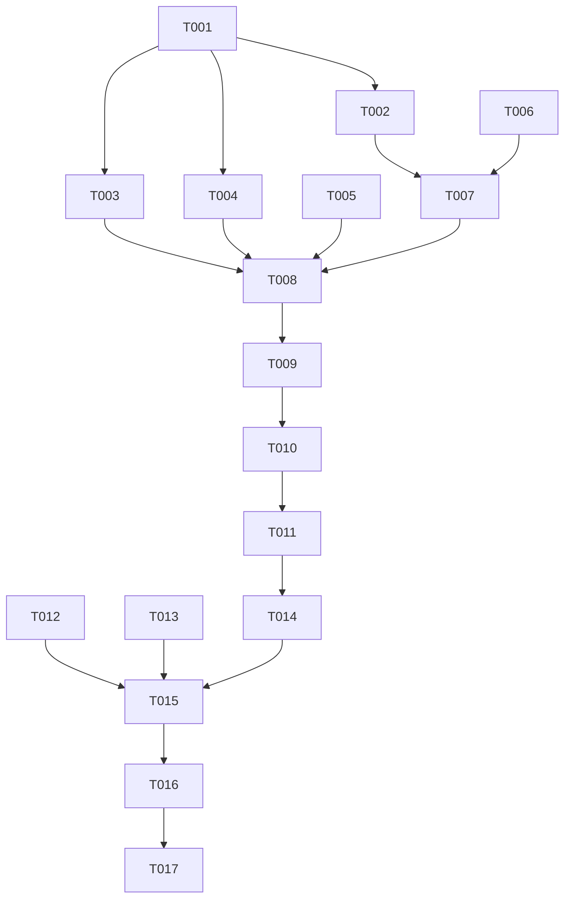

# Tasks: AI 真实对话（流式，多 provider）

**Input**: Design documents from `harmony/entry/src/main/ets/pages/ai-chat/`
**Prerequisites**: plan.md（已批准）, spec.md（4 个用户故事 P1–P4）

**Tests**: 本特性未要求自动化测试（沿用项目既有流程：`arkts_check` + 构建 + 模拟器 UI 验证），故不生成测试任务。

**Organization**: 按用户故事分组，顺序交付（US1 为 MVP 前置）。

## Format: `[ID] [P?] [Story] Description`

- **[P]**: 可并行（不同文件、无未完成依赖）
- **[Story]**: 所属用户故事（US1–US4）；Setup / Foundational / Polish / Verification 阶段不加故事标签
- 所有路径相对工作区根（`harmony/...`）

## Path Conventions

- 服务层：`harmony/entry/src/main/ets/services/ai/`
- 状态/存储/工具：`harmony/entry/src/main/ets/state/`、`storage/`、`utils/`
- 页面：`harmony/entry/src/main/ets/pages/`
- 本特性产物：`harmony/entry/src/main/ets/pages/ai-chat/`

---

## Phase 1: Setup

**Purpose**: 确认基线、既有契约与系统能力可用性

- [X] T001 核对基线：`harmony/entry/src/main/ets/pages/ai/AIChatPage.ets`（现状 mock）、`harmony/entry/src/main/ets/state/AIChatManager.ets` + `harmony/entry/src/main/ets/storage/StorageKeys.ets`（`AI_CONVERSATIONS` 结构与既有 CRUD）、`harmony/entry/src/main/ets/state/SettingsManager.ets`（`getApiProvider/getApiKey/setApiConfig` 与 `AppSettings.apiProvider/apiKey`）、`harmony/entry/src/main/ets/storage/SecureStorage.ets`（**ASSET 使用范式**）、`harmony/entry/src/main/ets/utils/I18n.ets`（`t/tp` + 前缀约定）、参考 `src/services/ai/agentService.ts` 的 `AI_PRESETS` 与 `streamChatCompletion`；并**用 `devecocli docs search` 核对系统流式网络接口**（`@ohos.net.http` 流式请求/逐块回调 + 取消）与自定义 HTTPS baseUrl 的可用性结论

---

## Phase 2: Foundational (Blocking Prerequisites)

**Purpose**: 密钥存储、LLM 客户端、会话与配置、文案——所有用户故事的前置

**⚠️ CRITICAL**: 本阶段完成前，任何用户故事均不可开始

- [X] T002 新建 `harmony/entry/src/main/ets/services/ai/ApiKeyStore.ets`：`save(key)/get()/clear()`，底层**复用 ASSET 范式**（安全存储；失败不抛、返回空/记日志；**日志不得输出 Key**）
- [X] T003 新建 `harmony/entry/src/main/ets/services/ai/LLMService.ets`：①provider **预设常量**（openai/deepseek/dashscope/moonshot/custom：baseUrl + 默认 model，对齐参考）；②`resolveBaseUrl/resolveModel`；③**流式请求**（OpenAI 兼容 `/chat/completions`，Bearer，`stream:true`）+ **SSE 增量解析**；④返回**取消句柄**；⑤错误映射（401/403→密钥无效、429→频率限制、5xx/网络/超时→可读提示，**不含 Key**）。**若 T001 确认流式接口不可用或不兼容**，则降级为非流式（一次性响应按块渲染）并**在报告中明确披露**
- [X] T004 改造 `harmony/entry/src/main/ets/state/AIChatManager.ets`：会话/消息 CRUD 完善（追加消息、更新消息状态、会话标题取首条用户消息摘要、启动恢复），**结构扩展且向后兼容**旧数据；保持既有创建/删除签名（依赖 T001）
- [X] T005 扩展 `harmony/entry/src/main/ets/utils/I18n.ets`：新增 `ai.*` 与 `settings.ai*` 文案（zh/en 成对：输入占位、发送/停止、未配置引导、错误提示、会话相关、AI 模型配置区标签）
- [X] T006 完善 `harmony/entry/src/main/ets/state/SettingsManager.ets`：provider 配置读写（`preset/baseUrl/model` 持久化；`apiKey` 字段**弃用**并注明改由 `ApiKeyStore` 承载）

**Checkpoint**: 服务与配置就绪，页面可接线

---

## Phase 3: User Story 1 - 配置模型与密钥 (Priority: P1) 🎯 MVP

**Goal**: 设置页"AI 模型"区可配置预设/自定义 baseUrl/model 与 API Key，保存后持久化且冷启动生效

**Independent Test**: 保存配置后重启仍生效；偏好设置中无 Key 明文

- [X] T007 [US1] 改造 `harmony/entry/src/main/ets/pages/SettingsPage.ets`：新增"AI 模型"配置区——预设选择（弹层）、自定义 baseUrl/model 输入、**API Key 掩码输入 + 显隐切换**、保存与清除、baseUrl 形态校验、已配置/未配置状态展示；文案走 `settings.ai*`（依赖 T002、T006）

**Checkpoint**: US1 可独立验证（配置持久化 + 无明文）

---

## Phase 4: User Story 2 - 流式对话 (Priority: P2)

**Goal**: 发送消息后逐步显示回复；可中断；失败可读且不丢输入

**Independent Test**: 发送消息见增量回复；点"停止"后停止追加且内容保留

- [X] T008 [US2] 改造 `harmony/entry/src/main/ets/pages/ai/AIChatPage.ets`：发送 → `LLMService` 流式（增量渲染助手消息）→ 完成收尾；"停止"中断并保留已生成内容；错误映射为可读提示且**保留用户输入**（依赖 T003、T004、T005）
- [X] T009 [US2] 同文件：生命周期与超时——离开页面终止请求；超时给出可读提示；无悬挂请求（依赖 T008）

**Checkpoint**: US1 + US2 均可独立验证

---

## Phase 5: User Story 3 - 多会话持久化 (Priority: P3)

**Goal**: 新建/切换/删除会话；会话与消息重启后恢复

**Independent Test**: 两个会话各自对话，重启后均可恢复

- [X] T010 [US3] `harmony/entry/src/main/ets/pages/ai/AIChatPage.ets`：会话入口（新建/切换/删除含确认）、消息区随会话切换、启动恢复既有会话（依赖 T009、T004）

**Checkpoint**: US1–US3 均可独立验证

---

## Phase 6: User Story 4 - 未配置/演示模式降级 (Priority: P4)

**Goal**: 未配置时引导且不发起请求；演示模式本地示例零请求

**Independent Test**: 未配置发送→见引导且无请求；演示模式回复来自本地

- [X] T011 [US4] `harmony/entry/src/main/ets/pages/ai/AIChatPage.ets`：发送前判定——演示模式→本地示例应答（零请求）；未配置 Key→展示引导（可跳转设置页）且**不构造请求**；已配置但离线→可读提示（依赖 T010、T002）

**Checkpoint**: 全部用户故事均可独立验证

---

## Phase 7: Polish & Cross-Cutting Concerns

**Purpose**: 质量与文档收口

- [X] T012 [P] 走查 AI 页与设置页新配置区：长回复可滚动/长词换行不溢出；键盘弹出时输入区可用；胶囊/标签类元素加"缩略/换行"保护；中英文案一致；**无弃用提示 API**
- [X] T013 [P] 更新 `harmony/DEVELOPMENT.md`：新增"AI 真实对话（流式）"小节（provider 预设与自定义、API Key 入 ASSET、流式实现与**降级结论**、取消与错误语义、未配置/演示零请求策略、会话持久化）
- [X] T014 对 `services/ai/LLMService.ets`、`services/ai/ApiKeyStore.ets`、`state/AIChatManager.ets`、`state/SettingsManager.ets`、`pages/ai/AIChatPage.ets`、`pages/SettingsPage.ets`、`utils/I18n.ets` 运行 `arkts_check` 并修复全部 ArkTS 严格模式违规（唯一允许噪声：`Logger.ets` 的 `BuildProfile` 已知误报）

---

## Phase 8: Verification

<!-- verification_scope: build+ui -->

**Purpose**: 构建、部署并逐用户故事做 UI 验证

- [X] T015 构建工程并修复编译错误（`devecocli build --modules entry`，迭代 修复 → 构建 直至成功）
- [X] T016 部署到模拟器（`devecocli run --skip-build --device 127.0.0.1:5555`，必要时先唤醒屏幕）
- [X] T017 运行 UI 验证（`verify_ui`）：US1 配置保存与冷启动生效（含"无 Key 明文"核对）；US2 流式增量 + 中断 + 错误可读（**不得使用真实计费额度做长对话；可用无效 Key 触发 401 验证错误路径**）；US3 会话新建/切换/重启恢复；US4 未配置引导（零请求）+ 演示模式零请求

---

## Dependencies & Execution Order

### Phase Dependencies

- **Setup (Phase 1)**: 无依赖
- **Foundational (Phase 2)**: 依赖 Setup
- **US1–US4 (Phase 3–6)**: 依赖 Foundational；按 P1 → P4 顺序
- **Polish (Phase 7)**: 依赖用户故事完成
- **Verification (Phase 8)**: 依赖全部代码改动完成

### User Story Dependencies

- **US1 (P1)**: 依赖 T002（密钥存储）、T006（配置读写）
- **US2 (P2)**: 依赖 US1（可配置前提）与 T003/T004/T005
- **US3 (P3)**: 依赖 US2（消息链路）与 T004
- **US4 (P4)**: 依赖 US3 与 T002

### Within Each User Story

- 服务/存储 → 状态 → 页面 → 交互
- 同一文件任务必须串行

### Parallel Opportunities

- T002 与 T003 可并行（不同文件）
- T012 与 T013 可并行（走查 vs 文档）

### Dependency Graph

---

## Parallel Example

| Phase | Tasks | Required Files | Execution Notes |
|-------|-------|----------------|-----------------|
| Setup | T001 | `AIChatPage.ets`, `AIChatManager.ets`, `SettingsManager.ets`, `SecureStorage.ets`, `I18n.ets`（只读）+ 文档查证 | 单任务 |
| Foundational | T002 [∥ T003] → T004/T005/T006 | `services/ai/ApiKeyStore.ets`, `services/ai/LLMService.ets`, `state/AIChatManager.ets`, `utils/I18n.ets`, `state/SettingsManager.ets` | T002/T003 不同文件可并行；其余按序 |
| US1 (P1) | T007 | `pages/SettingsPage.ets` | 单文件（配置区） |
| US2 (P2) | T008 → T009 | `pages/ai/AIChatPage.ets` | 同文件串行 |
| US3 (P3) | T010 | `pages/ai/AIChatPage.ets` | 同文件串行 |
| US4 (P4) | T011 | `pages/ai/AIChatPage.ets` | 同文件串行 |
| Polish | T012 [P] ∥ T013 [P] → T014 | 页面两文件 + 服务/状态/工具, `DEVELOPMENT.md` | 走查与文档可并行；T014 需在代码改动后 |
| Verification | T015 → T016 → T017 | 全工程 | 严格串行；**验证不得消耗真实计费额度做长对话**（用无效 Key 触发错误路径） |

---

## Implementation Strategy

### MVP First

1. 完成 Phase 1 Setup + Phase 2 Foundational（密钥存储 + LLM 客户端 + 会话/配置 + 文案）
2. 完成 Phase 3（US1：设置页 AI 模型配置区）
3. **STOP & VALIDATE**：配置保存 + 冷启动生效 + 无 Key 明文
4. 增量交付 US2（流式/中断/错误）→ US3（多会话）→ US4（降级策略）

### Incremental Delivery

- Foundational 完成即具备"可配置 + 可流式请求"能力；随后逐故事接线
- 每故事后独立验证；US4 为兜底策略，最后收口

---

## Notes

- [P] 任务 = 不同文件且无未完成依赖
- 同文件任务（尤其 `pages/ai/AIChatPage.ets`）必须串行
- **流式降级预案**：若系统流式接口不可用，按 T003 约定降级并披露（不得静默违背 FR-005）
- **验证纪律**：不得用真实计费额度做长对话；错误路径用**无效 Key**触发
- 本轮验证范围为 **build+ui**
- 推送待办：本地领先 2 个提交（`e27ed13`、`c32d090`）——GitHub 网络恢复后补推

### Summary

- **总任务数**: 17（T001–T017）
- **分阶段统计**: Setup 1 · Foundational 5（T002–T006）· US1 1（T007）· US2 2（T008–T009）· US3 1（T010）· US4 1（T011）· Polish 3（T012–T014）· Verification 3（T015–T017）
- **每故事任务数**: US1 = 1 · US2 = 2 · US3 = 1 · US4 = 1
- **并行机会**: T002 ∥ T003；T012 ∥ T013
- **独立测试标准**: US1 配置保存/冷启动生效/无明文；US2 流式增量/中断/错误可读；US3 会话新建切换重启恢复；US4 未配置引导零请求 + 演示零请求
- **建议 MVP 范围**: Phase 1 + Phase 2 + Phase 3（US1）
