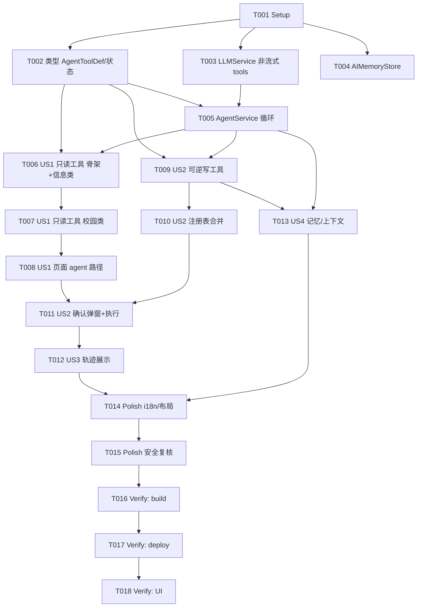

# Tasks: AI Agent（校园智能助手·工具调用）

**Input**: Design documents from `harmony/entry/src/main/ets/pages/ai/ai-agent/`
**Prerequisites**: plan.md（已批准）, spec.md（4 个用户故事：US1 只读工具 P1 / US2 可逆写 P1 / US3 工具轨迹 P2 / US4 记忆与上下文 P2）

**Tests**: 本特性未要求自动化测试（沿用项目既有流程：`arkts_check` + 构建 + 验证），故不生成测试任务。

**Organization**: 任务按用户故事分组，保证每个故事可独立实现、独立验证（US1 为 MVP）。

## Format: `[ID] [P?] [Story] Description`

- **[P]**: 可并行（不同文件、无未完成依赖）
- **[Story]**: 所属用户故事（US1–US4）；Setup / Foundational / Polish / Verification 阶段不加故事标签
- 所有路径相对工作区根（`harmony/...`）

## Path Conventions

- 领域层：`harmony/entry/src/main/ets/domain/`
- 服务层：`harmony/entry/src/main/ets/services/ai/`
- 状态层：`harmony/entry/src/main/ets/state/`
- 页面层：`harmony/entry/src/main/ets/pages/ai/`
- 本特性产物：`harmony/entry/src/main/ets/pages/ai/ai-agent/`

---

## Phase 1: Setup

**Purpose**: 确认改造基线（无脚手架工作）

- [X] T001 核对基线：`harmony/entry/src/main/ets/services/ai/LLMService.ets`（provider 预设/传输/鉴权装配）、`harmony/entry/src/main/ets/services/ai/ApiKeyStore.ets`、`harmony/entry/src/main/ets/state/AIChatManager.ets`（会话/消息持久化）、`harmony/entry/src/main/ets/pages/ai/AIChatPage.ets`（发送/流式渲染）、`harmony/entry/src/main/ets/domain/{AIAgentTypes,ActionTypes,AgentUITypes}.ets`（既有类型）、各校园服务入口（`SessionManager.get*Service()`）；确认无新增依赖

---

## Phase 2: Foundational (Blocking Prerequisites)

**Purpose**: 类型、非流式工具补全、记忆存储、agent 循环——所有用户故事的前置

**⚠️ CRITICAL**: 本阶段完成前，任何用户故事均不可开始

- [X] T002 [P] `harmony/entry/src/main/ets/domain/AIAgentTypes.ets` 与 `.../domain/ActionTypes.ets`：新增 `AgentToolDef`（`name`/`title`/`description`/`parametersJson`/`risk`/`permission`/`requiresConfirmation` + 可选 `dryRun`/`verify`/`summarize`/`confirmPrompt` + `run`）与执行/确认/验证状态常量（success/error/cancelled；not_required/approved/denied/unavailable；ok/message）；按需扩展 `ActionPreview`/`ConfirmationSpec`/`AuditRecord`（保持既有字段兼容）
- [X] T003 [P] `harmony/entry/src/main/ets/services/ai/LLMService.ets`：新增非流式带工具补全 `chatCompleteWithTools(config, apiKey, messagesJson, toolsJson)`——沿用既有 provider 预设/鉴权装配，请求体以**原始 JSON 文本**提交（`stream:false` + `tools` + `tool_choice:'auto'`），解析返回 `content` 与 `toolCalls`；错误按既有 `LLMErrorKind` 归一
- [X] T004 [P] 新建 `harmony/entry/src/main/ets/state/AIMemoryStore.ets`：记忆项 `load()/remember(key,value)/forget(key)`（基于既有 `PreferencesStorage` + `StorageKeys` 扩展，失败不抛）
- [X] T005 `harmony/entry/src/main/ets/services/ai/AgentService.ets`（新建）：`AgentCallbacks`（onAnswer/onToolStart/onToolEnd/requestConfirmation）；`buildContext()`（学期/周次/日期，复用既有学期解析）；`buildSystemPrompt(context, memory)`；`runAgent(config, messages, context, callbacks)`（**≤6 轮**循环：带 tools 请求 → 执行 `tool_calls` → 未知工具回灌可读错误 → 写工具 dryRun→确认→run→verify→审计 → 结果回灌 → 最终回答）；`createMockReply()`；`getAuditRecords()`（依赖 T002、T003）

**Checkpoint**: agent 骨架就绪（可用模拟/空气工具验证循环收敛）

---

## Phase 3: User Story 1 - 只读工具问答 (Priority: P1) 🎯 MVP

**Goal**: 38 个只读工具接入，模型可查真实数据作答

**Independent Test**: 询问"今天天气/我的作业/电费余额/哪有空教室"，系统调用对应只读工具并给出基于真实数据的结果

- [X] T006 [US1] 新建 `harmony/entry/src/main/ets/services/ai/AgentTools.ets`：只读工具**注册表骨架** + 信息/学习类工具（天气、今日概览、作业列表/详情、成绩、电费、个人日程列表、周课表、培养方案完成度/全量、资讯列表/搜索/详情）（依赖 T002、T005）
- [X] T007 [US1] `AgentTools.ets`：校园服务类只读工具（洗衣机楼宇/状态、校园卡余额/流水、校园网余额/账号/设备、体育场馆/时段/记录、空教室楼宇/查找、图书馆馆/楼层/区域/座位/记录、研读间类型/资源/成员/记录、邮件文件夹/搜索/读取）（依赖 T006）
- [X] T008 [US1] `harmony/entry/src/main/ets/pages/ai/AIChatPage.ets`：接入 agent 路径（只读）——发送走 `AgentService.runAgent`，显示"处理中/工具执行中"过程态，最终回答一次性呈现；演示模式走 `createMockReply`（依赖 T007）

**Checkpoint**: US1 可独立验证（只读工具问答）

---

## Phase 4: User Story 2 - 可逆写操作（预览 + 二次确认 + 验证 + 审计） (Priority: P1)

**Goal**: 11 个可逆写工具接入，写操作受确认/验证/审计治理

**Independent Test**: 请求"预约某座位"，系统展示预览并等待确认；确认后执行并验证；拒绝则不执行

- [X] T009 [US2] 新建 `harmony/entry/src/main/ets/services/ai/AgentWriteTools.ets`：11 个可逆写工具（`add_manual_deadline`/`remove_manual_deadline`/`recharge_campus_card`/`book_library_seat`/`cancel_library_seat_booking`/`logout_network_device`/`book_library_room`/`cancel_library_room_booking`/`add_personal_event`/`remove_personal_event`/`remember_preference`）——每个含 `parametersJson`/`risk`/`permission`/`requiresConfirmation` + `dryRun`（预览）/`verify`（执行后验证）/`confirmPrompt`/`summarize`/`run`（依赖 T002、T005；底层能力缺失者按 plan.md 决策延后并在报告中说明）
- [X] T010 [US2] `AgentTools.ets`：将 `AgentWriteTools` 注册进统一注册表 `AgentTools.all()/byName()`（读写合并）（依赖 T009）
- [X] T011 [US2] `harmony/entry/src/main/ets/pages/ai/AIChatPage.ets`：实现 `requestConfirmation`（确认弹窗：工具/预览/风险；返回 `Promise<boolean>`）；拒绝/无确认通道 → 不执行并显示"已取消/已阻止"；确认 → 执行并按 `onToolEnd` 展示结果（依赖 T008、T010；含 plan.md D4/D5）

**Checkpoint**: US1 + US2 均可独立验证

---

## Phase 5: User Story 3 - 工具轨迹与结果展示 (Priority: P2)

**Goal**: 对话内展示工具轨迹（名称/参数概要/结果状态/时间），敏感脱敏

**Independent Test**: 触发工具调用后，对话中出现工具轨迹条目（含状态）

- [X] T012 [US3] `harmony/entry/src/main/ets/pages/ai/AIChatPage.ets` + `harmony/entry/src/main/ets/state/AIChatManager.ets`：将 `ToolTrace` 关联到消息并在对话内渲染轨迹卡片（名称/参数概要/结果状态/时间）；参数与结果敏感信息脱敏（依赖 T011）

**Checkpoint**: US1–US3 均可独立工作

---

## Phase 6: User Story 4 - 记忆与上下文 (Priority: P2)

**Goal**: 上下文（学期/周次/日期）注入系统提示；"记住偏好"跨会话生效

**Independent Test**: 上下文相关提问结果符合当前学期/周次；"记住偏好"后后续可用

- [X] T013 [US4] `harmony/entry/src/main/ets/services/ai/AgentService.ets` + `state/AIMemoryStore.ets`：将已有记忆注入 `buildSystemPrompt`；`remember_preference` 写入 `AIMemoryStore` 并在后续会话（含冷启动恢复）可用（依赖 T005、T009）

**Checkpoint**: 全部用户故事均可独立工作

---

## Phase 7: Polish & Cross-Cutting Concerns

**Purpose**: 跨故事质量收口

- [X] T014 [P] 新增可见文案走 `harmony/entry/src/main/ets/utils/I18n.ets`（zh/en 成对）；走查 `AIChatPage.ets` 布局（全宽卡片配 `constraintSize` 防右缘溢出）；确认演示模式零真实请求
- [X] T015 安全复核：审计/轨迹/日志**无敏感明文**（API Key/令牌/完整学号）；**不可逆写工具（`select_course`/`drop_course`）未注册**；写操作"未确认不执行"路径复核；移除临时诊断输出

---

## Phase 8: Verification

<!-- verification_scope: build+ui -->

**Purpose**: 构建、部署并逐用户故事做 UI 验证

- [X] T016 构建工程并修复编译错误（`devecocli build --modules entry`；同时对改动/新增 `.ets` 文件运行 `arkts_check`；迭代 修复 → 构建 直至成功）
- [X] T017 部署到设备/模拟器（`devecocli run --skip-build --device 127.0.0.1:5555`）
- [X] T018 运行 UI 验证（`verify_ui`）：US1 只读工具问答；US2 写操作预览+确认+验证（含拒绝不执行）；US3 工具轨迹展示；US4 上下文/记忆

---

## Phase 9: 增量改造 — 输出流式化（用户变更）

**Purpose**: 将 agent 最终回答由"非流式一次性呈现"改为**流式增量渲染**

- [X] T019 `harmony/entry/src/main/ets/services/ai/LLMService.ets`：扩展流式解析以**捕获 `tool_calls` 增量**（保留既有 content 增量），提供"逐轮流式补全"能力（每轮回调 content 增量；轮次结束时返回累积的 toolCalls）
- [X] T020 `harmony/entry/src/main/ets/services/ai/AgentService.ets`：`runAgent` 每轮改用**流式**；中间含工具调用的轮次正文**不展示**；**最终轮**逐字流式输出（新增 `AgentCallbacks.onDelta`，`onAnswer` 保留为结束信号）
- [X] T021 `harmony/entry/src/main/ets/pages/ai/AIChatPage.ets`：接入流式渲染（复用既有 `streamingText` 机制）；过程态/确认卡/轨迹卡行为不变

**Verification**: 复用 Phase 8 的 `build+ui` 范围（变更后重跑 构建 + 部署 + 流式 UI 验证）。

---

## 📊 Dependency Graph

## ⚡ Parallel Execution Guide

| Phase | Tasks | Required Files | Execution Notes |
|-------|-------|----------------|-----------------|
| Setup | T001 | 只读核对 | 单任务 |
| Foundational | T002,T003,T004 [P]；T005 | `domain/*`, `LLMService.ets`, `AIMemoryStore.ets`, `AgentService.ets` | T002–T004 不同文件可并行；T005 依赖 T002/T003 |
| US1 (P1) | T006 → T007 → T008 | `AgentTools.ets`, `AIChatPage.ets` | T006/T007 同文件串行 |
| US2 (P1) | T009 → T010；T011 | `AgentWriteTools.ets`, `AgentTools.ets`, `AIChatPage.ets` | T009 与 T008 不同文件可并行；T011 依赖 T008+T010 |
| US3 (P2) | T012 | `AIChatPage.ets`, `AIChatManager.ets` | 依赖 T011 |
| US4 (P2) | T013 | `AgentService.ets`, `AIMemoryStore.ets` | 依赖 T005/T009 |
| Polish | T014 [P]；T015 | `I18n.ets`, 复核对 | T015 需代码收敛后 |
| Verification | T016 → T017 → T018 | 全工程 | 严格串行（build → deploy → UI） |

---

## Dependencies & Execution Order

### Phase Dependencies

- **Setup（Phase 1）**：无依赖
- **Foundational（Phase 2）**：依赖 Setup，阻塞所有用户故事
- **User Stories（Phase 3–6）**：均依赖 Foundational；US1 为 MVP，US2 依赖 US1 的 agent 路径
- **Polish（Phase 7）**：依赖所需用户故事完成
- **Verification（Phase 8）**：依赖 Polish

### User Story Dependencies

- **US1 (P1)**：Foundational 后即可开始
- **US2 (P1)**：依赖 US1 的页面 agent 路径（T008）
- **US3 (P2)**：依赖 US2 的确认/执行（T011）
- **US4 (P2)**：依赖 Foundational（T005）与写工具（T009）

### Within Each User Story

- US1：注册表骨架+信息类（T006）→ 校园类（T007）→ 页面接入（T008）
- US2：写工具（T009）→ 注册表合并（T010）→ 页面确认/执行（T011）
- US3：轨迹展示（T012）；US4：记忆/上下文（T013）
- 同文件任务必须串行（`AgentTools.ets`：T006→T007→T010；`AIChatPage.ets`：T008→T011→T012）

### Parallel Opportunities

- T002/T003/T004 三个不同文件可并行
- T009（`AgentWriteTools.ets`）与 T008（`AIChatPage.ets`）不同文件，可并行
- T014（`I18n.ets`）独立

---

## Parallel Example

| Phase | Tasks | Required Files | Execution Notes |
|-------|-------|----------------|-----------------|
| 基础三并行 | T002 ∥ T003 ∥ T004 | `AIAgentTypes/ActionTypes`, `LLMService.ets`, `AIMemoryStore.ets` | 不同文件 |
| 写工具 ⊕ 页面 | T009 ∥ T008 | `AgentWriteTools.ets`, `AIChatPage.ets` | 不同文件 |
| 同文件串行 | T006 → T007 → T010；T008 → T011 → T012 | `AgentTools.ets`, `AIChatPage.ets` | 不得并行 |

---

## Implementation Strategy

### MVP First

1. 完成 Setup + Foundational（agent 骨架）
2. 完成 US1（只读工具 + 页面接入）
3. **STOP & VALIDATE**：只读问答可用

### Incremental Delivery

- 依次交付 US1（只读）→ US2（可逆写+确认）→ US3（轨迹）→ US4（记忆）
- Polish 收口文案/布局/安全
- Verification 为 **build+ui**；完成后**等待真机测试**，通过后再提交/推送

---

## Notes

- [P] 任务 = 不同文件且无未完成依赖
- 同文件任务（`AgentTools.ets` / `AIChatPage.ets`）必须串行
- **本轮验证范围为 build+ui**；**实现与验证完成后不提交**，等待真机测试通过再入库
- 严格约束：写操作 100% 经确认；不可逆写不注册；演示模式零真实请求；日志/轨迹无敏感明文；不新增依赖
- 工具底层能力缺失者（如 `recharge_campus_card`/`add|remove_personal_event`/`add|remove_manual_deadline`）按 plan.md 决策处理：能补齐则实现，否则延后并在报告标注

---

## Summary Report

- **总任务数**: 18（T001–T018）
- **分阶段统计**: Setup 1（T001）· Foundational 4（T002–T005）· US1 3（T006–T008）· US2 3（T009–T011）· US3 1（T012）· US4 1（T013）· Polish 2（T014–T015）· Verification 3（T016–T018）
- **每故事任务数**: US1 = 3 · US2 = 3 · US3 = 1 · US4 = 1
- **并行机会**: T002∥T003∥T004；T008∥T009；T014 独立
- **独立测试标准**: US1 只读问答基于真实数据；US2 写操作预览+确认（拒绝不执行）+验证；US3 轨迹展示；US4 上下文/记忆生效
- **建议 MVP 范围**: Phase 1 + Phase 2 + US1（T001–T008）
- **Verification 范围**: `build+ui`（构建 + 部署 + UI 验证）
