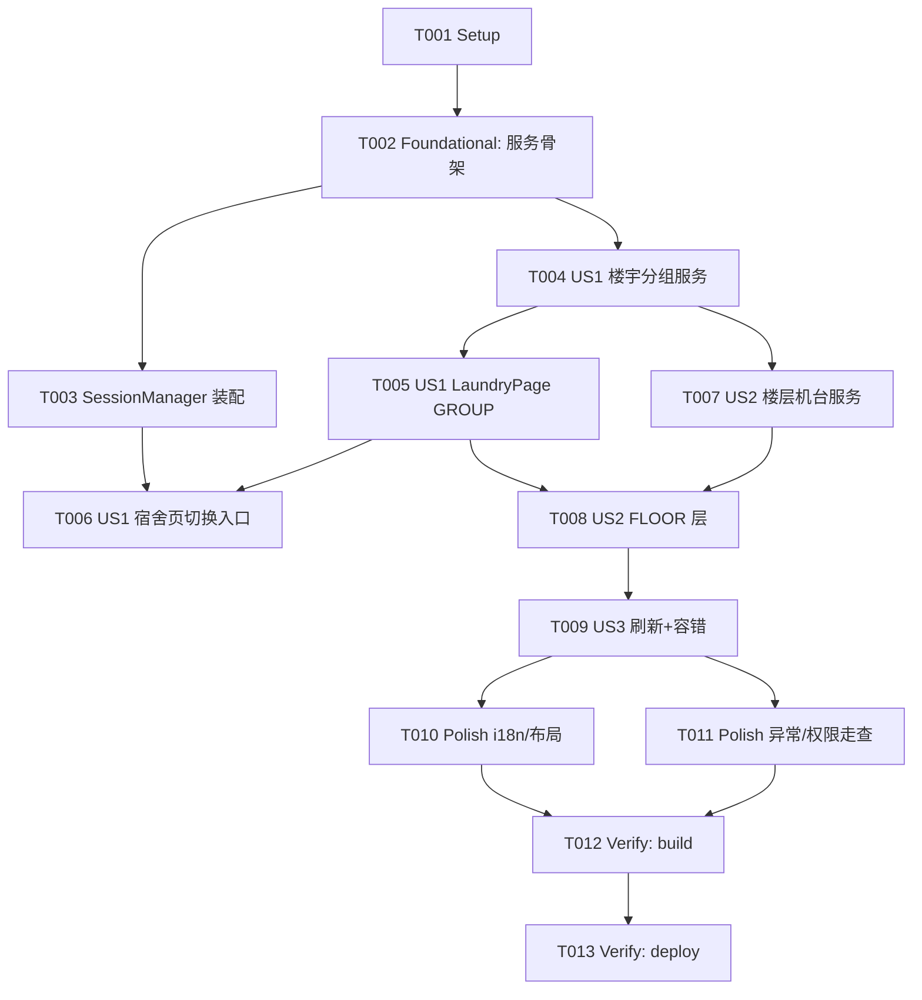

# Tasks: 宿舍洗衣机信息（只读）

**Input**: Design documents from `harmony/entry/src/main/ets/pages/campus/campus-laundry/`
**Prerequisites**: plan.md（已批准）, spec.md（3 个用户故事：US1 楼宇分组 P1 / US2 楼层机台 P1 / US3 刷新容错 P2）

**Tests**: 本特性未要求自动化测试（沿用项目既有流程：`arkts_check` + 构建 + 验证），故不生成测试任务。

**Organization**: 任务按用户故事分组，保证每个故事可独立实现、独立验证（US1 为 MVP）。

## Format: `[ID] [P?] [Story] Description`

- **[P]**: 可并行（不同文件、无未完成依赖）
- **[Story]**: 所属用户故事（US1/US2/US3）；Setup / Foundational / Polish / Verification 阶段不加故事标签
- 所有路径相对工作区根（`harmony/...`）

## Path Conventions

- 服务层：`harmony/entry/src/main/ets/services/`
- 页面层：`harmony/entry/src/main/ets/pages/campus/`
- 本特性产物：`harmony/entry/src/main/ets/pages/campus/campus-laundry/`

---

## Phase 1: Setup

**Purpose**: 确认改造基线（既有项目增量特性，无脚手架工作）

- [X] T001 核对既有能力与依赖基线：`harmony/entry/src/main/ets/services/HttpClient.ets`（`get`/`postJson`，请求体为标量/对象 JSON）、`harmony/entry/src/main/ets/services/auth/SessionManager.ets`（单例装配范式）、`harmony/entry/src/main/ets/pages/campus/DormitoryPage.ets`（电费页结构：`aboutToAppear`/`load`/`refresh`/`RightAction`/`build`）、`harmony/entry/src/main/module.json5`（已声明 `ohos.permission.INTERNET`）；确认无新增依赖/权限

---

## Phase 2: Foundational (Blocking Prerequisites)

**Purpose**: 服务骨架（模型/解析/常量）与单例装配——所有用户故事的前置

**⚠️ CRITICAL**: 本阶段完成前，任何用户故事均不可开始

- [X] T002 新建 `harmony/entry/src/main/ets/services/campus/LaundryService.ets`：模型类（`LaundryPlatform` 联合字符串/`LaundryBuilding`/`LaundryBuildingGroup`/`LaundryMachine`/`LaundryFloor`，全字段非可选默认值）；端点常量（洁力楼宇/状态/位置映射，海乐楼宇/设备；集中定义于文件顶部）；模块级辅助（`asString`、中文数字→整数、数字优先+名称排序、机台比较）；状态/ETA 解析辅助（洁力文本 → 空闲/使用中/异常 + 剩余分钟 + 更新时间；海乐数值 1/2/其他 → 状态）
- [X] T003 在 `harmony/entry/src/main/ets/services/auth/SessionManager.ets` 新增 `static getLaundryService(): LaundryService` 单例（严格照抄既有 `getLibrarySeatService()` 范式，但不注入 auth；以 `getAuthService().getHttpClient()` 构造）（依赖 T002）

**Checkpoint**: 服务骨架与装配就绪

---

## Phase 3: User Story 1 - 查看洗衣机楼宇分组 (Priority: P1) 🎯 MVP

**Goal**: 在"宿舍"页内切换出"洗衣机"子层，展示按平台/区域分组的楼宇列表

**Independent Test**: 进入"宿舍 → 洗衣机"即见分组楼宇列表；单平台失败仍可用

- [X] T004 [US1] `harmony/entry/src/main/ets/services/campus/LaundryService.ets`：实现 `getLaundryBuildings()`——并发两平台楼宇接口（部分成功合并，全失败抛可读错误）+ 分组（洁力按名称含 紫荆/南区/双清 归组、其余"其他位置"；海乐仅保留含"清华"者、组名"海乐生活"）+ 排序（仅保留非空组）（依赖 T002）
- [X] T005 [US1] 新建 `harmony/entry/src/main/ets/pages/campus/LaundryPage.ets`：组件骨架（层级状态、`DetailHeader` + 右上角刷新、`onBack`）+ GROUP 层（分组 + 楼宇行：名称 + 平台标签）+ 加载/错误（可读中文 + 重试）/空态 + 演示模式（内置示例、零网络请求）（依赖 T004）
- [X] T006 [US1] `harmony/entry/src/main/ets/pages/campus/DormitoryPage.ets`：顶部新增"电费 / 洗衣机"分段切换，选中"洗衣机"时内联渲染 `LaundryPage`（返回/切换不破坏既有电费内容与返回链）（依赖 T003、T005）

**Checkpoint**: US1 可独立演示

---

## Phase 4: User Story 2 - 查看楼层与机台状态 (Priority: P1)

**Goal**: 点楼宇进入楼层与机台列表（类型 + 名称/位置 + 状态；洁力含剩余时间）

**Independent Test**: 点楼宇后可看到楼层与机台列表与状态标签；洁力机台可见 ETA

- [X] T007 [US2] `harmony/entry/src/main/ets/services/campus/LaundryService.ets`：实现 `getLaundryFloors(building)`——按平台分支：洁力（状态接口按楼宇 + 位置映射接口尽力而为；文本解析）+ 海乐（三类目并发拉取后合并）；按楼层聚合与排序；异常抛可读错误（依赖 T004）
- [X] T008 [US2] `harmony/entry/src/main/ets/pages/campus/LaundryPage.ets`：FLOOR 层（楼层与机台列表：类型 + 名称/位置 + 状态标签着色；洁力展示剩余时间与更新时间；空态；错误可重试）+ 逐级返回（机台楼层 → 楼宇分组）（依赖 T005、T007）

**Checkpoint**: US1 + US2 均可独立工作

---

## Phase 5: User Story 3 - 手动刷新与容错 (Priority: P2)

**Goal**: 各层可手动刷新；单平台/单接口失败不使整体不可用

**Independent Test**: 触发刷新可重新拉取；单平台失败仍可见另一平台数据

- [X] T009 [US3] `harmony/entry/src/main/ets/pages/campus/LaundryPage.ets`：GROUP/FLOOR 各层手动刷新（加载中显示加载态）+ 演示模式刷新走内置示例（零请求）+ 容错复核（单平台/单接口失败不阻塞另一侧；全失败给可读错误与重试）（依赖 T008）

**Checkpoint**: 全部用户故事均可独立工作

---

## Phase 6: Polish & Cross-Cutting Concerns

**Purpose**: 跨故事质量收口

- [X] T010 [P] 新增可见文案走 `harmony/entry/src/main/ets/utils/I18n.ets`（zh/en 成对）；走查 `harmony/entry/src/main/ets/pages/campus/LaundryPage.ets` 与 `harmony/entry/src/main/ets/pages/campus/DormitoryPage.ets`：卡片/列表右缘不溢出（`constraintSize({maxWidth:'100%'})` + 左右 margin 约定）；演示模式零网络请求
- [X] T011 走查 `harmony/entry/src/main/ets/services/campus/LaundryService.ets`：异常统一转为可读中文错误、禁止暴露原始异常文本；移除临时诊断输出；确认未新增权限（`module.json5` 不变）且未引入凭据/会话依赖

---

## Phase 7: Verification

<!-- verification_scope: build-only -->

**Purpose**: 构建并部署以验证可编译与可部署（本轮为 build-only；不包含 UI 验证任务）

- [X] T012 构建工程并修复编译错误（`devecocli build --modules entry`；同时对改动 `.ets` 文件运行 `arkts_check`；迭代 修复 → 构建 直至成功）
- [X] T013 部署到设备/模拟器（`devecocli run --skip-build --device 127.0.0.1:5555`）

---

## 📊 Dependency Graph

## ⚡ Parallel Execution Guide

| Phase | Tasks | Required Files | Execution Notes |
|-------|-------|----------------|-----------------|
| Setup | T001 | 服务/页面/配置（只读核对） | 单任务 |
| Foundational | T002；T003 | `LaundryService.ets`（新）, `SessionManager.ets` | T003 依赖 T002；不同文件 |
| US1 (P1) | T004 → T005 → T006 | `LaundryService.ets`, `LaundryPage.ets`（新）, `DormitoryPage.ets` | T003 可与 T004 并行；T006 依赖 T003 与 T005 |
| US2 (P1) | T007 → T008 | `LaundryService.ets`, `LaundryPage.ets` | 同文件串行（服务/页面各自） |
| US3 (P2) | T009 | `LaundryPage.ets` | 依赖 T008 |
| Polish | T010 [P] ∥ T011 | `I18n.ets`, `LaundryService.ets` | T010 独立文件可并行 |
| Verification | T012 → T013 | 全工程 | 严格串行（build → deploy） |

---

## Dependencies & Execution Order

### Phase Dependencies

- **Setup（Phase 1）**：无依赖，可立即开始
- **Foundational（Phase 2）**：依赖 Setup，阻塞所有用户故事
- **User Stories（Phase 3–5）**：均依赖 Foundational；按 P1 → P1 → P2 顺序推进
- **Polish（Phase 6）**：依赖所需用户故事完成
- **Verification（Phase 7）**：依赖 Polish 完成

### User Story Dependencies

- **US1 (P1)**：Foundational 后即可开始（含入口切换 T006）
- **US2 (P1)**：依赖 US1 的页面骨架（T005）与服务楼宇方法（T004）
- **US3 (P2)**：依赖 US2 的 FLOOR 层（T008）

### Within Each User Story

- US1：服务分组（T004）→ 页面 GROUP（T005）→ 宿舍页入口（T006）
- US2：服务楼层/机台（T007）→ 页面 FLOOR（T008）
- US3：刷新/容错（T009）
- 同文件任务必须串行（`LaundryService.ets`：T002→T004→T007；`LaundryPage.ets`：T005→T008→T009）

### Parallel Opportunities

- T003（`SessionManager.ets`）与 T004（`LaundryService.ets`）分属不同文件，可并行（均在 T002 后）
- T010（`I18n.ets`）与 T011 可并行

---

## Parallel Example

| Phase | Tasks | Required Files | Execution Notes |
|-------|-------|----------------|-----------------|
| 装配 ⊕ 服务 | T003 ∥ T004 | `SessionManager.ets`, `LaundryService.ets` | 不同文件可并行（均依赖 T002） |
| 同文件串行 | T002 → T004 → T007；T005 → T008 → T009 | `LaundryService.ets`, `LaundryPage.ets` | 同文件不得并行 |

---

## Implementation Strategy

### MVP First

1. 完成 Phase 1 Setup + Phase 2 Foundational
2. 完成 US1（T004–T006）
3. **STOP & VALIDATE**：进入"宿舍 → 洗衣机"见到分组楼宇列表
4. 增量交付 US2（楼层/机台）→ US3（刷新/容错），每个故事后独立验证

### Incremental Delivery

- Foundational 完成即具备服务骨架；随后 US1 分组 → US2 机台状态 → US3 刷新容错
- Polish 收口文案/布局/异常与权限约束
- Verification 为 **build-only**：构建 + 部署

---

## Notes

- [P] 任务 = 不同文件且无未完成依赖
- 同文件任务（`LaundryService.ets` / `LaundryPage.ets`）必须串行，避免冲突
- **本轮验证范围为 build-only**：构建 + 部署（不含 UI 验证任务）
- 严格约束：第三方接口无鉴权/无 Cookie；不新增权限；演示模式零网络请求；不 `git` 提交
- 三方接口在设备网络下的可达性属真机验证项（见 spec.md Open Questions）

---

## Summary Report

- **总任务数**: 13（T001–T013）
- **分阶段统计**: Setup 1（T001）· Foundational 2（T002–T003）· US1 3（T004–T006）· US2 2（T007–T008）· US3 1（T009）· Polish 2（T010–T011）· Verification 2（T012–T013）
- **每故事任务数**: US1 = 3 · US2 = 2 · US3 = 1
- **并行机会**: T003 ∥ T004（不同文件）；T010 ∥ T011
- **独立测试标准**: US1 进入即见分组楼宇且单平台失败仍可用；US2 点楼宇见楼层与机台状态（洁力含 ETA）；US3 刷新可用且容错
- **建议 MVP 范围**: Phase 1 + Phase 2 + US1（T001–T006）
- **Verification 范围**: `build-only`（构建 + 部署）
