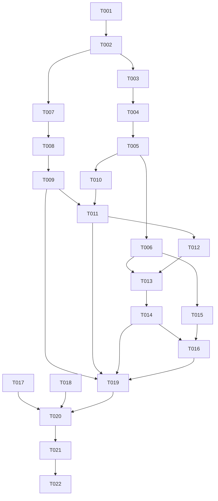

# Tasks: 清华邮件接入（Coremail 读写）

**Input**: Design documents from `harmony/entry/src/main/ets/pages/campus/campus-mail/`
**Prerequisites**: plan.md（已批准）, spec.md（6 个用户故事 P1–P6）

**Tests**: 本特性未要求自动化测试（沿用项目既有流程：`arkts_check` + 构建 + 模拟器 UI 验证），故不生成测试任务。

**Organization**: 任务按用户故事分组，顺序交付（US1 为 MVP）。

## Format: `[ID] [P?] [Story] Description`

- **[P]**: 可并行（不同文件、无未完成依赖）
- **[Story]**: 所属用户故事（US1–US6）；Setup / Foundational / Polish / Verification 阶段不加故事标签
- 所有路径相对工作区根（`harmony/...`）

## Path Conventions

- 服务层：`harmony/entry/src/main/ets/services/campus/`
- 页面层：`harmony/entry/src/main/ets/pages/campus/`
- 本特性产物：`harmony/entry/src/main/ets/pages/campus/campus-mail/`

---

## Phase 1: Setup

**Purpose**: 确认改造基线与可复用能力

- [X] T001 核对基线：`harmony/entry/src/main/ets/pages/campus/MailPage.ets`（现有占位 mock）、`harmony/entry/src/main/ets/pages/CampusPage.ets`（**不计划改动**）、`harmony/entry/src/main/ets/services/HttpClient.ets`（`get` / `postJson` / `resolveFinalUrl`）、`harmony/entry/src/main/ets/services/campus/CampusDataService.ets`（`roamByYyfwidHtml`）、`harmony/entry/src/main/ets/services/auth/SessionManager.ets`（单例范式）、受控 Web 渲染先例（`harmony/entry/src/main/ets/pages/campus/NewsPage.ets` 的 `loadData` 五参 + CSP + Cookie 同步）

---

## Phase 2: Foundational (Blocking Prerequisites)

**Purpose**: 模型、会话与 Coremail 接口层——所有用户故事的前置

**⚠️ CRITICAL**: 本阶段完成前，任何用户故事均不可开始

- [X] T002 新建 `harmony/entry/src/main/ets/services/campus/MailService.ets`：模型类 `MailFolder`/`MailContact`/`MailAttachment`/`MailMessageSummary`/`MailMessageDetail`/`MailListResult`/`ComposeDraft`（全字段非可选默认值）；**5 个系统文件夹常量**；端点与 `func` 名常量（列表线程/扁平、搜索、更新邮件信息、删除、撰写发送、兼容回退）；**容错解析辅助**（联系人三形态、正文与附件映射、递归寻找邮件数组、递归寻找总数、逐条映射失败跳过）；会话状态（缓存 + 时间戳）
- [X] T003 同文件：实现 `ensureMailSession(force)`——①经通用漫游建立门户会话（`CampusDataService.roamByYyfwidHtml(信息门户子系统标识)`）；②对"邮箱门户地址"与"Coremail 入口地址"依次 `resolveFinalUrl` 取最终地址并解析 `sid`（URL 参数优先，Cookie 兜底）；③再取一次以完成落地；④缓存约 20 分钟；⑤解析失败抛可读中文错误（依赖 T002）
- [X] T004 同文件：实现**调用包装**（JSON POST + 会话失效类错误码 → 清缓存强制重建**一次**后重试；业务错误 → 可读中文错误）与 `listMessages(fid, start, limit)`（多形态回退：线程/扁平 × 排序，全空再试兼容回退；"总数>0 但解析 0 条"抛可读错误）（依赖 T003）
- [X] T005 同文件：实现 `searchMessages(pattern, start, limit)` 与 `readMessage(id)`（详情：抄送、正文文本、正文 HTML、附件元信息）（依赖 T004）
- [X] T006 同文件：实现写操作 `markRead(ids, read)` / `deleteMessages(ids)` / `moveMessages(ids, fid)` / `sendMail(draft)`（依赖 T005）
- [X] T007 在 `harmony/entry/src/main/ets/services/auth/SessionManager.ets` 新增 `static getMailService(): MailService` 单例（严格照抄既有 `getLibrarySeatService()` 范式）（依赖 T002）

**Checkpoint**: 服务层可用，页面可调用

---

## Phase 3: User Story 1 - 浏览文件夹与邮件列表 (Priority: P1) 🎯 MVP

**Goal**: 进入"校园邮件"，见文件夹与当前文件夹邮件列表（含未读计数、附件标记），可切换文件夹与加载更多

**Independent Test**: 进入即见收件箱列表与未读计数；切换文件夹后列表刷新

- [X] T008 [US1] 改造 `harmony/entry/src/main/ets/pages/campus/MailPage.ets`：真实/演示双模式（`isReal = AuthManager.isLoggedIn() && !StateManager.isDemoMode()`）+ 页内多级状态（LIST/DETAIL/COMPOSE）+ 头部（标题"校园邮件" + 撰写入口 + 刷新）+ 文件夹 chips + 未读计数 + 列表（发件人/主题/摘要/时间/未读与附件标记）+ "加载更多"（追加去重）（依赖 T007）
- [X] T009 [US1] 同文件：加载/错误（可读中文 + 重试）/空态；演示模式使用内置示例且**零网络请求**（依赖 T008）

**Checkpoint**: US1 可独立演示

---

## Phase 4: User Story 2 - 阅读邮件详情 (Priority: P2)

**Goal**: 点击邮件进入详情（收发抄送/主题/时间/正文/附件元信息）

**Independent Test**: 点击任一邮件即可看到详情字段与正文；有附件时见附件元信息

- [X] T010 [US2] 新建 `harmony/entry/src/main/ets/pages/campus/MailDetailView.ets`：`@Component`（输入：详情数据 + 回调）——展示发件人/收件人/抄送/主题/时间/正文（**纯文本直显；富文本用受控 Web**：CSP 禁脚本 + 禁文件访问 + 禁缩放 + 关暗色 + `loadData` 五参 + 同步会话 Cookie）/附件元信息列表（名称、大小）；返回回调（依赖 T005）
- [X] T011 [US2] 在 `harmony/entry/src/main/ets/pages/campus/MailPage.ets` 接入详情：点击列表项 → 拉取详情 → 内联渲染 `MailDetailView`；返回回到列表（依赖 T009、T010）

**Checkpoint**: US1 + US2 均可独立工作

---

## Phase 5: User Story 3 - 搜索邮件 (Priority: P3)

**Goal**: 关键词搜索并展示结果列表，可打开详情

**Independent Test**: 输入关键词后见结果列表；点击结果能打开详情；无结果显示空态

- [X] T012 [US3] 在 `harmony/entry/src/main/ets/pages/campus/MailPage.ets` 增加搜索框与搜索流程（复用列表渲染；空态提示；清除搜索恢复文件夹视图）（依赖 T011）

**Checkpoint**: US1–US3 均可独立工作

---

## Phase 6: User Story 4 - 标记已读 (Priority: P4)

**Goal**: 打开未读邮件后被标记为已读，列表未读标记与计数随之更新

**Independent Test**: 打开一封未读邮件后，返回列表可见该项变为已读、未读计数减一

- [X] T013 [US4] 在 `harmony/entry/src/main/ets/pages/campus/MailPage.ets` 实现"打开详情后标记已读"：调用服务置已读；**失败不阻塞阅读**（仅提示/记日志）；返回列表时更新该项未读标记与未读计数（依赖 T012、T006）

**Checkpoint**: US1–US4 均可独立工作

---

## Phase 7: User Story 5 - 删除与移动邮件 (Priority: P5)

**Goal**: 删除邮件或将邮件移动到其他文件夹，均需二次确认

**Independent Test**: 删除后该邮件从当前列表消失；移动后目标文件夹可见该邮件

- [X] T014 [US5] 在 `harmony/entry/src/main/ets/pages/campus/MailPage.ets` 与 `harmony/entry/src/main/ets/pages/campus/MailDetailView.ets` 增加删除与移动：`AlertDialog.show` 二次确认（删除）；移动需先选择目标文件夹再确认；成功 toast + 刷新当前列表/详情返回；失败展示服务端可读原因（依赖 T013）

**Checkpoint**: US1–US5 均可独立工作

---

## Phase 8: User Story 6 - 撰写并发送邮件 (Priority: P6)

**Goal**: 撰写（收件人/抄送/主题/正文）并发送，发送前二次确认，成功/失败均有反馈

**Independent Test**: 填写最小必填项后发送得到成功反馈；缺必填项时给出校验提示

- [X] T015 [US6] 新建 `harmony/entry/src/main/ets/pages/campus/MailComposeView.ets`：`@Component`（输入：初始草稿 + 发送回调 + 返回回调）——收件人/抄送/主题/正文输入 + **必填校验**（收件人、主题）+ 发送前**二次确认**；失败**保留已填内容**并展示服务端消息（依赖 T006）
- [X] T016 [US6] 在 `harmony/entry/src/main/ets/pages/campus/MailPage.ets` 接入撰写：头部"撰写"入口 → 渲染 `MailComposeView`；发送成功 → 提示并返回列表（依赖 T014、T015）

**Checkpoint**: 全部用户故事均可独立工作

---

## Phase 9: Polish & Cross-Cutting Concerns

**Purpose**: 质量与文档收口

- [X] T017 [P] 走查 `harmony/entry/src/main/ets/pages/campus/MailPage.ets`、`MailDetailView.ets`、`MailComposeView.ets`：卡片/列表 `width('100%') + constraintSize({ maxWidth: '100%' }) + 左右 margin 16`（防右缘溢出，含搜索框/文件夹行等工具行）；演示模式零请求；中文文案风格一致
- [X] T018 [P] 更新 `harmony/DEVELOPMENT.md`：新增"清华邮件（Coremail 读写）接入"进展小节（会话 `sid` 双路径解析、多形态回退、受控 Web 正文、写操作确认），并更新待办
- [X] T019 对 `harmony/entry/src/main/ets/services/campus/MailService.ets`、`harmony/entry/src/main/ets/pages/campus/MailPage.ets`、`MailDetailView.ets`、`MailComposeView.ets`、`harmony/entry/src/main/ets/services/auth/SessionManager.ets` 运行 `arkts_check` 并修复全部 ArkTS 严格模式违规（唯一允许噪声：`Logger.ets` 的 `BuildProfile` 已知误报）

---

## Phase 10: Verification

<!-- verification_scope: build+ui -->

**Purpose**: 构建、部署并逐用户故事做 UI 验证

- [X] T020 构建工程并修复编译错误（`devecocli build --modules entry`，迭代 修复 → 构建 直至成功）
- [X] T021 部署到模拟器（`devecocli run --skip-build --device 127.0.0.1:5555`，必要时先唤醒屏幕）
- [X] T022 运行 UI 验证（`verify_ui`）：逐用户故事校验（US1 文件夹与列表/未读计数/分页；US2 详情字段与附件元信息；US3 搜索结果；US4 已读标记与计数；US5 删除/移动确认与刷新；US6 撰写校验/确认/发送反馈）

> **验证结论（2026-10-11，spec-verify 执行）**：三项验证任务均已执行（构建 1 次通过；部署成功，Smoke 锁屏抖动唤醒后 PASS；UI 验证逐故事完成）。
> - US1 **真实模式 PASS**（收件箱 190 封 / 已发送 34 封 / 未读 16，分页总数正确）；US2–US6 **演示模式 PASS**（US5/US6 按安全约束仅验证到确认弹窗并取消，未真实删除/发送）。
> - **未勾选门槛说明**：子代理按任务书门槛判定权威 Phase 2 存在 1 项失败 → 其原报告最终状态为 **FAIL**。该失败为 **US6 的软键盘遮挡"发送"按钮**（`screenshot_14/15` 为证：表单完好、底部按钮不可见），同一用例在 Phase 1 已完整通过，属**验证环境抖振**而非产品缺陷。
> - **真实模式待修缺口（重要）**：① 详情正文不可获取（`!readMessage` 在该部署返回空壳错误；`/coremail/s` 为 XML 端点、载荷在 `messages[]`）；② 搜索返回 0 结果；③ 列表无附件标记（接口未返回附件字段）。均已记录，修复需后续迭代。

---

## Dependencies & Execution Order

### Phase Dependencies

- **Setup (Phase 1)**: 无依赖，可立即开始
- **Foundational (Phase 2)**: 依赖 Setup；`CampusPage.ets` 不改动
- **User Stories (Phase 3–8)**: 依赖 Foundational；按 P1 → P6 顺序推进（页面同文件，故串行）
- **Polish (Phase 9)**: 依赖所需用户故事完成
- **Verification (Phase 10)**: 依赖全部代码改动完成

### User Story Dependencies

- **US1 (P1)**: 依赖 T007（装配）与 T004（列表）
- **US2 (P2)**: 依赖 US1 的页面骨架（T008/T009）与 T005（详情）
- **US3 (P3)**: 依赖 US2（详情可打开）与 T005（搜索）
- **US4 (P4)**: 依赖 US3 与 T006（写操作）
- **US5 (P5)**: 依赖 US4（详情与列表状态）
- **US6 (P6)**: 依赖 US5 与 T006（发送）

### Within Each User Story

- 模型/解析 → 会话 → 接口 → 页面视图 → 交互
- 同一文件的任务必须串行（`MailService.ets` 的 T002–T006；`MailPage.ets` 的 T008/T009/T011/T012/T013/T014/T016）

### Parallel Opportunities

- T017 与 T018 可并行（不同文件）
- 组件文件（`MailDetailView.ets` / `MailComposeView.ets`）与其页面接入非同文件，但接入依赖组件先完成

### Dependency Graph

---

## Parallel Example

| Phase | Tasks | Required Files | Execution Notes |
|-------|-------|----------------|-----------------|
| Setup | T001 | `MailPage.ets`, `CampusPage.ets`, `HttpClient.ets`, `CampusDataService.ets`, `SessionManager.ets`, `NewsPage.ets`（只读核对） | 单任务 |
| Foundational | T002 → T003 → T004 → T005 → T006；T007 | `MailService.ets`（新）, `SessionManager.ets` | 同文件串行；T007 在不同文件但与 T002 有依赖 |
| US1 (P1) | T008 → T009 | `MailPage.ets` | 同文件串行 |
| US2 (P2) | T010；T011 | `MailDetailView.ets`（新）, `MailPage.ets` | T010 与 T011 不同文件（T011 依赖 T010） |
| US3 (P3) | T012 | `MailPage.ets` | 同文件串行 |
| US4 (P4) | T013 | `MailPage.ets` | 同文件串行 |
| US5 (P5) | T014 | `MailPage.ets`, `MailDetailView.ets` | 串行（依赖 T013） |
| US6 (P6) | T015 → T016 | `MailComposeView.ets`（新）, `MailPage.ets` | T015 与 T016 不同文件（T016 依赖 T015） |
| Polish | T017 [P] ∥ T018 [P] → T019 | 页面三文件, `MailService.ets`, `SessionManager.ets`, `DEVELOPMENT.md` | 走查/文档可并行；T019 需在代码改动后 |
| Verification | T020 → T021 → T022 | 全工程 | 严格串行（构建 → 部署 → UI 验证） |

---

## Implementation Strategy

### MVP First

1. 完成 Phase 1 Setup + Phase 2 Foundational（含会话与会话自愈）
2. 完成 Phase 3（US1：文件夹 + 列表 + 未读计数 + 分页 + 加载/错误/空态 + 演示模式）
3. **STOP & VALIDATE**：独立验证 US1（真实列表可见、切换文件夹刷新、演示模式零请求）
4. 增量交付 US2 → US6，每个故事后独立验证

### Incremental Delivery

- Foundational 完成即打通"会话 → 列表 → 详情"链路；随后叠加搜索、已读、删除/移动、发送（写操作放在最后，风险最高）
- 每个故事后独立验证；写操作失败不得丢失用户输入

---

## Notes

- [P] 任务 = 不同文件且无未完成依赖
- 同文件任务（`MailService.ets` / `MailPage.ets`）必须串行，避免冲突
- 本轮验证范围为 **build+ui**：构建 + 部署 + 逐用户故事 UI 验证
- `CampusPage.ets` 不改动（入口沿用现有"校园邮件"页，页内多级）
- 富文本正文必须**禁脚本**（CSP）并保证中文不乱码
- 写操作（删除/移动/发送）必须二次确认；标记已读失败不阻塞阅读

### Summary

- **总任务数**: 22（T001–T022）
- **分阶段统计**: Setup 1（T001）· Foundational 6（T002–T007）· US1 2（T008–T009）· US2 2（T010–T011）· US3 1（T012）· US4 1（T013）· US5 1（T014）· US6 2（T015–T016）· Polish 3（T017–T019）· Verification 3（T020–T022）
- **每故事任务数**: US1 = 2 · US2 = 2 · US3 = 1 · US4 = 1 · US5 = 1 · US6 = 2
- **并行机会**: T017 与 T018（不同文件）；其余同文件任务串行
- **独立测试标准**: US1 文件夹/列表/未读计数/分页；US2 详情字段与附件元信息；US3 搜索结果与空态；US4 打开未读后标记与计数变化；US5 删除/移动的确认与刷新；US6 撰写校验/确认/发送反馈
- **建议 MVP 范围**: Phase 1 + Phase 2 + Phase 3（US1）——即可交付"浏览文件夹与邮件列表"的最小可用价值
