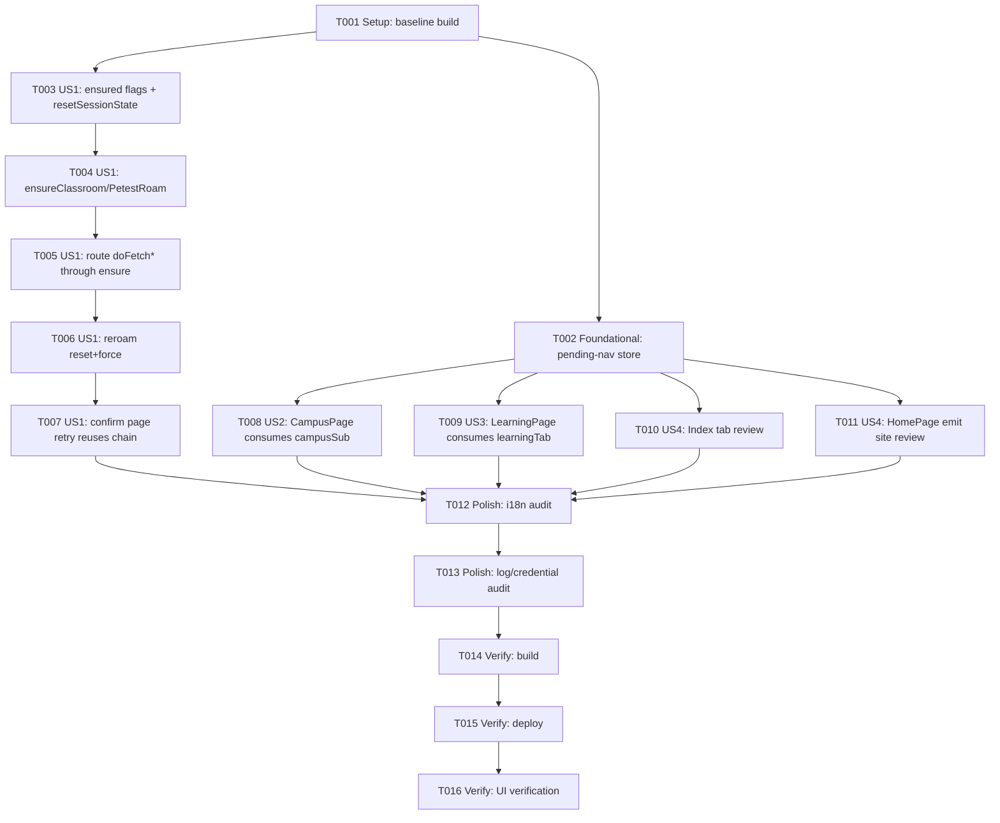

# Tasks: 校园子功能会话自愈与跨页导航可靠性

**Input**: Design documents from `harmony/entry/src/main/ets/pages/campus/campus-session-nav/`
**Prerequisites**: plan.md (required), spec.md (required for user stories)

**Tests**: 本特性未请求 TDD，故不生成测试任务（构建 + 部署 + UI 验证见 Verification 阶段）。

**Organization**: 任务按用户故事分组，每个故事可独立实现与验证。

## Format: `[ID] [P?] [Story] Description`

- **[P]**: 可在不同文件上并行执行（无依赖）
- **[Story]**: 该任务所属用户故事（US1/US2/US3/US4）
- 描述包含确切文件路径

## Path Conventions

- 仓库根 = `D:\Develop\campus_os\campus-os`；HarmonyOS 工程根 = `harmony/`。
- 下列路径均为**仓库根相对路径**（如 `harmony/entry/src/main/ets/...`）。
- 授权改动清单见 `plan.md` 契约 C；不得越界、不得 `git` 提交、不得清 Cookie/凭证、不得改解析语义。

---

## Phase 1: Setup (Shared Infrastructure)

**Purpose**: 复用既有工程，建立可编译基线（不新增脚手架/依赖）

- [X] T001 Confirm reuse of the existing HarmonyOS project and establish a green compilation baseline in `harmony/` by running `devecocli build --modules entry` (no new scaffolding, dependencies, resources, or permissions)

---

## Phase 2: Foundational (Blocking Prerequisites)

**Purpose**: 跨页导航"待处理目标"共享基础（US2 与 US3 共用）

**⚠️ 说明**: 本阶段仅阻塞 **US2/US3**；**US1 不依赖本阶段**，可在 Setup 完成后立即并行开展。

- [X] T002 [P] Add an in-memory pending-nav store (`campusSub` / `learningTab`) and record the target inside `emitNavigate` (keep existing emit behavior), plus `takePendingCampusSub()` / `takePendingLearningTab()` accessors (value-returning + clearing), per plan.md 契约 B / D4, in `harmony/entry/src/main/ets/state/UiEvents.ets`

**Checkpoint**: 待处理导航目标基础就绪 —— US2/US3 可开始；US1 不受影响

---

## Phase 3: User Story 1 - 长时间停留后空教室/体测查询自愈 (Priority: P1) 🎯 MVP

**Goal**: 会话失效后，通过页面"刷新/重试"即可自动恢复空教室与体测查询，无需手动重登。

**Independent Test**: 真实登录态进入"空教室查询"（及"体测成绩"），使会话失效后点击"刷新/重试"，观察是否自动恢复并展示数据、无需手动重登、无需先访问成绩查询。

### Implementation for User Story 1

- [X] T003 [P] [US1] Add `classroomRoamEnsured` / `petestRoamEnsured` private fields and reset them in `resetSessionState()`, per plan.md 契约 A / D2, in `harmony/entry/src/main/ets/services/campus/CampusDataService.ets`
- [X] T004 [US1] Add `ensureClassroomRoam(force)` / `ensurePetestRoam(force)`: guard on flag when `!force`; `roamByYyfwid(<yyfwid>)`; on failure call existing `forceSessionRefreshOnce()` then retry roam once; set flag on success; do not throw (delegate to outer recovery), per 契约 A / D3, in `harmony/entry/src/main/ets/services/campus/CampusDataService.ets` (depends on T003)
- [X] T005 [US1] Route the roam calls through the new ensure methods: `doFetchClassroomListHtml()` → `ensureClassroomRoam(false)`, `doFetchClassroomStateHtml(...)` → `ensureClassroomRoam(true)` (preserve per-call re-roam), `doFetchPEResultText()` → `ensurePetestRoam(false)`; do NOT change URLs/parsers, in `harmony/entry/src/main/ets/services/campus/CampusDataService.ets` (depends on T004)
- [X] T006 [US1] Update the `withSessionRecovery` reroam callbacks of `fetchClassroomList()` / `fetchClassroomState()` / `fetchPEResult()` to reset the corresponding ensured flag and force re-roam, per 契约 A, in `harmony/entry/src/main/ets/services/campus/CampusDataService.ets` (depends on T005)
- [X] T007 [US1] Confirm the refresh/retry paths in `harmony/entry/src/main/ets/pages/ClassroomPage.ets` and `harmony/entry/src/main/ets/pages/campus/PETestPage.ets` already reuse the same service chain (FR-003); only if a bypassing retry entry exists, minimally route it through the same service calls (conditional; no change expected) (depends on T006)

**Checkpoint**: US1 可独立验证 —— 会话失效后"刷新/重试"自愈

---

## Phase 4: User Story 2 - 冷启动后"查空教室"一次到位 (Priority: P1)

**Goal**: 冷启动后首页"查空教室"首次点击即直达"空教室查询"子页。

**Independent Test**: 冷启动后停留在首页，直接点击"查空教室"，观察是否立即切换到校园 Tab 并打开空教室子页（不再需要第二次点击）。

### Implementation for User Story 2

- [X] T008 [US2] In `CampusPage`, consume `takePendingCampusSub()` in `aboutToAppear()` (set `subScreen` when non-empty) and clear the pending `campusSub` inside the live navigate subscription after applying the event value, per 契约 B / D5, in `harmony/entry/src/main/ets/pages/CampusPage.ets` (depends on T002)

**Checkpoint**: US2 可独立验证 —— 冷启动"查空教室"一次到位

---

## Phase 5: User Story 3 - 冷启动后"添加 DDL"直达学习·作业 (Priority: P2)

**Goal**: 冷启动后指向学习子标签的首页入口首次点击即直达对应子标签。

**Independent Test**: 冷启动后停留在首页，点击"添加 DDL"（及"未读通知"），观察是否直接进入学习页"作业"（及"通知"）子标签。

### Implementation for User Story 3

- [X] T009 [US3] In `LearningPage`, consume `takePendingLearningTab()` in `aboutToAppear()` (set `activeTab` when non-empty) and clear the pending `learningTab` inside the live navigate subscription after applying the event value, per 契约 B / D5, in `harmony/entry/src/main/ets/pages/LearningPage.ets` (depends on T002)

**Checkpoint**: US3 可独立验证 —— 冷启动学习子标签一次到位

---

## Phase 6: User Story 4 - 既有跨页导航不回归 (Priority: P2)

**Goal**: 引入待处理目标机制后，其余跨页导航（Tab 切换、既有 emit 站点）行为不变。

**Independent Test**: 逐一触发既有跨页导航入口（图书馆座位 pill、AI 页跳转、学习/校园子标签），确认与修复前一致。

### Implementation for User Story 4

- [X] T010 [P] [US4] Verify the always-mounted `Index` tab consumption remains live and needs no change; only add pending-tab consumption if cold-start tab switching is actually lost, in `harmony/entry/src/main/ets/pages/Index.ets` (conditional; no change expected) (depends on T002)
- [X] T011 [P] [US4] Confirm the existing emit sites still behave with the pending write inside `emitNavigate` (no change expected): review `HomePage.navigateTo(...)` in `harmony/entry/src/main/ets/pages/HomePage.ets`; treat `AIChatPage` emit site as out-of-scope/read-only (depends on T002)

**Checkpoint**: US1–US4 均可独立验证

---

## Phase 7: Polish & Cross-Cutting Concerns

**Purpose**: 跨故事收尾约束

- [X] T012 [P] Ensure no new user-visible strings were introduced; if any were, add zh/en pairs in `harmony/entry/src/main/ets/utils/I18n.ets` (FR-009)
- [X] T013 Audit hilog statements in all touched files under `harmony/entry/src/main/ets/` to ensure no credential plaintext and remove any temporary diagnostics (FR-004)

---

## Phase 8: Verification

<!-- verification_scope: build+ui -->

**Purpose**: 构建、部署并对已部署应用做 UI 验证

- [X] T014 Build the project and fix any compilation errors (invoke `devecocli build --modules entry`; also run `arkts_check` on touched `.ets` files; iterate fix → build until success)
- [X] T015 Deploy the application to the device/emulator (invoke `devecocli run --skip-build --device 127.0.0.1:5555`)
- [X] T016 Run UI verification against the deployed application (invoke `verify_ui`; cover US1 会话自愈重试、US2 冷启动"查空教室"一次到位、US3 冷启动"添加 DDL"直达作业、US4 既有导航不回归)

---

## 📊 Dependency Graph



## ⚡ Parallel Execution Guide

| Phase | Tasks | Required Files | Execution Notes |
|-------|-------|----------------|-----------------|
| Setup | T001 | `harmony/` | 单独执行；建立绿色基线 |
| Foundational | T002 | `state/UiEvents.ets` | 单文件串行；完成后 US2/US3 可并行 |
| US1 | T003 | `services/campus/CampusDataService.ets` | T003→T004→T005→T006 同文件串行；T007 为条件性核对 |
| US2 | T008 | `pages/CampusPage.ets` | 依赖 T002；与 US3 可并行（不同文件） |
| US3 | T009 | `pages/LearningPage.ets` | 依赖 T002；与 US2 可并行（不同文件） |
| US4 | T010, T011 | `pages/Index.ets`, `pages/HomePage.ets` | T010/T011 标记 [P] 可并行；预期无改动 |
| Polish | T012, T013 | `utils/I18n.ets`, touched `ets/` files | T012 标记 [P]；T013 需在改动收敛后执行 |
| Verification | T014, T015, T016 | 全工程 | 严格串行：build → deploy → UI verify |

---

## Dependencies & Execution Order

### Phase Dependencies

- **Setup (Phase 1)**: 无依赖，可立即开始
- **Foundational (Phase 2)**: 依赖 Setup 完成 —— 阻塞 **US2/US3**（US1 不受影响，可并行）
- **User Stories (Phase 3–6)**: US1 依赖 Setup；US2/US3/US4 依赖 Foundational
- **Polish (Phase 7)**: 依赖所需用户故事完成
- **Verification (Phase 8)**: 依赖 Polish 完成，严格串行

### User Story Dependencies

- **User Story 1 (P1)**: Setup 后即可开始，无跨故事依赖
- **User Story 2 (P1)**: 依赖 Foundational（T002）；与 US3 可并行
- **User Story 3 (P2)**: 依赖 Foundational（T002）；与 US2 可并行
- **User Story 4 (P2)**: 依赖 Foundational（T002）；核对性任务，预期无改动

### Within Each User Story

- US1：字段/复位（T003）→ ensure 方法（T004）→ 路由（T005）→ reroam（T006）→ 页面核对（T007）
- US2/US3：挂载消费 + 事件清理（各 1 个任务）
- US4：只读核对（预期无改动）
- 每个故事完成后即可独立验证

### Parallel Opportunities

- T002 可与 US1 的 T003 并行起步（不同文件）
- T008（CampusPage.ets）与 T009（LearningPage.ets）可并行
- T010（Index.ets）与 T011（HomePage.ets）可并行
- T012（I18n.ets）可并行

---

## Parallel Example: User Story 2 + User Story 3

```bash
# Foundational 完成后，US2 与 US3 可在不同文件上并行：
Task: "T008 [US2] CampusPage consumes pending campusSub in harmony/entry/src/main/ets/pages/CampusPage.ets"
Task: "T009 [US3] LearningPage consumes pending learningTab in harmony/entry/src/main/ets/pages/LearningPage.ets"

# US4 的只读核对同样可并行：
Task: "T010 [US4] Index tab review in harmony/entry/src/main/ets/pages/Index.ets"
Task: "T011 [US4] HomePage emit site review in harmony/entry/src/main/ets/pages/HomePage.ets"
```

---

## Implementation Strategy

### MVP First (User Story 1 Only)

1. 完成 T001 (Setup)
2. 完成 T003–T007 (US1：会话自愈)
3. **STOP and VALIDATE**：会话失效后"刷新/重试"自愈

### Incremental Delivery

1. Setup + Foundational → 基础就绪
2. US1 → 独立验证（① 会话自愈）
3. US2 → 独立验证（② 冷启动"查空教室"）
4. US3 → 独立验证（② 冷启动"添加 DDL"）
5. US4 → 回归核对（既有导航不破坏）
6. Polish → Verification（build + deploy + UI 验证）

---

## Notes

- [P] 任务 = 不同文件、无依赖
- [Story] 标签用于需求追溯
- 每个用户故事应可独立完成与验证
- 本特性未请求测试任务；验证以构建 + 部署 + UI 验证为准
- 严格约束：仅改授权清单文件、不清 Cookie/凭证、不改解析语义、不 `git` 提交

---

## Summary Report

- **总任务数**: 16（T001–T016）
- **按阶段**: Setup 1（T001）｜Foundational 1（T002）｜US1 5（T003–T007）｜US2 1（T008）｜US3 1（T009）｜US4 2（T010–T011）｜Polish 2（T012–T013）｜Verification 3（T014–T016）
- **并行机会**: T002 可并行于 US1 起步；T008 与 T009 可并行；T010/T011 可并行；T012 可并行
- **独立测试标准**: US1 会话失效后重试自愈；US2 冷启动"查空教室"一次到位；US3 冷启动"添加 DDL"直达作业；US4 既有导航不回归
- **建议 MVP 范围**: US1（P1）+ US2（P1）
- **格式校验**: 所有任务 `- [ ]` 起始、ID 连续唯一、US 任务含 `[USx]` 标签、Setup/Foundational/Polish/Verification 无故事标签 ✅
- **Verification 范围**: `build+ui`（构建 + 部署 + UI 验证）
