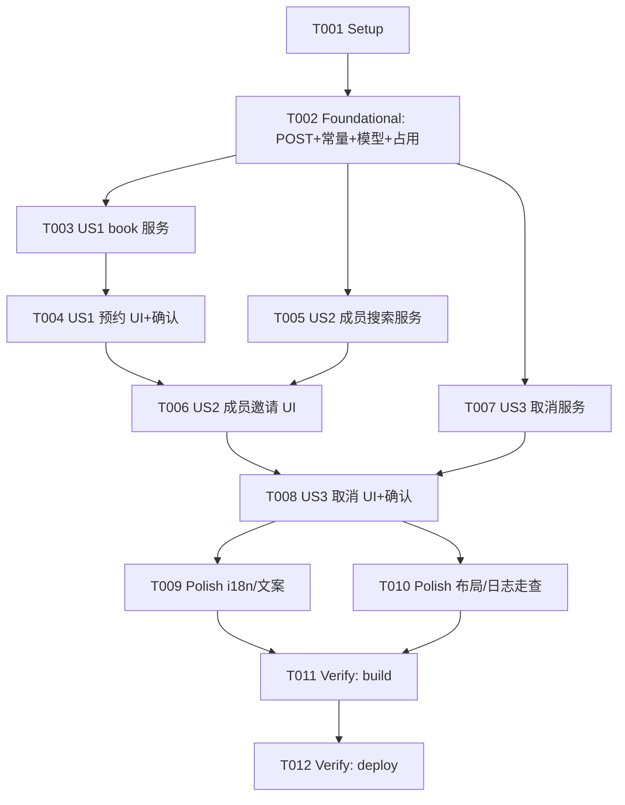

# Tasks: 研读间预约（含取消与成员邀请）

**Input**: Design documents from `harmony/entry/src/main/ets/pages/campus/library-room-booking/`
**Prerequisites**: plan.md（已批准）, spec.md（3 个用户故事：US1 预约 P1 / US2 成员邀请 P1 / US3 取消 P2）

**Tests**: 本特性未要求自动化测试（沿用项目既有流程：`arkts_check` + 构建 + 验证），故不生成测试任务。

**Organization**: 任务按用户故事分组，保证每个故事可独立实现、独立验证（US1 为 MVP）。

## Format: `[ID] [P?] [Story] Description`

- **[P]**: 可并行（不同文件、无未完成依赖）
- **[Story]**: 所属用户故事（US1/US2/US3）；Setup / Foundational / Polish / Verification 阶段不加故事标签
- 所有路径相对工作区根（`harmony/...`）

## Path Conventions

- 服务层：`harmony/entry/src/main/ets/services/`
- 页面层：`harmony/entry/src/main/ets/pages/campus/`
- 本特性产物：`harmony/entry/src/main/ets/pages/campus/library-room-booking/`

---

## Phase 1: Setup

**Purpose**: 确认改造基线（既有项目增量特性，无脚手架工作）

- [X] T001 核对既有接线与依赖基线：`harmony/entry/src/main/ets/services/campus/LibraryRoomService.ets`（cab 会话 `assureCabSession`/`withCabRetry`、只读方法、`cabFetch` 仅 GET）、`harmony/entry/src/main/ets/pages/campus/LibraryRoomPage.ets`（KIND/RESOURCE/BOOKINGS 三层）、`harmony/entry/src/main/ets/pages/campus/ReservationPage.ets`（研读间卡片内联渲染）、`harmony/entry/src/main/ets/services/HttpClient.ets`（`postJsonRaw`/`postJson` 能力）、`SessionManager.getLibraryRoomService()`；确认无新增依赖

---

## Phase 2: Foundational (Blocking Prerequisites)

**Purpose**: POST JSON 能力、端点常量、新增模型与资源占用区间解析——所有用户故事的前置

**⚠️ CRITICAL**: 本阶段完成前，任何用户故事均不可开始

- [X] T002 `harmony/entry/src/main/ets/services/campus/LibraryRoomService.ets`：新增私有 `cabPostJson(url, bodyJsonText)`（经 `HttpClient.postJsonRaw` 提交 `application/json`；统一"非 JSON / `code !== 0` → 可读错误 → 返回 `data`"解析，与既有 `cabFetch` 同构）；新增端点常量（预约 `…/ic-web/reserve`、取消 `…/ic-web/reserve/delete`、成员搜索 `…/ic-web/account/getMembers?page=1&pageNum=10&key=`）；新增模型 `LibRoomUsage`/`LibRoomMember`/`LibRoomBookResult`；`LibRoomResource` **追加** `usageList`（解析 `resvInfo` 起止），保留既有 `usageCount`

**Checkpoint**: 写能力基础设施就绪

---

## Phase 3: User Story 1 - 预约研读间 (Priority: P1) 🎯 MVP

**Goal**: 对某资源选择日期/时段（按规则校验）→ 二次确认 → 提交 → 刷新"我的预约"

**Independent Test**: 对合法时段（minUser=1 的房间）确认提交，见成功提示且"我的预约"出现该记录

- [X] T003 [US1] `LibraryRoomService.ets`：实现 `bookLibraryRoom(req: LibRoomBookRequest)`——校验（结束晚于开始；时长在 `minMinute`/`maxMinute` 内；落于 `openStart`/`openEnd` 内；人数在 `minUser`/`maxUser` 内；与 `usageList` 不重叠）→ `POST …/ic-web/reserve`（JSON body：`sysKind:1`、`appAccNo`(cabAccNo)、`memberKind:1`、`resvBeginTime`/`resvEndTime`（`YYYY-MM-DD HH:mm:00`，分钟须为 5 的倍数）、`testName:''`、`resvKind:2`、`resvProperty:0`、`appUrl:''`、`resvMember:[…]`、`resvDev:[devId]`、`memo:''`、`captcha:''`、`addServices:[]`）→ `code===0` 成功；整体包 `withCabRetry`（依赖 T002）
- [X] T004 [US1] `harmony/entry/src/main/ets/pages/campus/LibraryRoomPage.ets`：RESOURCE 层新增"预约"入口 → 预约表单（时段起止 `HH:mm`；展示房间规则提示：开放时间/时长限制/人数上下限）→ 二次确认弹窗 → 提交（提交中禁用防重复）→ 成功刷新 BOOKINGS 并提示；演示模式不发起请求（依赖 T003）

**Checkpoint**: US1 可独立验证（时段预约成功）

---

## Phase 4: User Story 2 - 邀请成员 (Priority: P1)

**Goal**: 按姓名/学号搜索成员并加入/移除；按 minUser/maxUser 校验并纳入提交

**Independent Test**: 搜索返回候选并加入/移除；人数不符时提交被阻止并给出可读原因

- [X] T005 [US2] `LibraryRoomService.ets`：实现 `getRoomMemberCandidates(keyword: string): Promise<LibRoomMember[]>`（`GET` 成员搜索；结果映射 `{accNo,label,department}`；包 `withCabRetry`）（依赖 T002）
- [X] T006 [US2] `LibraryRoomPage.ets`：预约表单新增成员区（关键词搜索 → 候选列表（学号脱敏）→ 添加/移除；显示当前人数与上下限）并将所选 `accNo` 作为提交 body 的 `resvMember`；人数不符时阻止提交（依赖 T004、T005）

**Checkpoint**: US1 + US2 均可独立验证

---

## Phase 5: User Story 3 - 取消预约 (Priority: P2)

**Goal**: 对"我的预约"记录二次确认后取消，成功刷新列表

**Independent Test**: 在"我的预约"点某记录"取消"，确认后见成功提示，且列表更新

- [X] T007 [US3] `LibraryRoomService.ets`：实现 `cancelRoomBooking(uuid: string): Promise<LibRoomBookResult>`（`POST …/ic-web/reserve/delete`，JSON body `{uuid}`；包 `withCabRetry`）（依赖 T002）
- [X] T008 [US3] `LibraryRoomPage.ets`：BOOKINGS 层新增"取消"入口 → 二次确认（房间/时间）→ 提交（提交中禁用防重复）→ 成功刷新列表并提示；演示模式不发起请求（依赖 T006、T007）

**Checkpoint**: 全部用户故事均可独立工作

---

## Phase 6: Polish & Cross-Cutting Concerns

**Purpose**: 跨故事质量收口

- [X] T009 [P] 新增可见文案走 `harmony/entry/src/main/ets/utils/I18n.ets`（zh/en 成对）；移除"完整下单请在官方小程序完成"等只读引导文案（`LibraryRoomPage.ets`）
- [X] T010 走查 `LibraryRoomPage.ets`：卡片/列表右缘不溢出（`constraintSize({maxWidth:'100%'})` + 左右 margin 约定）；演示模式读写零网络请求；审计写操作（预约/取消/成员搜索）日志与错误信息无凭据明文（FR-014）；移除临时诊断输出

---

## Phase 7: Verification

<!-- verification_scope: build-only -->

**Purpose**: 构建并部署以验证可编译与可部署（本轮为 build-only；不包含 UI 验证任务）

- [X] T011 构建工程并修复编译错误（`devecocli build --modules entry`；同时对改动 `.ets` 文件运行 `arkts_check`；迭代 修复 → 构建 直至成功）
- [X] T012 部署到设备/模拟器（`devecocli run --skip-build --device 127.0.0.1:5555`）

---

## 📊 Dependency Graph

## ⚡ Parallel Execution Guide

| Phase | Tasks | Required Files | Execution Notes |
|-------|-------|----------------|-----------------|
| Setup | T001 | 服务/页面/入口/HttpClient（只读核对） | 单任务 |
| Foundational | T002 | `LibraryRoomService.ets` | 单文件；完成后用户故事可开始 |
| US1 (P1) | T003 → T004 | `LibraryRoomService.ets`, `LibraryRoomPage.ets` | T003/T004 不同文件；T004 依赖 T003 |
| US2 (P1) | T005 → T006 | `LibraryRoomService.ets`, `LibraryRoomPage.ets` | T005 与 T004 不同文件可并行；T006 依赖 T004 与 T005（同页串行） |
| US3 (P2) | T007 → T008 | `LibraryRoomService.ets`, `LibraryRoomPage.ets` | T007 与 T006 不同文件可并行；T008 依赖 T006 与 T007（同页串行） |
| Polish | T009 [P] ∥ T010 | `I18n.ets`, `LibraryRoomPage.ets` | T009 独立文件可并行 |
| Verification | T011 → T012 | 全工程 | 严格串行（build → deploy） |

---

## Dependencies & Execution Order

### Phase Dependencies

- **Setup（Phase 1）**：无依赖，可立即开始
- **Foundational（Phase 2）**：依赖 Setup，阻塞所有用户故事
- **User Stories（Phase 3–5）**：均依赖 Foundational；按 P1 → P1 → P2 顺序推进
- **Polish（Phase 6）**：依赖所需用户故事完成
- **Verification（Phase 7）**：依赖 Polish 完成

### User Story Dependencies

- **US1 (P1)**：Foundational 后即可开始
- **US2 (P1)**：依赖 US1 的预约表单（T004）与服务搜索（T005）
- **US3 (P2)**：依赖 US2 的页面稳定（T006）与取消服务（T007）

### Within Each User Story

- US1：服务方法（T003）→ 页面表单/确认（T004）
- US2：服务搜索（T005）→ 页面成员区（T006）
- US3：服务取消（T007）→ 页面取消交互（T008）
- 同文件任务必须串行（`LibraryRoomService.ets`：T002→T003→T005→T007；`LibraryRoomPage.ets`：T004→T006→T008）

### Parallel Opportunities

- T005（服务）与 T004（页面）分属不同文件，可并行
- T007（服务）与 T006（页面）分属不同文件，可并行
- T009（`I18n.ets`）与 T010 可并行

---

## Parallel Example

| Phase | Tasks | Required Files | Execution Notes |
|-------|-------|----------------|-----------------|
| 服务 ⊕ 页面 | T004 ∥ T005；T006 ∥ T007 | `LibraryRoomPage.ets`, `LibraryRoomService.ets` | 不同文件可并行 |
| 同文件串行 | T002 → T003 → T005 → T007；T004 → T006 → T008 | 两文件各自串行 | 同文件不得并行 |

---

## Implementation Strategy

### MVP First

1. 完成 Phase 1 Setup + Phase 2 Foundational
2. 完成 US1（T003–T004）
3. **STOP & VALIDATE**：时段预约成功并出现在"我的预约"
4. 增量交付 US2（成员邀请）→ US3（取消），每个故事后独立验证

### Incremental Delivery

- Foundational 完成即具备写能力底座；随后 US1 预约 → US2 成员邀请 → US3 取消
- Polish 收口文案与日志约束
- Verification 为 **build-only**：构建 + 部署

---

## Notes

- [P] 任务 = 不同文件且无未完成依赖
- 同文件任务（`LibraryRoomService.ets` / `LibraryRoomPage.ets`）必须串行，避免冲突
- **本轮验证范围为 build-only**：构建 + 部署（不含 UI 验证任务）
- 严格约束：写操作日志无凭据明文；演示模式读写零网络请求；不新增依赖/资源；不 `git` 提交
- `cabFetch` 保持既有 GET 语义不变，写接口一律走新增 `cabPostJson`

---

## Summary Report

- **总任务数**: 12（T001–T012）
- **分阶段统计**: Setup 1（T001）· Foundational 1（T002）· US1 2（T003–T004）· US2 2（T005–T006）· US3 2（T007–T008）· Polish 2（T009–T010）· Verification 2（T011–T012）
- **每故事任务数**: US1 = 2 · US2 = 2 · US3 = 2
- **并行机会**: T004 ∥ T005、T006 ∥ T007（不同文件）；T009 ∥ T010
- **独立测试标准**: US1 合法时段预约成功并出现在"我的预约"；US2 成员搜索/增删与人数校验；US3 取消成功且列表更新
- **建议 MVP 范围**: Phase 1 + Phase 2 + US1（T001–T004）
- **Verification 范围**: `build-only`（构建 + 部署）
