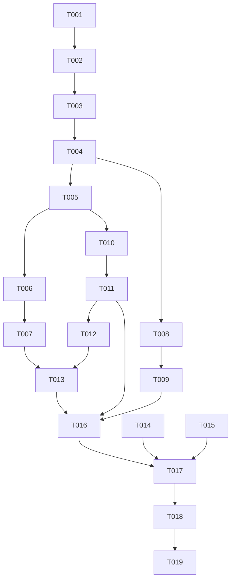

# Tasks: 研读间查询（只读，含子系统登录）

**Input**: Design documents from `harmony/entry/src/main/ets/pages/campus/library-room/`
**Prerequisites**: plan.md（已批准）, spec.md（3 个用户故事 P1–P3）

**Tests**: 本特性未要求自动化测试（沿用项目既有流程：`arkts_check` + 构建 + 模拟器 UI 验证），故不生成测试任务。

**Organization**: 任务按用户故事分组，保证每个故事可独立实现、独立验证（US1 为 MVP）。

## Format: `[ID] [P?] [Story] Description`

- **[P]**: 可并行（不同文件、无未完成依赖）
- **[Story]**: 所属用户故事（US1/US2/US3）；Setup / Foundational / Polish / Verification 阶段不加故事标签
- 所有路径相对工作区根（`harmony/...`）

## Path Conventions

- 共享能力：`harmony/entry/src/main/ets/services/`（`HttpClient.ets`、`auth/TsinghuaAuthService.ets`）
- 服务层：`harmony/entry/src/main/ets/services/campus/`
- 页面层：`harmony/entry/src/main/ets/pages/campus/`
- 本特性产物：`harmony/entry/src/main/ets/pages/campus/library-room/`

---

## Phase 1: Setup

**Purpose**: 确认改造基线（既有项目增量特性）

- [X] T001 核对既有接线与依赖基线：`harmony/entry/src/main/ets/pages/campus/ReservationPage.ets`（研读间卡片当前为"即将支持"提示）、`harmony/entry/src/main/ets/pages/CampusPage.ets`（`ReservationPage` 分发已存在，**不计划改动**）、`harmony/entry/src/main/ets/services/HttpClient.ets`（`manualRedirect` 重定向循环与 Cookie 注入）、`harmony/entry/src/main/ets/services/auth/TsinghuaAuthService.ets`（`roamIdSubsystem`/`getRoamCredentials`/`withSessionRecovery`）、`harmony/entry/src/main/ets/services/campus/LibrarySeatService.ets`（只读服务 + 自定义 reroam 范式）、`SessionManager` 单例范式

---

## Phase 2: Foundational (Blocking Prerequisites)

**Purpose**: 登录能力 + 只读服务——所有用户故事的前置

**⚠️ CRITICAL**: 本阶段完成前，任何用户故事均不可开始

- [X] T002 在 `harmony/entry/src/main/ets/services/HttpClient.ets` 新增 `resolveFinalUrl(url: string): Promise<string>`：以 GET 发起请求，复用既有请求头/Cookie 注入与手动重定向循环，**返回最终落点地址**；**不改既有 `get`/`postForm`/`manualRedirect` 的签名与行为**
- [X] T003 在 `harmony/entry/src/main/ets/services/auth/TsinghuaAuthService.ets` 新增 `cabLogin(): Promise<void>`：①请求研读间"认证地址"接口（JSON 取地址字段；纯文本地址亦兼容）→ ②非 WebVPN 域则做等价前缀替换 → ③`resolveFinalUrl` 取最终地址 → ④解析 `/login/form/<标识>`（**保留 `?`/`#` 之后完整尾串**）→ ⑤`roamIdSubsystem(标识)` → ⑥请求"用户信息"接口校验（业务码 0 且账号与当前登录账号一致；否则抛可读错误）（依赖 T002）
- [X] T004 新建 `harmony/entry/src/main/ets/services/campus/LibraryRoomService.ets`：模型类 `LibRoomKind`/`LibRoomBrief`/`LibRoomResource`/`LibRoomBookRecord`/`LibRoomUserInfo`（全字段非可选默认值）；端点常量（房间类型 / 资源列表 / 我的预约）；JSON 统一解析辅助（业务码非 0 → 抛服务端消息；非 JSON → 可读错误）；日期辅助（近 5 天、`YYYY-MM-DD` 与 `yyyyMMdd`）；会话装配（"已登录"标记 + 账号号缓存 + `assureCabSession` 两轮复查 + `withCabRetry`＝`withSessionRecovery(op, 自定义 reroam{重置标记+强制 cabLogin}, 'cab')`）（依赖 T003）
- [X] T005 同文件：实现 `getRoomKindList()`（类型 + 房间数与房间简述）（依赖 T004）
- [X] T006 同文件：实现 `getRoomResourceList(dateYmd: string, kindId: number)`（资源：房间名/类型/实验室与房间/预约规则/人数区间/开放起止/占用条数）（依赖 T005）
- [X] T007 同文件：实现 `getRoomBookingRecords()`（查询窗口"今天 → +6 天"；记录含房间/类型/日期/起止/成员文本）（依赖 T006）
- [X] T008 在 `harmony/entry/src/main/ets/services/auth/SessionManager.ets` 新增 `static getLibraryRoomService(): LibraryRoomService` 单例（严格照抄既有 `getLibrarySeatService()` 范式）（依赖 T004）

**Checkpoint**: 登录链路与只读服务就绪，页面可调用

---

## Phase 3: User Story 1 - 进入研读间并查看类型列表 (Priority: P1) 🎯 MVP

**Goal**: 进入"场馆预约 → 研读间"，自动完成子系统登录与账号校验，展示类型列表（类型名 + 房间数）

**Independent Test**: 进入页面即可看到类型列表（含房间数）；会话失效时可自愈或给出可读错误

- [X] T009 [US1] 改造 `harmony/entry/src/main/ets/pages/campus/ReservationPage.ets`："研读间预约"卡片 → 内联渲染 `LibraryRoomPage`（返回回到卡片）；"体育场馆预约"保持"即将支持"提示（依赖 T008）
- [X] T010 [US1] 新建 `harmony/entry/src/main/ets/pages/campus/LibraryRoomPage.ets`：`@Component`（输入 `onBack`）骨架——层级状态（KIND/RESOURCE/BOOKINGS）、头部 + 右上角刷新（加载时进度）、KIND 态（类型卡片：类型名 + "N 个房间"；点击展开"近 5 天"日期项）（依赖 T005）
- [X] T011 [US1] 同文件：各态加载（含"正在建立研读间会话"提示）/错误（可读中文 + 重试）/空态；演示模式（`isReal = AuthManager.isLoggedIn() && !StateManager.isDemoMode()`；非真实模式内置示例且**零网络请求**）（依赖 T010）

**Checkpoint**: US1 可独立演示

---

## Phase 4: User Story 2 - 查看某类型近 5 天的可预约资源 (Priority: P2)

**Goal**: 选某类型某天 → 资源列表（房间名、人数区间、开放时间、开放/未开放标记）

**Independent Test**: 展开类型 → 点某天 → 看到资源列表（含人数区间与开放时间、开放标记）

- [X] T012 [US2] 在 `harmony/entry/src/main/ets/pages/campus/LibraryRoomPage.ets` 增加 RESOURCE 态（资源卡片：房间名（含 `最少~最多人` 区间）、类型名、开放时间、开放/未开放徽标）与返回（资源 → 类型）（依赖 T011）

**Checkpoint**: US1 + US2 均可独立工作

---

## Phase 5: User Story 3 - 查看我的预约 (Priority: P3)

**Goal**: 展示研读间预约记录（房间/类型/日期与起止/成员）；无记录时空态

**Independent Test**: 进入"我的预约"读到记录；无记录看到空态

- [X] T013 [US3] 在 `harmony/entry/src/main/ets/pages/campus/LibraryRoomPage.ets` 增加 BOOKINGS 态（记录卡片 + 空态）与 KIND 态入口（依赖 T012、T007）

**Checkpoint**: 全部用户故事均可独立工作

---

## Phase 6: Polish & Cross-Cutting Concerns

**Purpose**: 跨故事的质量收口

- [X] T014 [P] 走查 `harmony/entry/src/main/ets/pages/campus/LibraryRoomPage.ets` 与 `harmony/entry/src/main/ets/pages/campus/ReservationPage.ets`：卡片右缘不溢出（`constraintSize` 约定）、演示模式零网络请求、中文文案风格一致、只读引导文案（"完整下单请在官方小程序完成"）就位
- [X] T015 [P] 更新 `harmony/DEVELOPMENT.md`：新增"研读间（只读 + 子系统登录）接入"进展小节；"其他待办"收敛为仅剩体育场馆
- [X] T016 对 `harmony/entry/src/main/ets/services/campus/LibraryRoomService.ets`、`harmony/entry/src/main/ets/pages/campus/LibraryRoomPage.ets`、`harmony/entry/src/main/ets/pages/campus/ReservationPage.ets`、`harmony/entry/src/main/ets/services/auth/SessionManager.ets`、`harmony/entry/src/main/ets/services/HttpClient.ets`、`harmony/entry/src/main/ets/services/auth/TsinghuaAuthService.ets` 运行 `arkts_check` 并修复全部 ArkTS 严格模式违规（唯一允许噪声：`Logger.ets` 的 `BuildProfile` 已知误报）

---

## Phase 7: Verification

<!-- verification_scope: build+ui -->

**Purpose**: 构建、部署并逐用户故事做 UI 验证

- [X] T017 构建工程并修复编译错误（`devecocli build --modules entry`，迭代 修复 → 构建 直至成功）
- [X] T018 部署到模拟器（`devecocli run --skip-build --device 127.0.0.1:5555`，必要时先唤醒屏幕）
- [X] T019 运行 UI 验证（`verify_ui`）：逐用户故事校验已部署应用界面（US1 类型列表与房间数；US2 近 5 天日期项与资源列表（人数区间/开放时间/标记）；US3 我的预约/空态）

---

## Dependencies & Execution Order

### Phase Dependencies

- **Setup (Phase 1)**: 无依赖，可立即开始
- **Foundational (Phase 2)**: 依赖 Setup；`CampusPage.ets` 不改动
- **User Stories (Phase 3–5)**: 均依赖 Foundational；按 P1 → P3 顺序推进
- **Polish (Phase 6)**: 依赖所需用户故事完成
- **Verification (Phase 7)**: 依赖全部代码改动完成

### User Story Dependencies

- **US1 (P1)**: 依赖 T008（装配）与 T005（类型列表）；含入口接线（T009）
- **US2 (P2)**: 依赖 US1 的组件骨架（T010/T011）与服务方法（T006）
- **US3 (P3)**: 依赖 US2 的层级骨架（T012）与服务方法（T007）

### Within Each User Story

- 网络能力 → 认证方法 → 服务模型/会话 → 服务方法 → 页面层级 → 交互
- 同文件任务串行（`LibraryRoomService.ets` 的 T004–T007；`LibraryRoomPage.ets` 的 T010–T013）

### Parallel Opportunities

- T004（服务）与 T008（装配）同依赖 T003/T004，须串行（T008 依赖 T004）
- T014 与 T015 可并行（不同文件）
- 无其他可并行项（服务与页面各自单文件）

### Dependency Graph

---

## Parallel Example

| Phase | Tasks | Required Files | Execution Notes |
|-------|-------|----------------|-----------------|
| Setup | T001 | `ReservationPage.ets`, `CampusPage.ets`, `HttpClient.ets`, `TsinghuaAuthService.ets`, `LibrarySeatService.ets`, `SessionManager.ets`（只读核对） | 单任务 |
| Foundational | T002 → T003 → T004 → T005 → T006 → T007；T008 | `HttpClient.ets`, `TsinghuaAuthService.ets`, `LibraryRoomService.ets`（新）, `SessionManager.ets` | 依赖链严格串行；T008 在 T004 后 |
| US1 (P1) | T009；T010 → T011 | `ReservationPage.ets`, `LibraryRoomPage.ets` | T009 与 T010 不同文件；T010 依赖 T005，T009 依赖 T008 |
| US2 (P2) | T012 | `LibraryRoomPage.ets` | 同文件串行 |
| US3 (P3) | T013 | `LibraryRoomPage.ets` | 同文件串行 |
| Polish | T014 [P] ∥ T015 [P] → T016 | 页面两文件, `DEVELOPMENT.md`, 6 文件 | T014/T015 不同文件可并行；T016 需在代码改动后 |
| Verification | T017 → T018 → T019 | 全工程 | 严格串行（构建 → 部署 → UI 验证） |

---

## Implementation Strategy

### MVP First

1. 完成 Phase 1 Setup + Phase 2 Foundational（含 cab 登录链路）
2. 完成 Phase 3（US1：入口接线 + 类型列表 + 加载/错误/空态 + 演示模式）
3. **STOP & VALIDATE**：独立验证 US1（类型列表可见、子系统登录成功）
4. 增量交付 US2 → US3，每个故事后独立验证

### Incremental Delivery

- Foundational 完成即打通"登录 → 取数"链路；随后按 P1→P3 叠加层级（类型/近 5 天 → 资源 → 我的预约）
- 只读边界在 Polish 显式收口（引导官方小程序）

---

## Notes

- [P] 任务 = 不同文件且无未完成依赖
- 同文件任务（`LibraryRoomService.ets` / `LibraryRoomPage.ets`）必须串行，避免冲突
- 本轮验证范围为 **build+ui**：构建 + 部署 + 逐用户故事 UI 验证
- `CampusPage.ets` 不改动（入口经 `ReservationPage` 内联渲染）
- 共享文件改动均为**新增方法**，不得改动既有签名与行为

### Summary

- **总任务数**: 19（T001–T019）
- **分阶段统计**: Setup 1（T001）· Foundational 7（T002–T008）· US1 3（T009–T011）· US2 1（T012）· US3 1（T013）· Polish 3（T014–T016）· Verification 3（T017–T019）
- **每故事任务数**: US1 = 3 · US2 = 1 · US3 = 1
- **并行机会**: T014 与 T015（不同文件）；其余同文件任务串行
- **独立测试标准**: US1 进入即见类型列表（含房间数）；US2 展开类型见近 5 天、点某天见资源（人数区间/开放时间/标记）；US3 我的预约记录/空态
- **建议 MVP 范围**: Phase 1 + Phase 2 + Phase 3（US1）——即可交付"进入研读间并查看类型列表"的最小可用价值
