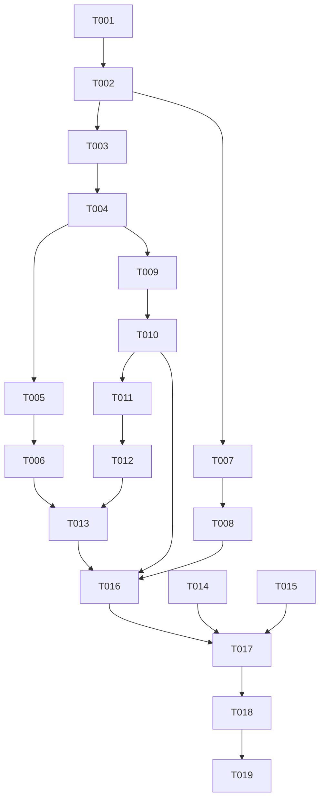

# Tasks: 图书馆座位查询（只读）

**Input**: Design documents from `harmony/entry/src/main/ets/pages/campus/library-seat/`
**Prerequisites**: plan.md（已批准）, spec.md（3 个用户故事 P1–P3）

**Tests**: 本特性未要求自动化测试（沿用项目既有流程：`arkts_check` + 构建 + 模拟器 UI 验证），故不生成测试任务。

**Organization**: 任务按用户故事分组，保证每个故事可独立实现、独立验证（US1 为 MVP）。

## Format: `[ID] [P?] [Story] Description`

- **[P]**: 可并行（不同文件、无未完成依赖）
- **[Story]**: 所属用户故事（US1/US2/US3）；Setup / Foundational / Polish / Verification 阶段不加故事标签
- 所有路径相对工作区根（`harmony/...`）

## Path Conventions

- 服务层：`harmony/entry/src/main/ets/services/`
- 页面层：`harmony/entry/src/main/ets/pages/campus/`
- 本特性产物：`harmony/entry/src/main/ets/pages/campus/library-seat/`

---

## Phase 1: Setup

**Purpose**: 确认改造基线（既有项目增量特性，无脚手架工作）

- [X] T001 核对既有接线与依赖基线：`harmony/entry/src/main/ets/pages/campus/ReservationPage.ets`（三卡片占位）、`harmony/entry/src/main/ets/pages/CampusPage.ets`（`ReservationPage` 分发已存在，**不计划改动**）、`harmony/entry/src/main/ets/services/auth/SessionManager.ets`（单例范式）、`harmony/entry/src/main/ets/services/auth/TsinghuaAuthService.ets`（`roamIdSubsystem`/`withSessionRecovery`）、`harmony/entry/src/main/ets/services/HttpClient.ets`（`get`）；确认无新增依赖

---

## Phase 2: Foundational (Blocking Prerequisites)

**Purpose**: 模型、会话、解析与只读服务——所有用户故事的前置

**⚠️ CRITICAL**: 本阶段完成前，任何用户故事均不可开始

- [X] T002 新建 `harmony/entry/src/main/ets/services/campus/LibrarySeatService.ets`：模型类 `LibraryInfo`/`LibraryFloorInfo`/`LibrarySectionInfo`/`LibrarySeatInfo`/`LibraryBookingRecord`（全字段非可选默认值）；端点常量（馆树 / 区域与日期 / 可预约日时段 / 座位列表 / 我的预约，沿用参考标识与路径形态）；模块级辅助（`dateForChoice`、`pad`、`qs`、`asRecord`、`asObjectArray`、座位状态→中文标签映射）
- [X] T003 同文件：实现子系统会话激活（id 漫游 + 已激活标记，首个 home 请求失败忽略）与统一两层会话恢复包装 `withLibRetry`（自定义 reroam：重置标记 + 强制重漫游；label `lib`），以及 JSON 统一解析（失败标记 → 抛服务端消息；`data.list` 缺失 → 可读错误）（依赖 T002）
- [X] T004 同文件：实现 `getLibraryList()` 与 `getLibraryFloorList(libraryId, dateChoice)`（楼层聚合各开放区域的可用/总数；开放层并发、单层失败容错为 0；未开放楼层不发请求）（依赖 T003）
- [X] T005 同文件：实现 `getLibrarySectionList(floorId, dateChoice)`、内部"取目标日时段"（`areadays` 命中目标日期，今天起始时间钳制为当前或更晚）与 `getLibrarySeatList(sectionId, dateChoice)`（时段参数 + 座位列表与状态）（依赖 T004）
- [X] T006 同文件：实现 `getLibraryBookingRecords()`（我的预约记录）（依赖 T005）
- [X] T007 在 `harmony/entry/src/main/ets/services/auth/SessionManager.ets` 新增 `static getLibrarySeatService(): LibrarySeatService` 单例（严格照抄既有 `getCampusCardService()` 范式）（依赖 T002）

**Checkpoint**: 只读服务就绪，页面可调用

---

## Phase 3: User Story 1 - 浏览图书馆与楼层使用率 (Priority: P1) 🎯 MVP

**Goal**: 进入"场馆预约 → 图书馆座位"，见馆列表与所选馆楼层使用率，可切换今天/明天

**Independent Test**: 进入页面即见馆与楼层使用率；切换"明天"后使用率刷新

- [X] T008 [US1] 改造 `harmony/entry/src/main/ets/pages/campus/ReservationPage.ets`：保留三张入口卡片；"图书馆座位预约" → 内联渲染 `LibrarySeatPage`（返回回到卡片）；"研读间预约"/"体育场馆预约" → 提示"即将支持"（不发起请求）（依赖 T007）
- [X] T009 [US1] 新建 `harmony/entry/src/main/ets/pages/campus/LibrarySeatPage.ets`：组件骨架（层级状态、`DetailHeader` + 右上角刷新、`今天/明天` 分段控件、`onBack`）+ LIBRARY 层（馆列表、默认选中开放馆）与 FLOOR 列表展示（名称 + 可用/总数，未开放标记）（依赖 T004）
- [X] T010 [US1] 在 `harmony/entry/src/main/ets/pages/campus/LibrarySeatPage.ets` 补齐各层加载/错误（可读中文 + 重试）/空态，以及演示模式（内置示例、零网络请求）（依赖 T009）

**Checkpoint**: US1 可独立演示

---

## Phase 4: User Story 2 - 查看区域与座位状态 (Priority: P2)

**Goal**: 楼层 → 区域（可用/总数/已预约）→ 座位（名称 + 状态标签），逐级可返回

**Independent Test**: 从楼层点入区域、再点入座位，看到列表与状态；可逐级返回

- [X] T011 [US2] 在 `harmony/entry/src/main/ets/pages/campus/LibrarySeatPage.ets` 增加 FLOOR → SECTION 层（区域列表：可用/总数/已预约数；点楼层进入）（依赖 T010）
- [X] T012 [US2] 在 `harmony/entry/src/main/ets/pages/campus/LibrarySeatPage.ets` 增加 SECTION → SEAT 层（座位列表：名称 + 状态标签与着色）与逐级返回（座位 → 区域 → 楼层 → 馆）（依赖 T011）

**Checkpoint**: US1 + US2 均可独立工作

---

## Phase 5: User Story 3 - 查看我的预约 (Priority: P3)

**Goal**: 展示当前账号的座位预约记录（位置/时间/状态）；无记录时空态

**Independent Test**: 进入"我的预约"读到记录；无记录看到空态

- [X] T013 [US3] 在 `harmony/entry/src/main/ets/pages/campus/LibrarySeatPage.ets` 增加 BOOKINGS 层（我的预约：记录列表 + 空态）与 LIBRARY 层入口（依赖 T012、T006）

**Checkpoint**: 全部用户故事均可独立工作

---

## Phase 6: Polish & Cross-Cutting Concerns

**Purpose**: 跨故事的质量收口

- [X] T014 [P] 走查 `harmony/entry/src/main/ets/pages/campus/LibrarySeatPage.ets` 与 `harmony/entry/src/main/ets/pages/campus/ReservationPage.ets`：卡片右缘不溢出（`constraintSize` 约定）、演示模式零网络请求、中文文案风格一致、只读引导提示（"预约请前往官方小程序完成"）就位
- [X] T015 [P] 更新 `harmony/DEVELOPMENT.md`：新增"图书馆座位（只读）接入"进展小节，并把场馆预约待办收敛为仅剩研读间 / 体育场馆
- [X] T016 对 `harmony/entry/src/main/ets/services/campus/LibrarySeatService.ets`、`harmony/entry/src/main/ets/pages/campus/LibrarySeatPage.ets`、`harmony/entry/src/main/ets/pages/campus/ReservationPage.ets`、`harmony/entry/src/main/ets/services/auth/SessionManager.ets` 运行 `arkts_check` 并修复全部 ArkTS 严格模式违规（唯一允许噪声：`Logger.ets` 的 `BuildProfile` 已知误报）

---

## Phase 7: Verification

<!-- verification_scope: build+ui -->

**Purpose**: 构建、部署并逐用户故事做 UI 验证

- [X] T017 构建工程并修复编译错误（`devecocli build --modules entry`，迭代 修复 → 构建 直至成功）
- [X] T018 部署到模拟器（`devecocli run --skip-build --device 127.0.0.1:5555`，必要时先唤醒屏幕）
- [X] T019 运行 UI 验证（`verify_ui`）：逐用户故事校验已部署应用界面（US1 馆+楼层使用率与今天/明天切换；US2 区域列表与座位状态、逐级返回；US3 我的预约/空态）

---

## Dependencies & Execution Order

### Phase Dependencies

- **Setup (Phase 1)**: 无依赖，可立即开始
- **Foundational (Phase 2)**: 依赖 Setup；`CampusPage.ets` 不改动
- **User Stories (Phase 3–5)**: 均依赖 Foundational；按 P1 → P3 顺序推进
- **Polish (Phase 6)**: 依赖所需用户故事完成
- **Verification (Phase 7)**: 依赖全部代码改动完成

### User Story Dependencies

- **US1 (P1)**: 依赖 T007（装配）与 T004（馆/楼层）；含入口接线（T008），为其余故事的可达前提
- **US2 (P2)**: 依赖 US1 的页面骨架（T009/T010）
- **US3 (P3)**: 依赖 US2 的层级骨架（T012）与服务方法（T006）

### Within Each User Story

- 模型 → 会话/解析 → 服务方法 → 页面层级 → 交互
- 同文件任务串行（`LibrarySeatService.ets` 的 T002–T006；`LibrarySeatPage.ets` 的 T009–T013）

### Parallel Opportunities

- T014 与 T015 可并行（不同文件）
- 无其他可并行项（服务与页面各自单文件，须串行）

### Dependency Graph

---

## Parallel Example

| Phase | Tasks | Required Files | Execution Notes |
|-------|-------|----------------|-----------------|
| Setup | T001 | `ReservationPage.ets`, `CampusPage.ets`, `SessionManager.ets`, `TsinghuaAuthService.ets`, `HttpClient.ets`（只读核对） | 单任务 |
| Foundational | T002 → T003 → T004 → T005 → T006；T007 | `LibrarySeatService.ets`（新）, `SessionManager.ets` | 同文件串行；T007 在不同文件但与 T002 有依赖，须在 T002 后 |
| US1 (P1) | T008；T009 → T010 | `ReservationPage.ets`, `LibrarySeatPage.ets` | T008 与 T009 不同文件；T009 依赖 T004，T008 依赖 T007 |
| US2 (P2) | T011 → T012 | `LibrarySeatPage.ets` | 同文件串行 |
| US3 (P3) | T013 | `LibrarySeatPage.ets` | 同文件串行 |
| Polish | T014 [P] ∥ T015 [P] → T016 | 页面两文件, `DEVELOPMENT.md`, 4 文件 | T014/T015 不同文件可并行；T016 需在代码改动后 |
| Verification | T017 → T018 → T019 | 全工程 | 严格串行（构建 → 部署 → UI 验证） |

---

## Implementation Strategy

### MVP First

1. 完成 Phase 1 Setup + Phase 2 Foundational
2. 完成 Phase 3（US1：入口接线 + 馆/楼层使用率 + 加载/错误/空态 + 演示模式）
3. **STOP & VALIDATE**：独立验证 US1（馆与楼层使用率可见、今天/明天可切换）
4. 增量交付 US2 → US3，每个故事后独立验证

### Incremental Delivery

- Foundational 完成即具备完整数据链路；随后按 P1→P3 叠加层级（图书馆 → 楼层 → 区域 → 座位 → 我的预约），每层互不破坏
- 只读边界在 Polish 显式收口（引导官方小程序）

---

## Notes

- [P] 任务 = 不同文件且无未完成依赖
- 同文件任务（`LibrarySeatService.ets` / `LibrarySeatPage.ets`）必须串行，避免冲突
- 本轮验证范围为 **build+ui**：构建 + 部署 + 逐用户故事 UI 验证
- `CampusPage.ets` 不改动（入口经 `ReservationPage` 内联渲染）

### Summary

- **总任务数**: 19（T001–T019）
- **分阶段统计**: Setup 1（T001）· Foundational 6（T002–T007）· US1 3（T008–T010）· US2 2（T011–T012）· US3 1（T013）· Polish 3（T014–T016）· Verification 3（T017–T019）
- **每故事任务数**: US1 = 3 · US2 = 2 · US3 = 1
- **并行机会**: T014 与 T015（不同文件）；其余同文件任务串行
- **独立测试标准**: US1 进入即见馆+楼层使用率且日期可切换；US2 区域列表（可用/总数/已预约）与座位状态标签、逐级返回；US3 我的预约记录/空态
- **建议 MVP 范围**: Phase 1 + Phase 2 + Phase 3（US1）——即可交付"查看图书馆与楼层使用率"的最小可用价值
