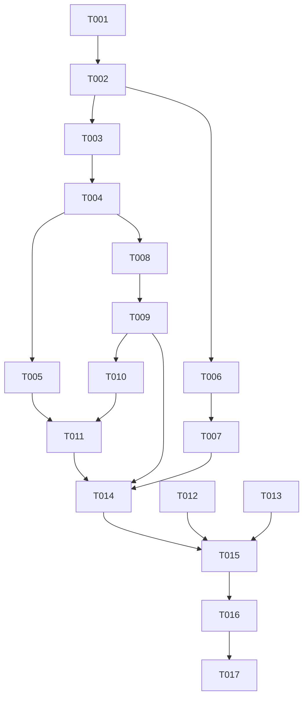

# Tasks: 体育场馆查询（只读）

**Input**: Design documents from `harmony/entry/src/main/ets/pages/campus/sports-booking/`
**Prerequisites**: plan.md（已批准）, spec.md（3 个用户故事 P1–P3）

**Tests**: 本特性未要求自动化测试（沿用项目既有流程：`arkts_check` + 构建 + 模拟器 UI 验证），故不生成测试任务。

**Organization**: 任务按用户故事分组，保证每个故事可独立实现、独立验证（US1 为 MVP）。

## Format: `[ID] [P?] [Story] Description`

- **[P]**: 可并行（不同文件、无未完成依赖）
- **[Story]**: 所属用户故事（US1/US2/US3）；Setup / Foundational / Polish / Verification 阶段不加故事标签
- 所有路径相对工作区根（`harmony/...`）

## Path Conventions

- 服务层：`harmony/entry/src/main/ets/services/campus/`
- 页面层：`harmony/entry/src/main/ets/pages/campus/`
- 本特性产物：`harmony/entry/src/main/ets/pages/campus/sports-booking/`

---

## Phase 1: Setup

**Purpose**: 确认改造基线（既有项目增量特性）

- [X] T001 核对既有接线与依赖基线：`harmony/entry/src/main/ets/pages/campus/ReservationPage.ets`（体育场馆卡片当前为"即将支持"提示）、`harmony/entry/src/main/ets/pages/CampusPage.ets`（**不计划改动**）、`harmony/entry/src/main/ets/services/campus/CampusDataService.ets`（`roamByYyfwidHtml` 通用漫游、`parseToWebVPN` 包装）、`harmony/entry/src/main/ets/services/HttpClient.ets`（字符集推断：响应头 charset → URL 标记 → UTF-8 嗅探）、`harmony/entry/src/main/ets/services/campus/LibrarySeatService.ets`（只读服务 + `withSessionRecovery` 范式）、`SessionManager` 单例范式

---

## Phase 2: Foundational (Blocking Prerequisites)

**Purpose**: 模型、解析与会话——所有用户故事的前置

**⚠️ CRITICAL**: 本阶段完成前，任何用户故事均不可开始

- [X] T002 新建 `harmony/entry/src/main/ets/services/campus/SportsService.ets`：模型类 `SportsVenue`/`SportsResource`/`SportsResourceInfo`/`SportsRecord`（全字段非可选默认值）；**场馆固定清单常量（对齐参考的 8 个场馆：名称/场馆标识/项目标识）**；端点常量（资源首页（含限额）/资源明细/联系电话/未支付订单/已支付订单，沿用参考子系统 token 与路径形态）；模块级辅助（限额变量多形态匹配 `var x='n'|"n"|n`；资源脚本解析：资源推送/费用/预约状态/状态颜色四类调用以资源标识为键合并；日期辅助"近 7 天"；HTML 表格行/列解析辅助）
- [X] T003 同文件：实现会话建立与恢复——`ensureSportsSession()`＝`CampusDataService.roamByYyfwidHtml(<体育场馆子系统标识>)`，并包 `withSessionRecovery(op, ensureSportsSession, 'sports')`。**先以日志确认漫游落点地址形态**：若为原始主机地址（非 WebVPN 域），则在 `harmony/entry/src/main/ets/services/campus/CampusDataService.ets` 的 URL 包装中**加法式补充体育场馆主机映射**（不改既有 zhjw 分支）（依赖 T002）
- [X] T004 同文件：实现 `getSportsResources(venue: SportsVenue, dateYmd: string): Promise<SportsResourceInfo>`（并发取"限额 + 联系电话 + 资源列表"，联系电话为约定值（如 `do_not`）时置空；组装 `{count, init, phone, data}`）（依赖 T003）
- [X] T005 同文件：实现 `getSportsRecords(): Promise<SportsRecord[]>`（未支付订单 + 已支付订单**合并**；按列序取名称/场地/时间/价格/支付方式；从行内脚本调用正则提取支付标识/预约标识；**逐行容错**；先打印首行诊断日志以核对列序）（依赖 T004）
- [X] T006 在 `harmony/entry/src/main/ets/services/auth/SessionManager.ets` 新增 `static getSportsService(): SportsService` 单例（严格照抄既有 `getLibrarySeatService()` 范式）（依赖 T002）

**Checkpoint**: 只读服务就绪，页面可调用

---

## Phase 3: User Story 1 - 查看场馆某日的可预约资源 (Priority: P1) 🎯 MVP

**Goal**: 进入"场馆预约 → 体育场馆"，见场馆清单与近 7 天日期，展示当日资源（时段/场地/费用/可预约/已锁定）

**Independent Test**: 进入页面即见默认场馆当日资源列表；切换场馆/日期后刷新

- [X] T007 [US1] 改造 `harmony/entry/src/main/ets/pages/campus/ReservationPage.ets`："体育场馆预约"卡片 → 内联渲染 `SportsBookingPage`（返回回到卡片列表）（依赖 T006）
- [X] T008 [US1] 新建 `harmony/entry/src/main/ets/pages/campus/SportsBookingPage.ets`：`@Component`（输入 `onBack`）——视图状态（RESOURCES/RECORDS）、头部（标题"体育场馆"）+ 右上角刷新（加载时进度）、场馆 chips（默认第一个）、"近 7 天"日期行（默认今天）、资源卡片列表（时段、场地、费用（有值时）、可预约/已锁定标注）（依赖 T004）
- [X] T009 [US1] 同文件：加载/错误（可读中文 + 重试）/空态；演示模式（`isReal = AuthManager.isLoggedIn() && !StateManager.isDemoMode()`；非真实模式内置示例且**零网络请求**）（依赖 T008）

**Checkpoint**: US1 可独立演示

---

## Phase 4: User Story 2 - 查看场馆限额与联系电话 (Priority: P2)

**Goal**: 展示所选场馆当日限额（已用/上限）与联系电话（服务端提供时）

**Independent Test**: 加载完成即见限额数值；有电话时见电话行

- [X] T010 [US2] 在 `harmony/entry/src/main/ets/pages/campus/SportsBookingPage.ets` 增加限额行（已用/上限）与联系电话行（仅当服务端返回时展示），随场馆/日期切换刷新（依赖 T009）

**Checkpoint**: US1 + US2 均可独立工作

---

## Phase 5: User Story 3 - 查看我的预约记录 (Priority: P3)

**Goal**: 合并展示未支付与已支付记录（名称/场地/时间/价格/支付方式 + 可取消/可支付标注）；无记录时空态

**Independent Test**: 进入"我的预约记录"读到合并列表；无记录看到空态

- [X] T011 [US3] 在 `harmony/entry/src/main/ets/pages/campus/SportsBookingPage.ets` 增加 RECORDS 视图（合并列表 + 可取消/可支付标注；空态）与 RESOURCES 视图入口；返回回到资源视图（依赖 T010、T005）

**Checkpoint**: 全部用户故事均可独立工作

---

## Phase 6: Polish & Cross-Cutting Concerns

**Purpose**: 跨故事的质量收口

- [X] T012 [P] 走查 `harmony/entry/src/main/ets/pages/campus/SportsBookingPage.ets` 与 `harmony/entry/src/main/ets/pages/campus/ReservationPage.ets`：卡片右缘不溢出（`constraintSize` 约定）、演示模式零网络请求、中文文案风格一致、只读引导文案（"下单与支付请通过官方渠道完成"）就位
- [X] T013 [P] 更新 `harmony/DEVELOPMENT.md`：新增"体育场馆（只读）接入"进展小节（含 GBK 解析与通用漫游要点），并把"其他待办"的场馆预约条目移除/收敛
- [X] T014 对 `harmony/entry/src/main/ets/services/campus/SportsService.ets`、`harmony/entry/src/main/ets/pages/campus/SportsBookingPage.ets`、`harmony/entry/src/main/ets/pages/campus/ReservationPage.ets`、`harmony/entry/src/main/ets/services/auth/SessionManager.ets`（以及若发生改动的 `harmony/entry/src/main/ets/services/campus/CampusDataService.ets`）运行 `arkts_check` 并修复全部 ArkTS 严格模式违规（唯一允许噪声：`Logger.ets` 的 `BuildProfile` 已知误报）

---

## Phase 7: Verification

<!-- verification_scope: build+ui -->

**Purpose**: 构建、部署并逐用户故事做 UI 验证

- [X] T015 构建工程并修复编译错误（`devecocli build --modules entry`，迭代 修复 → 构建 直至成功）
- [X] T016 部署到模拟器（`devecocli run --skip-build --device 127.0.0.1:5555`，必要时先唤醒屏幕）
- [X] T017 运行 UI 验证（`verify_ui`）：逐用户故事校验已部署应用界面（US1 场馆/日期/资源列表；US2 限额与电话；US3 预约记录/空态），并**重点确认中文无乱码**

> **验证记录（2026-10-11）**：T015 一次构建成功；T016 首次 `Smoke: FAIL_BLANK`（锁屏）经 `devecocli ui swipe` 唤醒后 `Smoke: PASS`；T017 三个用户故事均在**演示模式**下通过（资源视图/限额与电话/记录视图与返回）。
> **真实链路不可用（上游变更）**：体育场馆子系统漫游落点为 `www.sports.tsinghua.edu.cn/venue/login.html?typeCode=16384&ticket=…`（现行新版场馆系统），而本实现沿用的旧版 gymbook 主机 `50.tsinghua.edu.cn` 的 WebVPN 前缀返回 `<title>访问出错</title>`（code=200 len=1429，无限额变量、无资源脚本调用）→ 真实模式下 US1–US3 均只能展示可读错误「无法获取体育场馆预约限额」+「重试」。**中文乱码（SC-007）在真实数据上无法评估**（该端点不返回 GBK 内容）。详见验证报告。

---

## Dependencies & Execution Order

### Phase Dependencies

- **Setup (Phase 1)**: 无依赖，可立即开始
- **Foundational (Phase 2)**: 依赖 Setup；`CampusPage.ets` 不改动
- **User Stories (Phase 3–5)**: 均依赖 Foundational；按 P1 → P3 顺序推进
- **Polish (Phase 6)**: 依赖所需用户故事完成
- **Verification (Phase 7)**: 依赖全部代码改动完成

### User Story Dependencies

- **US1 (P1)**: 依赖 T006（装配）与 T004（资源）；含入口接线（T007）
- **US2 (P2)**: 依赖 US1 的页面骨架（T008/T009）
- **US3 (P3)**: 依赖 US2 的页面骨架（T010）与服务方法（T005）

### Within Each User Story

- 模型/解析 → 会话 → 服务方法 → 页面视图 → 交互
- 同文件任务串行（`SportsService.ets` 的 T002–T005；`SportsBookingPage.ets` 的 T008–T011 与 US2 的 T010）

### Parallel Opportunities

- T012 与 T013 可并行（不同文件）
- 无其他可并行项（服务与页面各自单文件）

### Dependency Graph

---

## Parallel Example

| Phase | Tasks | Required Files | Execution Notes |
|-------|-------|----------------|-----------------|
| Setup | T001 | `ReservationPage.ets`, `CampusPage.ets`, `CampusDataService.ets`, `HttpClient.ets`, `LibrarySeatService.ets`, `SessionManager.ets`（只读核对） | 单任务 |
| Foundational | T002 → T003 → T004 → T005；T006 | `SportsService.ets`（新）, `SessionManager.ets`, （条件性）`CampusDataService.ets` | 同文件串行；T006 在不同文件但与 T002 有依赖，须在 T002 后 |
| US1 (P1) | T007；T008 → T009 | `ReservationPage.ets`, `SportsBookingPage.ets` | T007 与 T008 不同文件；T008 依赖 T004，T007 依赖 T006 |
| US2 (P2) | T010 | `SportsBookingPage.ets` | 同文件串行 |
| US3 (P3) | T011 | `SportsBookingPage.ets` | 同文件串行 |
| Polish | T012 [P] ∥ T013 [P] → T014 | 页面两文件, `DEVELOPMENT.md`, 4–5 文件 | T012/T013 不同文件可并行；T014 需在代码改动后 |
| Verification | T015 → T016 → T017 | 全工程 | 严格串行（构建 → 部署 → UI 验证） |

---

## Implementation Strategy

### MVP First

1. 完成 Phase 1 Setup + Phase 2 Foundational（含会话与 GBK 解析）
2. 完成 Phase 3（US1：入口接线 + 场馆/日期 + 资源列表 + 加载/错误/空态 + 演示模式）
3. **STOP & VALIDATE**：独立验证 US1（资源列表可见、中文无乱码、切换刷新）
4. 增量交付 US2 → US3，每个故事后独立验证

### Incremental Delivery

- Foundational 完成即打通"漫游 → 取数 → 解析"链路；随后按 P1→P3 叠加限额/电话与记录视图
- 只读边界在 Polish 显式收口（引导官方渠道）

---

## Notes

- [P] 任务 = 不同文件且无未完成依赖
- 同文件任务（`SportsService.ets` / `SportsBookingPage.ets`）必须串行，避免冲突
- 本轮验证范围为 **build+ui**：构建 + 部署 + 逐用户故事 UI 验证（**重点确认中文无乱码**）
- `CampusPage.ets` 不改动（入口经 `ReservationPage` 内联渲染）
- 若需扩展 URL 包装主机映射，须为**加法式**，不得改动既有 zhjw 分支

### Summary

- **总任务数**: 17（T001–T017）
- **分阶段统计**: Setup 1（T001）· Foundational 5（T002–T006）· US1 3（T007–T009）· US2 1（T010）· US3 1（T011）· Polish 3（T012–T014）· Verification 3（T015–T017）
- **每故事任务数**: US1 = 3 · US2 = 1 · US3 = 1
- **并行机会**: T012 与 T013（不同文件）；其余同文件任务串行
- **独立测试标准**: US1 进入即见场馆清单与当日资源（时段/场地/费用/状态），切换场馆/日期刷新且中文无乱码；US2 限额（已用/上限）与电话（有值时）；US3 合并记录列表/空态
- **建议 MVP 范围**: Phase 1 + Phase 2 + Phase 3（US1）——即可交付"查看场馆某日可预约资源"的最小可用价值
