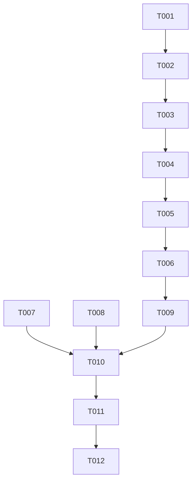

# Tasks: 课表页视觉改进（块状重构）

**Input**: Design documents from `harmony/entry/src/main/ets/pages/schedule-visual/`
**Prerequisites**: plan.md（已批准）, spec.md（3 个用户故事 P1–P3）

**Tests**: 本特性未要求自动化测试（沿用项目既有流程：`arkts_check` + 构建 + 模拟器 UI 验证），故不生成测试任务。

**Organization**: 按用户故事分组；**须在 `i18n-migration` 之后实施**（课表静态文案使用其 `schedule.*` 词典键）。

## Format: `[ID] [P?] [Story] Description`

- **[P]**: 可并行（不同文件、无未完成依赖）
- **[Story]**: 所属用户故事（US1–US3）；Setup / Foundational / Polish / Verification 阶段不加故事标签
- 所有路径相对工作区根（`harmony/...`）

## Path Conventions

- 组件：`harmony/entry/src/main/ets/components/`
- 页面：`harmony/entry/src/main/ets/pages/`
- 本特性产物：`harmony/entry/src/main/ets/pages/schedule-visual/`

---

## Phase 1: Setup

**Purpose**: 确认课表现状与可复用数据/令牌

- [X] T001 核对基线：`harmony/entry/src/main/ets/pages/SchedulePage.ets`（现状：6 节 × 7 天固定 64px 表格、单行地点、统一配色；既有周导航 ‹ ›/回本周、加载/空态/错误、演示分支）；`harmony/entry/src/main/ets/services/campus/CampusDataService.ets` 的 `ScheduleEvent`（`date/title/location/startTime/endTime`，真实 `location` 已解析）；`Theme/Radius/Space/FontSize` 令牌；并确认 `i18n-migration` 已提供 `schedule.*` 词典键（若缺，记录待补键名）

---

## Phase 2: Foundational (Blocking Prerequisites)

**Purpose**: 块状网格组件（时间轴 + 日列 + 跨节块）

**⚠️ CRITICAL**: 本阶段完成前，任何用户故事均不可开始

- [X] T002 新建 `harmony/entry/src/main/ets/components/ScheduleGrid.ets`：①节次常量（6 大节的**起止时间**）；②固定**调色板**与课程名**确定性散列**（含对比度安全的前/背景色配对）；③UI 模型 `ScheduleBlock{dayIndex, startPeriod, endPeriod, title, location, colorIndex}`；④渲染：左侧时间轴（大节起止）+ 日列头（星期简称 + `MM-DD`）+ 每列**顺序堆叠**（起始节渲染跨节块，**被覆盖节次跳过**，其余渲染空单元）+ 块内"课程名（多行）→ 地点（多行）"与**安全裁剪**（空地点不渲染）；⑤纯展示、无副作用、**不硬编码中文**（静态字样由调用方传入）

**Checkpoint**: 组件就绪，页面可接入

---

## Phase 3: User Story 1 - 块状课表与完整课程信息 (Priority: P1) 🎯 MVP

**Goal**: 课程以块呈现（块高对应节次数）、按课程名配色、显示课程名与完整地点

**Independent Test**: 打开课表即见块状课表；跨节课程块高明显更大；长地点完整可读

- [X] T003 [US1] 改造 `harmony/entry/src/main/ets/pages/SchedulePage.ets`：把 `ScheduleEvent[]` 映射为 `ScheduleBlock[]`（**节次区间换算**：起始按节开始阈值、结束按节结束阈值；异常时间**跳过并记日志**）+ 接入 `ScheduleGrid`；**保持**既有周导航、加载/空态/错误行为不变（依赖 T002）
- [X] T004 [US1] 同文件：演示示例数据映射为同一 `ScheduleBlock[]` 并复用同一渲染（演示与真实视觉一致）（依赖 T003）

**Checkpoint**: US1 可独立验证

---

## Phase 4: User Story 2 - 时间轴与日列日期 (Priority: P2)

**Goal**: 时间轴展示各大节起止时间；日列头展示星期 + 日期并随周次更新

**Independent Test**: 时间轴显示 6 大节起止；切周后日列日期同步更新

- [X] T005 [US2] 在 `harmony/entry/src/main/ets/components/ScheduleGrid.ets` 与 `harmony/entry/src/main/ets/pages/SchedulePage.ets` 完善：时间轴文案（起-止）与日列日期（由当周周一 + 列索引计算，`MM-DD`）随周导航更新（依赖 T004）

**Checkpoint**: US1 + US2 均可独立验证

---

## Phase 5: User Story 3 - 布局稳健与状态一致 (Priority: P3)

**Goal**: 空地点/超长文本/重叠课程等边界不破版；状态与演示行为与既有一致

**Independent Test**: 构造长地点/空地点/重叠课程场景，界面不溢出、不遮挡、不崩溃

- [X] T006 [US3] 在 `harmony/entry/src/main/ets/components/ScheduleGrid.ets` 补齐边界处理：空/空白地点不渲染；超长课程名/地点的折行与安全裁剪；**同列同时段重叠课程**的既定策略（并列或顺序堆叠，保证可辨识）；单列宽度自适应不溢出（依赖 T005）

**Checkpoint**: 三个用户故事均可独立验证

---

## Phase 6: Polish & Cross-Cutting Concerns

**Purpose**: 质量与文档收口

- [X] T007 [P] 走查 `harmony/entry/src/main/ets/components/ScheduleGrid.ets` 与 `harmony/entry/src/main/ets/pages/SchedulePage.ets`：无横向溢出/无块遮挡；课表静态文案均走 `schedule.*` 键（无硬编码中文）；无弃用提示 API；布局遵循既有约定（全宽元素 `constraintSize` 防溢出）
- [X] T008 [P] 更新 `harmony/DEVELOPMENT.md`：新增"课表页块状视觉重构"进展小节（配色散列、节次区间换算、叠加/跳过策略、空地点与裁剪规则）
- [X] T009 对 `harmony/entry/src/main/ets/components/ScheduleGrid.ets` 与 `harmony/entry/src/main/ets/pages/SchedulePage.ets` 运行 `arkts_check` 并修复全部 ArkTS 严格模式违规（唯一允许噪声：`Logger.ets` 的 `BuildProfile` 已知误报）

---

## Phase 7: Verification

<!-- verification_scope: build+ui -->

**Purpose**: 构建、部署并逐用户故事做 UI 验证（含边界场景）

- [X] T010 构建工程并修复编译错误（`devecocli build --modules entry`，迭代 修复 → 构建 直至成功）
- [X] T011 部署到模拟器（`devecocli run --skip-build --device 127.0.0.1:5555`，必要时先唤醒屏幕）
- [X] T012 运行 UI 验证（`verify_ui`）：US1 块状课表（块高对应节次数、按课程名配色、课程名 + 完整地点）；US2 时间轴与日列日期随周次更新；US3 边界（空地点/长文本/重叠课程）；并**回归**既有周导航、加载/空态/错误与演示模式

---

## Dependencies & Execution Order

### Phase Dependencies

- **Setup (Phase 1)**: 无依赖（但**须在 `i18n-migration` 之后**开始实施，以保证 `schedule.*` 键存在）
- **Foundational (Phase 2)**: 依赖 Setup
- **US1–US3 (Phase 3–5)**: 依赖 Foundational；按 P1 → P3 顺序
- **Polish (Phase 6)**: 依赖用户故事完成
- **Verification (Phase 7)**: 依赖全部代码改动完成

### User Story Dependencies

- **US1 (P1)**: 依赖 T002（组件）
- **US2 (P2)**: 依赖 US1 的接入（T003/T004）
- **US3 (P3)**: 依赖 US2（时间轴/日期完善后统一处理边界）

### Within Each User Story

- 组件 → 数据映射 → 页面接入 → 边界处理
- 同一文件（`SchedulePage.ets` / `ScheduleGrid.ets`）的任务必须串行

### Parallel Opportunities

- T007 与 T008 可并行（走查 vs 文档）

### Dependency Graph

---

## Parallel Example

| Phase | Tasks | Required Files | Execution Notes |
|-------|-------|----------------|-----------------|
| Setup | T001 | `SchedulePage.ets`, `CampusDataService.ets`, `Theme.ets`（只读核对）+ `I18n.ets`（键确认） | 单任务 |
| Foundational | T002 | `components/ScheduleGrid.ets`（新） | 单任务 |
| US1 | T003 → T004 | `pages/SchedulePage.ets` | 同文件串行 |
| US2 | T005 | `components/ScheduleGrid.ets`, `pages/SchedulePage.ets` | 两文件协同（先组件后页面） |
| US3 | T006 | `components/ScheduleGrid.ets` | 单文件 |
| Polish | T007 [P] ∥ T008 [P] → T009 | 组件/页面, `DEVELOPMENT.md` | 走查与文档可并行 |
| Verification | T010 → T011 → T012 | 全工程 | 严格串行 |

---

## Implementation Strategy

### MVP First

1. 完成 Phase 1 + Phase 2（网格组件）
2. 完成 Phase 3（US1：块状课表 + 完整地点）
3. **STOP & VALIDATE**：块高/配色/地点展示符合预期
4. 增量交付 US2（时间轴/日期）→ US3（边界稳健）

### Incremental Delivery

- 组件完成即可接入真实数据渲染；随后补时间轴与日期、再收边界
- 每个故事后独立验证；**回归**既有交互与状态行为

---

## Notes

- [P] 任务 = 不同文件且无未完成依赖
- 同文件任务（`ScheduleGrid.ets` / `SchedulePage.ets`）必须串行
- **实施顺序**：`i18n-migration` → 本特性
- **不新增数据请求**；本轮**不含**当前时间线与点击详情
- 本轮验证范围为 **build+ui**（含边界场景与既有行为回归）

### Summary

- **总任务数**: 12（T001–T012）
- **分阶段统计**: Setup 1 · Foundational 1 · US1 2 · US2 1 · US3 1 · Polish 3 · Verification 3
- **每故事任务数**: US1 = 2 · US2 = 1 · US3 = 1
- **并行机会**: T007 与 T008
- **独立测试标准**: US1 块状课表（块高/配色/完整地点）；US2 时间轴与日列日期随周次；US3 空地点/长文本/重叠课程不破版
- **建议 MVP 范围**: Phase 1 + Phase 2 + Phase 3（US1）
