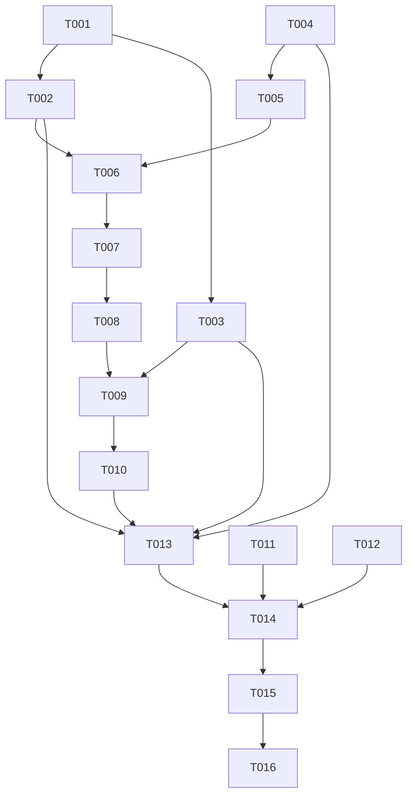

# Tasks: 设置页功能对接（含 i18n 框架）

**Input**: Design documents from `harmony/entry/src/main/ets/pages/settings-integration/`
**Prerequisites**: plan.md（已批准）, spec.md（6 个用户故事 P1–P6）

**Tests**: 本特性未要求自动化测试（沿用项目既有流程：`arkts_check` + 构建 + 模拟器 UI 验证），故不生成测试任务。

**Organization**: 任务按用户故事分组，顺序交付（US1 为 MVP）。

## Format: `[ID] [P?] [Story] Description`

- **[P]**: 可并行（不同文件、无未完成依赖）
- **[Story]**: 所属用户故事（US1–US6）；Setup / Foundational / Polish / Verification 阶段不加故事标签
- 所有路径相对工作区根（`harmony/...`）

## Path Conventions

- 工具/存储：`harmony/entry/src/main/ets/utils/`、`harmony/entry/src/main/ets/storage/`
- 状态层：`harmony/entry/src/main/ets/state/`
- 页面层：`harmony/entry/src/main/ets/pages/`
- 本特性产物：`harmony/entry/src/main/ets/pages/settings-integration/`

---

## Phase 1: Setup

**Purpose**: 确认基线与系统能力可用性

- [X] T001 核对基线：`harmony/entry/src/main/ets/pages/SettingsPage.ets`（现状：开关只写内存、语言仅本地态、三项"开发中"、退出无确认、版本硬编码、使用弃用提示 API）；`harmony/entry/src/main/ets/state/StateManager.ets`（`settings` + `saveSettings`）与 `harmony/entry/src/main/ets/state/SettingsManager.ets`（setter 未持久化）；`harmony/entry/src/main/ets/storage/StorageKeys.ets`（AI 会话 / 学习缓存键名）；`harmony/entry/src/main/ets/storage/SecureStorage.ets`（`clearCredentials`）；`harmony/entry/src/main/ets/services/auth/SessionManager.ets`（`logout`）；`harmony/entry/src/main/ets/state/AuthManager.ets`（登录态/演示模式判定）；并用 `devecocli docs search` 查证**读取自身应用包信息（版本号）**的正确接口

---

## Phase 2: Foundational (Blocking Prerequisites)

**Purpose**: i18n 框架、数据清理工具、偏好持久化——所有用户故事的前置

**⚠️ CRITICAL**: 本阶段完成前，任何用户故事均不可开始

- [X] T002 新建 `harmony/entry/src/main/ets/utils/I18n.ets`：①词典（**设置页全部文案键，zh/en 成对**）；②`static t(key: string): string`（未命中回退中文；中文亦缺返回**可读占位**，禁止空白/键名外泄）；③`static setLocale(locale: string): void`（仅接受 `zh`/`en`，非法回退 `zh`；写 **AppStorage**（键如 `locale`）+ 持久化）；④`static getLocale(): string`
- [X] T003 [P] 新建 `harmony/entry/src/main/ets/storage/LocalDataCleaner.ets`：`clearAiConversations(): Promise<number>` 与 `clearLearningCache(): Promise<number>`（基于既有 `StorageKeys`；返回清理条数，无数据返回 0；**失败不抛**，返回 0）
- [X] T004 改造 `harmony/entry/src/main/ets/state/SettingsManager.ets`：`setDemoMode` / `setTrustDevice` / `setLocale` **写入内存后持久化**（调用既有设置保存入口）；**签名与语义不变**；写入失败记录日志（不抛）

**Checkpoint**: 框架与持久化就绪，页面可接线

---

## Phase 3: User Story 1 - 偏好项持久化与即时生效 (Priority: P1) 🎯 MVP

**Goal**: 演示模式/信任设备开关持久化，演示模式当次运行即生效

**Independent Test**: 打开演示模式 → 重启仍为开；当次运行内校园等页面即按演示模式表现

- [X] T005 [US1] 改造 `harmony/entry/src/main/ets/pages/SettingsPage.ets`：演示模式/信任设备开关改为调用 `SettingsManager` 的 setter（持久化）；演示模式切换后确保全局判定立即生效；写入异常给出可读提示（依赖 T004）

**Checkpoint**: US1 可独立验证（重启后偏好保持）

---

## Phase 4: User Story 2 - i18n 框架与设置页双语 (Priority: P2)

**Goal**: 语言切换（中文/English）后设置页文案即时切换并持久化

**Independent Test**: 选 English → 设置页文案 1 秒内变英文；重启仍为英文；切回中文即时恢复

- [X] T006 [US2] 改造 `harmony/entry/src/main/ets/pages/SettingsPage.ets`：全部文案改为 `I18n.t('settings.xxx')`；页面以 `@StorageLink('locale')` 订阅语言变化**即时重渲染**；语言选择弹窗写入 `I18n.setLocale`（依赖 T002、T005）

**Checkpoint**: US1 + US2 均可独立验证

---

## Phase 5: User Story 3 - 账号信息展示 (Priority: P3)

**Goal**: 设置页展示账号信息（学号；姓名/邮箱可得时），未登录/演示模式呈现状态

**Independent Test**: 登录后见学号；演示模式下见"演示模式"状态文案

- [X] T007 [US3] 在 `harmony/entry/src/main/ets/pages/SettingsPage.ets` 增加账号信息区（只读）：学号取自本地凭证/会话；姓名/邮箱**仅在既有能力可直接获取时**展示，否则**省略该行**；未登录/演示模式展示对应状态（依赖 T006）

**Checkpoint**: US1–US3 均可独立验证

---

## Phase 6: User Story 4 - 退出登录（清会话 + 清凭证） (Priority: P4)

**Goal**: 二次确认后注销会话并清除本地凭证；之后冷启动不再自动登录

**Independent Test**: 退出后回到未登录态；冷启动不再自动登录

- [X] T008 [US4] 在 `harmony/entry/src/main/ets/pages/SettingsPage.ets` 改造退出登录：`AlertDialog.show` **二次确认** → 注销会话（`SessionManager.logout()`）→ 清除本地凭证（`SecureStorage.clearCredentials()`）→ 提示成功（非弃用 API）；异常给出可读提示（依赖 T007）

**Checkpoint**: US1–US4 均可独立验证

---

## Phase 7: User Story 5 - 数据清理 (Priority: P5)

**Goal**: 清理本地数据（AI 会话 / 学习缓存），二次确认并给出结果

**Independent Test**: 清理后对应本地数据为空；提示清理结果

- [X] T009 [US5] 在 `harmony/entry/src/main/ets/pages/SettingsPage.ets` 增加数据清理：入口 + `AlertDialog` 二次确认 → 调用 `LocalDataCleaner` → 结果提示（含清理项与条数；无数据亦可读）（依赖 T003、T008）

**Checkpoint**: US1–US5 均可独立验证

---

## Phase 8: User Story 6 - 关于与版本、"暂不支持"项 (Priority: P6)

**Goal**: 展示真实版本号；三项未实现功能标注"暂不支持"

**Independent Test**: 版本号与构建一致；三项显示"暂不支持"且点击无跳转

- [X] T010 [US6] 在 `harmony/entry/src/main/ets/pages/SettingsPage.ets`：版本区改为读取**自身应用包信息**（失败回退可读占位，**不得硬编码**）；"AI 记忆 / 操作记录 / 智能监控"改为**"暂不支持"**并呈禁用态（不可点击跳转、移除"已保存偏好/查看最近操作"等误导文案）（依赖 T009、T001 的接口查证结果）

**Checkpoint**: 全部用户故事均可独立验证

---

## Phase 9: Polish & Cross-Cutting Concerns

**Purpose**: 质量与文档收口

- [X] T011 [P] 走查 `harmony/entry/src/main/ets/pages/SettingsPage.ets`：布局遵循既有约定（分区标题 + 白卡行组；全宽元素 `width('100%') + constraintSize({ maxWidth: '100%' })` 防右缘溢出）；**页面内不得再使用弃用提示 API**（统一 `getUIContext().getPromptAction()`）；中英文案风格一致
- [X] T012 [P] 更新 `harmony/DEVELOPMENT.md`：新增"设置页功能对接（含 i18n 框架）"进展小节（偏好持久化、i18n 分期：本轮框架 + 设置页、其余页面后续批次；退出登录清会话+清凭证；数据清理范围；版本号来源），并更新待办
- [X] T013 对 `harmony/entry/src/main/ets/utils/I18n.ets`、`harmony/entry/src/main/ets/storage/LocalDataCleaner.ets`、`harmony/entry/src/main/ets/state/SettingsManager.ets`、`harmony/entry/src/main/ets/pages/SettingsPage.ets` 运行 `arkts_check` 并修复全部 ArkTS 严格模式违规（唯一允许噪声：`Logger.ets` 的 `BuildProfile` 已知误报）

---

## Phase 10: Verification

<!-- verification_scope: build+ui -->

**Purpose**: 构建、部署并逐用户故事做 UI 验证（**含重启验证持久化**）

- [X] T014 构建工程并修复编译错误（`devecocli build --modules entry`，迭代 修复 → 构建 直至成功）
- [X] T015 部署到模拟器（`devecocli run --skip-build --device 127.0.0.1:5555`，必要时先唤醒屏幕）
- [X] T016 运行 UI 验证（`verify_ui`）并逐用户故事校验：US1 开关持久化（**重启后仍保持**）与演示模式即时生效；US2 语言切换即时生效 + 持久化 + 未迁移页面文案不泄露键名；US3 账号信息/状态文案；US4 退出登录二次确认（**置于最后执行**，因会清除凭证）；US5 数据清理确认与结果；US6 版本号与"暂不支持"禁用态

> **验证结论（2026-10-11，spec-verify 执行）**：三项验证任务均已执行（构建 1 次通过；部署成功；UI 验证逐故事完成）。
> - **权威结果：US1/US2/US3/US5/US6 = PASS（真实模式 + 重启验证持久化）；US4 = FAIL** → 子代理最终判定 **FAIL**。
> - US4 失败项：**演示模式开启的会话下**退出登录后，页内状态文案仍显示"演示模式"而非"未登录"（`statusText/accountValue` 中 `demoMode` 判定优先于 `isSignedIn`；属原实现既有逻辑，非本轮回归）。
> - **修复（编排层执行，2026-10-11）**：按用户决策采用"**未登录优先 + 附演示提示**"——`!isSignedIn` 时状态/账号取值优先显示"未登录"，若演示模式仍开则附加" · 演示模式"；已重新 `arkts_check`（仅 Logger 噪声）→ 构建成功 → 部署 Smoke PASS。
> - **其余已知边界（非缺陷）**：① 退出登录后**不整应用回登录页**（`Index.ets` 登录门控不感知登出，约束禁止改导航装配；**冷启动正确停留登录页**，SC-004 ✅）；② 演示模式持久化为开时冷启动落在登录页，需再点"演示模式（无需账号）"进入；③ 底部标签栏文案属导航装配，本轮未迁移（中文，符合分期范围）。
> - **验证期修复记录（Phase 1）**：① `I18n`/`SettingsPage`/`Ui.ets` 修复"整页语言不刷新"（`@StorageLink` 依赖 + `Ui` 组件属性加 `@Prop`）；② `Phase4SelfTest` 用例不再覆盖用户语言偏好；③ `SettingsPage` 修复学号异步到达后不刷新。

---

## Dependencies & Execution Order

### Phase Dependencies

- **Setup (Phase 1)**: 无依赖，可立即开始
- **Foundational (Phase 2)**: 依赖 Setup
- **User Stories (Phase 3–8)**: 依赖 Foundational；按 P1 → P6 顺序推进（页面同文件，故串行）
- **Polish (Phase 9)**: 依赖所需用户故事完成
- **Verification (Phase 10)**: 依赖全部代码改动完成

### User Story Dependencies

- **US1 (P1)**: 依赖 T004（持久化）
- **US2 (P2)**: 依赖 US1 的页面改造与 T002（i18n 框架）
- **US3 (P3)**: 依赖 US2（页面已 i18n 化）
- **US4 (P4)**: 依赖 US3（页面结构稳定）
- **US5 (P5)**: 依赖 US4 与 T003（清理工具）
- **US6 (P6)**: 依赖 US5 与 T001 的版本接口查证

### Within Each User Story

- 框架/工具 → 持久化 → 页面接线 → 交互
- 同一文件（`SettingsPage.ets`）的任务必须串行

### Parallel Opportunities

- T003 可与 T002 并行（不同文件）
- T011 与 T012 可并行（页面走查 vs 文档）

### Dependency Graph

---

## Parallel Example

| Phase | Tasks | Required Files | Execution Notes |
|-------|-------|----------------|-----------------|
| Setup | T001 | `SettingsPage.ets`, `StateManager.ets`, `SettingsManager.ets`, `StorageKeys.ets`, `SecureStorage.ets`, `SessionManager.ets`, `AuthManager.ets`（只读核对）+ 文档查证 | 单任务 |
| Foundational | T002 [∥ T003] → T004 | `utils/I18n.ets`（新）, `storage/LocalDataCleaner.ets`（新）, `state/SettingsManager.ets` | T002/T003 不同文件可并行；T004 独立于两者但建议在其后 |
| US1 (P1) | T005 | `pages/SettingsPage.ets` | 同文件串行起点 |
| US2 (P2) | T006 | `pages/SettingsPage.ets` | 同文件串行 |
| US3 (P3) | T007 | `pages/SettingsPage.ets` | 同文件串行 |
| US4 (P4) | T008 | `pages/SettingsPage.ets` | 同文件串行 |
| US5 (P5) | T009 | `pages/SettingsPage.ets` | 同文件串行 |
| US6 (P6) | T010 | `pages/SettingsPage.ets` | 同文件串行 |
| Polish | T011 [P] ∥ T012 [P] → T013 | 页面/工具/状态文件, `DEVELOPMENT.md` | 走查与文档可并行；T013 需在代码改动后 |
| Verification | T014 → T015 → T016 | 全工程 | 严格串行；**US4（退出登录）验证置于最后**（会清除凭证） |

---

## Implementation Strategy

### MVP First

1. 完成 Phase 1 Setup + Phase 2 Foundational
2. 完成 Phase 3（US1：演示模式/信任设备持久化 + 即时生效）
3. **STOP & VALIDATE**：重启应用后偏好保持；演示模式当次运行即生效
4. 增量交付 US2 → US6（i18n、账号信息、退出登录、数据清理、关于/版本）

### Incremental Delivery

- Foundational 完成即具备 i18n 框架、清理工具与持久化入口
- 页面按 P1→P6 逐项接线，每项后独立验证
- 退出登录与数据清理属"破坏性操作"，放在最后验证

---

## Notes

- [P] 任务 = 不同文件且无未完成依赖
- **同一文件**（`SettingsPage.ets`）的任务必须串行
- 本轮验证范围为 **build+ui**：构建 + 部署 + 逐用户故事 UI 验证（**含重启验证持久化**）
- i18n **本轮仅覆盖设置页**；未迁移页面回退中文且不得泄露键名
- 版本号**不得硬编码**；若读取自身包信息的接口不可用，回退为可读占位并在报告中说明
- 所有提示统一使用 `getUIContext().getPromptAction()`（移除页面内弃用 API 调用）

### Summary

- **总任务数**: 16（T001–T016）
- **分阶段统计**: Setup 1（T001）· Foundational 3（T002–T004）· US1 1（T005）· US2 1（T006）· US3 1（T007）· US4 1（T008）· US5 1（T009）· US6 1（T010）· Polish 3（T011–T013）· Verification 3（T014–T016）
- **每故事任务数**: US1 = 1 · US2 = 1 · US3 = 1 · US4 = 1 · US5 = 1 · US6 = 1
- **并行机会**: T002 与 T003；T011 与 T012
- **独立测试标准**: US1 重启后偏好保持 + 演示模式即时生效；US2 语言切换 ≤1s 且持久化、未迁移页不泄露键名；US3 账号信息/状态文案；US4 退出后冷启动不再自动登录；US5 清理后有可读结果且数据为空；US6 版本与构建一致、三项显示"暂不支持"
- **建议 MVP 范围**: Phase 1 + Phase 2 + Phase 3（US1）——即可交付"设置真正生效并持久化"的最小可用价值
