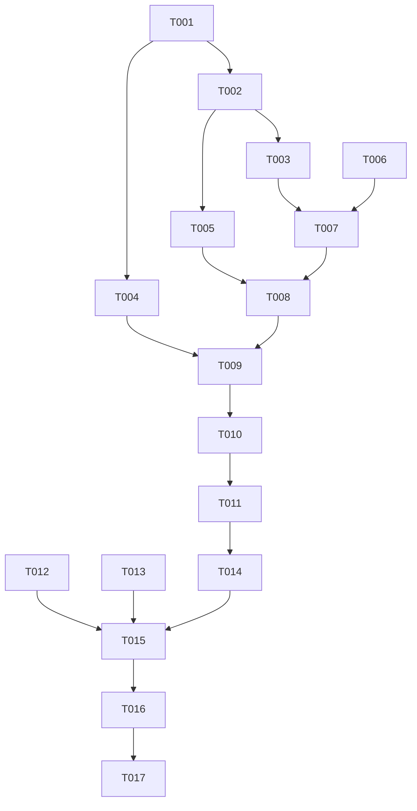

# Tasks: 信任此设备与会话门控（含退出登录回登录页）

**Input**: Design documents from `harmony/entry/src/main/ets/pages/trust-device/`
**Prerequisites**: plan.md（已批准）, spec.md（5 个用户故事 P1–P5）

**Tests**: 本特性未要求自动化测试（沿用项目既有流程：`arkts_check` + 构建 + 模拟器 UI 验证），故不生成测试任务。

**Organization**: 按用户故事分组，顺序交付（US1 为入口）。

## Format: `[ID] [P?] [Story] Description`

- **[P]**: 可并行（不同文件、无未完成依赖）
- **[Story]**: 所属用户故事（US1–US5）；Setup / Foundational / Polish / Verification 阶段不加故事标签
- 所有路径相对工作区根（`harmony/...`）

## Path Conventions

- 认证/会话：`harmony/entry/src/main/ets/services/auth/`
- 状态/存储/工具：`harmony/entry/src/main/ets/state/`、`storage/`、`utils/`
- 装配与页面：`harmony/entry/src/main/ets/entryability/`、`pages/`
- 本特性产物：`harmony/entry/src/main/ets/pages/trust-device/`

---

## Phase 1: Setup

**Purpose**: 确认认证链路与装配基线

- [X] T001 核对基线：`pages/LoginPage.ets`（登录表单与**2FA 流程**、既有调用点）、`services/auth/SessionManager.ets`（`login/tryAutoLogin/verify2FACode/logout`）、`services/auth/TsinghuaAuthService.ets`（`login` 与 `LoginResultType.TWO_FACTOR` 语义）、`storage/SecureStorage.ets`（ASSET 凭证读写清）、`state/SettingsManager.ets`（`trustDevice` 持久化路径）、`state/AuthManager.ets`（登录态与 2FA 状态）、`entryability/EntryAbility.ets`（`onCreate`/`onDestroy`/设置加载时机）、`pages/Index.ets`（登录态使用点与 Tabs 装配）、`storage/StorageKeys.ets`、`utils/I18n.ets`

---

## Phase 2: Foundational (Blocking Prerequisites)

**Purpose**: 信任状态、凭证策略、2FA 状态、清理机制与文案——所有用户故事的前置

**⚠️ CRITICAL**: 本阶段完成前，任何用户故事均不可开始

- [X] T002 扩展 `harmony/entry/src/main/ets/storage/StorageKeys.ets` 与 `harmony/entry/src/main/ets/state/SettingsManager.ets`：新增**"是否曾选择信任"**与**"待清除标记"**的读写（**复用既有 `trustDevice` 作为当前值/上次选择**；签名对外不破坏）
- [X] T003 改造 `harmony/entry/src/main/ets/services/auth/SessionManager.ets`（及 `TsinghuaAuthService.ets` 的**加法式**配合）：`login` 支持"**是否持久化凭证**"——**信任→写 ASSET；不信任→不写**（仅内存会话）；返回值语义不变，既有调用（无第二参）行为与之前一致（依赖 T002）
- [X] T004 改造 `harmony/entry/src/main/ets/state/AuthManager.ets` 与 `harmony/entry/src/main/ets/services/auth/SessionManager.ets`：新增**"需 2FA"登录态**；`tryAutoLogin` 命中 `TWO_FACTOR` 时置该态并保留待验证上下文（供门控渲染）（依赖 T001）
- [X] T005 改造 `harmony/entry/src/main/ets/entryability/EntryAbility.ets`：①**退出钩子**——若"待清除"为真 → 清凭证并复位标记；②**启动兜底**——设置加载后若"未信任"或"待清除" → 清凭证并复位（依赖 T002）
- [X] T006 扩展 `harmony/entry/src/main/ets/utils/I18n.ets`：新增 `login.*`（信任开关与说明、"需要二次认证"提示、取消信任后的提示等）与必要 `settings.*` 文案（zh/en 成对）

**Checkpoint**: 策略与门控基础设施就绪

---

## Phase 3: User Story 1 - 登录时选择是否信任此设备 (Priority: P1) 🎯 MVP

**Goal**: 登录页提供信任选择（默认＝上次选择；无历史默认不勾选），并据此决定凭证是否持久化

**Independent Test**: 勾选登录→冷启动自动登录；不勾选登录→冷启动停在登录页

- [X] T007 [US1] 改造 `harmony/entry/src/main/ets/pages/LoginPage.ets`：新增**"信任此设备"开关**（初值＝上次选择，无历史则关）；登录调用传入该选择（`SessionManager.login(credentials, trust)`）；成功后**写回"上次选择/曾选择"**；文案走 `login.*`（依赖 T003、T006）

**Checkpoint**: US1 可独立验证

---

## Phase 4: User Story 2 - 取消信任与退出清理 (Priority: P2)

**Goal**: 取消信任→标记；退出时清除已存凭证；强杀由启动兜底；重新开启信任后恢复持久化

**Independent Test**: 信任登录→取消信任→正常退出→再启动不自动登录且凭证已清；强杀场景启动亦完成清除

- [X] T008 [US2] 改造 `harmony/entry/src/main/ets/pages/SettingsPage.ets`（必要时配合 `SettingsManager`）：取消"信任此设备"→**置待清除标记** + 更新"上次选择" + **明示提示**（退出后需重新登录）；重新开启→**复位待清除**；**不得**在取消时清会话（会话复用不受影响）（依赖 T005、T007）

**Checkpoint**: US1 + US2 均可独立验证

---

## Phase 5: User Story 3 - 自动登录需 2FA 时进入 2FA 界面 (Priority: P3)

**Goal**: 需要二次认证时直接进入 2FA 视图并给出可读提示

**Independent Test**: 构造需 2FA 的自动登录 → 进入 2FA 界面并可完成验证

- [X] T009 [US3] 改造 `harmony/entry/src/main/ets/pages/Index.ets` 与 `harmony/entry/src/main/ets/pages/LoginPage.ets`：当登录态为**需 2FA** 时**直接渲染 2FA 视图**（复用既有流程）并给出可读提示（`login.twoFactorRequired`）；非 2FA 失败回登录页并提示对应原因（依赖 T004、T008）

**Checkpoint**: US1–US3 均可独立验证

---

## Phase 6: User Story 4 - 退出登录后整应用回登录页 (Priority: P4)

**Goal**: 退出登录/会话失效后整应用回到登录页

**Independent Test**: 退出登录→界面为登录页且底部 Tab 不可访问；冷启动为登录页

- [X] T010 [US4] 改造 `harmony/entry/src/main/ets/pages/Index.ets`：以**登录态唯一门控**（未登录 → 登录页，**不渲染 Tabs**；已登录 → Tabs）；退出登录/会话失效时**立即切换**（依赖 T009）

**Checkpoint**: US1–US4 均可独立验证

---

## Phase 7: User Story 5 - 运行期会话复用不受影响 (Priority: P5)

**Goal**: 未信任/取消信任不影响本次运行内的会话复用

**Independent Test**: 不信任登录后在本次运行内正常使用课表/成绩/校园等，无额外重登

- [X] T011 [US5] 走查并回归（代码路径核对 + 运行验证）：确认本特性**仅在"登录是否落盘"与"退出/启动清理"两处触碰凭证**，未清理 Cookie、未重置会话、未打断漫游与请求；取消信任**不触发**任何会话操作（依赖 T010）

**Checkpoint**: 全部用户故事均可独立验证

---

## Phase 8: Polish & Cross-Cutting Concerns

**Purpose**: 质量与文档收口

- [X] T012 [P] 走查：新增/改动文案 100% 走 i18n（zh/en 成对）；**日志无密码/凭证明文**；无弃用提示 API（统一 `getUIContext()` 系列）；`LoginPage`/`SettingsPage` 新增控件布局不溢出
- [X] T013 [P] 更新 `harmony/DEVELOPMENT.md`：新增"信任此设备与会话门控"小节（策略语义、双保险清理、2FA 进入路径、Index 门控、会话复用不受影响的边界说明、**参考实现未实现该能力的对照结论**）
- [X] T014 对 `pages/LoginPage.ets`、`pages/Index.ets`、`pages/SettingsPage.ets`、`services/auth/SessionManager.ets`、`services/auth/TsinghuaAuthService.ets`、`state/AuthManager.ets`、`state/SettingsManager.ets`、`storage/StorageKeys.ets`、`entryability/EntryAbility.ets`、`utils/I18n.ets` 运行 `arkts_check` 并修复全部 ArkTS 严格模式违规（唯一允许噪声：`Logger.ets` 的 `BuildProfile` 已知误报）

---

## Phase 9: Verification

<!-- verification_scope: build+ui -->

**Purpose**: 构建、部署并逐用户故事做 UI 验证（**含冷启动/退出/强杀三类场景**）

- [X] T015 构建工程并修复编译错误（`devecocli build --modules entry`，迭代 修复 → 构建 直至成功）—— **PASS**：首次构建即 `BUILD SUCCESSFUL`（0 次修复）
- [X] T016 部署到模拟器（`devecocli run --skip-build --device 127.0.0.1:5555`，必要时先唤醒屏幕）—— **PASS**：`App installed successfully` + `Smoke: PASS`（无需唤醒/重启）
- [X] T017 运行 UI 验证（`verify_ui`）：US1 信任/不信任登录后**冷启动行为差异**；US2 取消信任后**正常退出**与**强杀**（`aa force-stop` 后重启）两条路径的凭证清除与不自动登录；US3 需 2FA 场景进入 2FA 界面（如可由退出信任列表/无效指纹构造，若无法构造请如实标注）；US4 退出登录后**整应用回登录页**；US5 未信任状态下运行期使用不中断
  - 结果：US1 ✅（开关默认＝上次选择；不信任登录后冷启动停在登录页且凭证已清）；US2 ✅ 强杀路径（`aa force-stop` → 启动兜底 `TRUST startup purge done` + `CRED_CLEAR ok` + 不自动登录）；US4 ✅；修订 A/B（FR-017/FR-018）✅ 回填 + 一键直达主页；US5 ⚠️ 未完成（`verify_ui` 工具 3/3 次尝试均在"底部标签/开关点击"环节失败，非产品缺陷；等价替代证据见报告）；US3 ❌ 未验证（无法构造服务端要求 2FA 的场景）；附加（另一账号无 Cookie 串号）❌ 未验证（无第二账号凭据）；US2 正常退出路径 ⚠️ 未单独验证（仅有一次可破坏性观测窗口，已用于强杀路径）

---

## Dependencies & Execution Order

### Phase Dependencies

- **Setup (Phase 1)**: 无依赖
- **Foundational (Phase 2)**: 依赖 Setup
- **US1–US5 (Phase 3–7)**: 依赖 Foundational；按 P1 → P5 顺序
- **Polish (Phase 8)**: 依赖用户故事完成
- **Verification (Phase 9)**: 依赖全部代码改动完成

### User Story Dependencies

- **US1 (P1)**: 依赖 T003（凭证策略）、T006（文案）
- **US2 (P2)**: 依赖 US1 与 T005（清理机制）
- **US3 (P3)**: 依赖 T004（需 2FA 状态）
- **US4 (P4)**: 依赖 US3（同一门控渲染位置）
- **US5 (P5)**: 依赖 US4（门控完成后的整体回归）

### Within Each User Story

- 状态/存储 → 服务 → 装配 → 页面 → 交互
- 同一文件任务必须串行（`Index.ets` 的 T009/T010；`LoginPage.ets` 的 T007/T009）

### Parallel Opportunities

- T012 与 T013 可并行（走查 vs 文档）

### Dependency Graph

---

## Parallel Example

| Phase | Tasks | Required Files | Execution Notes |
|-------|-------|----------------|-----------------|
| Setup | T001 | 认证/装配相关 9 文件（只读核对） | 单任务 |
| Foundational | T002 → T003；T004；T005；T006 | `StorageKeys.ets`, `SettingsManager.ets`, `SessionManager.ets`, `TsinghuaAuthService.ets`, `AuthManager.ets`, `EntryAbility.ets`, `I18n.ets` | T004/T006 与 T002/T003 不同文件，可并行；T005 依赖 T002 |
| US1 (P1) | T007 | `pages/LoginPage.ets` | 单文件 |
| US2 (P2) | T008 | `pages/SettingsPage.ets`（+`SettingsManager`） | 单文件（+状态） |
| US3 (P3) | T009 | `pages/Index.ets`, `pages/LoginPage.ets` | 两文件协同 |
| US4 (P4) | T010 | `pages/Index.ets` | 同文件串行（T009 后） |
| US5 (P5) | T011 | 只读回归 | 单任务 |
| Polish | T012 [P] ∥ T013 [P] → T014 | 页面/服务/状态/装配 + `DEVELOPMENT.md` | 走查与文档可并行 |
| Verification | T015 → T016 → T017 | 全工程 | 严格串行；**含强杀场景**（`aa force-stop`） |

---

## Implementation Strategy

### MVP First

1. 完成 Phase 1 + Phase 2（策略与清理机制 + 文案）
2. 完成 Phase 3（US1：登录页信任选择 → 凭证是否落盘）
3. **STOP & VALIDATE**：信任/不信任两条冷启动路径差异明确
4. 增量交付 US2（取消信任与清理）→ US3（2FA 进入）→ US4（整应用门控）→ US5（复用回归）

### Incremental Delivery

- Foundational 完成即具备"凭证策略 + 清理 + 需 2FA 状态"
- 装配层（`Index`/`EntryAbility`）改动集中在 US3/US4 收口，避免早期扰动登录链路
- **关键回归**：每步后确认"自动登录/退出/2FA"三条路径未被破坏

---

## Notes

- [P] 任务 = 不同文件且无未完成依赖
- 同文件任务必须串行（尤其 `pages/Index.ets` 与 `pages/LoginPage.ets`）
- **强杀场景**必须验证：`hdc shell "aa force-stop com.campusos.app"` 后重启，检查凭证清除与不自动登录
- **会话复用**是本特性的硬边界：取消信任/未信任**不得**清会话或打断漫游
- 本轮验证范围为 **build+ui**

### Summary

- **总任务数**: 17（T001–T017）
- **分阶段统计**: Setup 1 · Foundational 5（T002–T006）· US1 1 · US2 1 · US3 1 · US4 1 · US5 1 · Polish 3（T012–T014）· Verification 3（T015–T017）
- **每故事任务数**: US1 = 1 · US2 = 1 · US3 = 1 · US4 = 1 · US5 = 1
- **并行机会**: T004/T006 与 T002/T003；T012 ∥ T013
- **独立测试标准**: US1 信任/不信任冷启动差异；US2 取消信任后退出与强杀均清凭证；US3 需 2FA 进界面；US4 退出后整应用回登录页；US5 运行期使用不中断
- **建议 MVP 范围**: Phase 1 + Phase 2 + Phase 3（US1）
