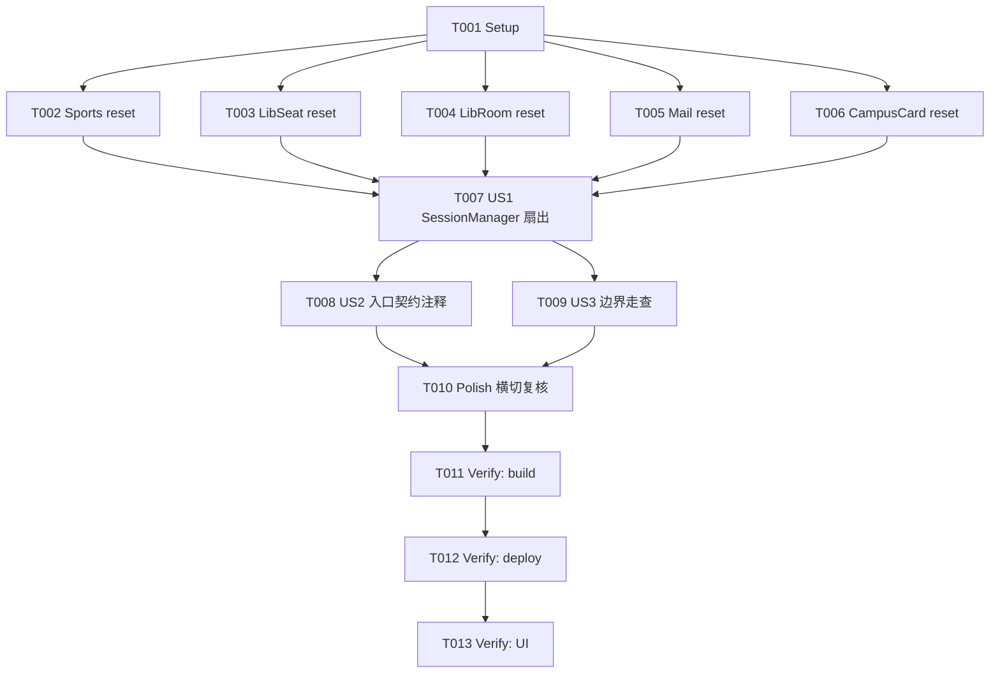

# Tasks: 会话复位统一（子系统"已确保"标志与瞬态缓存）

**Input**: Design documents from `harmony/entry/src/main/ets/services/auth/session-reset-unification/`
**Prerequisites**: plan.md（已批准）, spec.md（3 个用户故事：US1 重登后可用 P1 / US2 入口统一可扩展 P2 / US3 无副作用 P2）

**Tests**: 本特性未要求自动化测试（沿用项目既有流程：`arkts_check` + 构建 + 验证），故不生成测试任务。

**Organization**: 任务按用户故事分组；本特性为服务层横切加固，Foundational 为各服务复位方法（并行），US1 为统一入口扇出。

## Format: `[ID] [P?] [Story] Description`

- **[P]**: 可并行（不同文件、无未完成依赖）
- **[Story]**: 所属用户故事（US1/US2/US3）；Setup / Foundational / Polish / Verification 阶段不加故事标签
- 所有路径相对工作区根（`harmony/...`）

## Path Conventions

- 服务层：`harmony/entry/src/main/ets/services/`
- 本特性产物：`harmony/entry/src/main/ets/services/auth/session-reset-unification/`

---

## Phase 1: Setup

**Purpose**: 确认改造基线（无脚手架工作）

- [X] T001 核对基线：`harmony/entry/src/main/ets/services/auth/SessionManager.ets`（`resetSessionState()` 现状与 3 个触发点：登录成功 L219 / 2FA 成功 L241 / 退出登录 L274；单例字段与 `!== undefined` 判据）；各服务瞬态字段清单（`SportsService.sportsSessionEnsured`、`LibrarySeatService.libAccessEnsured`/`accessTokenValue`/`accessTokenTs`/`lastDaySegment`、`LibraryRoomService.cabLoginEnsured`/`cabAccNo`、`MailService.session`、`CampusCardService.accountUser`/`accountCardId`）；确认无新增依赖

---

## Phase 2: Foundational (Blocking Prerequisites)

**Purpose**: 各服务新增一致签名的复位方法（无参/同步/幂等/不抛）

**⚠️ CRITICAL**: 本阶段完成前，US1 入口扇出不可开始

- [X] T002 [P] 在 `harmony/entry/src/main/ets/services/campus/SportsService.ets` 新增 `resetSessionState(): void`：`sportsSessionEnsured = false`
- [X] T003 [P] 在 `harmony/entry/src/main/ets/services/campus/LibrarySeatService.ets` 新增 `resetSessionState(): void`：`libAccessEnsured = false`；`accessTokenValue = ''`；`accessTokenTs = 0`；`lastDaySegment = undefined`
- [X] T004 [P] 在 `harmony/entry/src/main/ets/services/campus/LibraryRoomService.ets` 新增 `resetSessionState(): void`：`cabLoginEnsured = false`；`cabAccNo = -1`
- [X] T005 [P] 在 `harmony/entry/src/main/ets/services/campus/MailService.ets` 新增 `resetSessionState(): void`：`session = undefined`（清邮件会话）
- [X] T006 [P] 在 `harmony/entry/src/main/ets/services/campus/CampusCardService.ets` 新增 `resetSessionState(): void`：`accountUser = ''`；`accountCardId = ''`

**Checkpoint**: 各服务复位方法就绪（签名/语义一致）

---

## Phase 3: User Story 1 - 进程内重登后各子服务首次访问可用 (Priority: P1) 🎯 MVP

**Goal**: 单一入口在既有 3 触发点扇出到各已实例化服务，使重登后不再复用陈旧会话态

**Independent Test**: 访问各子服务 → 退出 → 重登 → 再次访问，无需额外操作即可成功

- [X] T007 [US1] 改造 `harmony/entry/src/main/ets/services/auth/SessionManager.ets` 的 `resetSessionState()`：在既有 `campusDataService` 复位后，逐一对其余**已实例化**服务调用 `resetSessionState()`（`sportsService`/`librarySeatService`/`libraryRoomService`/`mailService`/`campusCardService`，均以 `!== undefined` 判据，**不触发懒加载**），每个调用**异常隔离**（单服务异常不中断其余与登录/退出流程）；调用点与既有时序（门控广播前）不变（依赖 T002–T006）

**Checkpoint**: US1 可独立验证（重登后各子服务首次访问成功）

---

## Phase 4: User Story 2 - 复位入口统一且可扩展 (Priority: P2)

**Goal**: 复位行为由单一入口统一扇出；各服务以一致签名暴露复位方法，便于后续接入

**Independent Test**: 检查入口统一调用各服务复位方法；新增服务仅需实现同签名方法并在入口登记

- [X] T008 [US2] `SessionManager.ets`：为复位入口补充简明契约注释（各服务 `resetSessionState()` 的签名约定 + 扇出清单 + 惰性/异常隔离约定），确保新增服务可按同一范式低成本登记（依赖 T007）

**Checkpoint**: US1 + US2 均可独立工作

---

## Phase 5: User Story 3 - 复位无副作用 (Priority: P2)

**Goal**: 复位不清 Cookie/凭证、不复位 csrf、幂等且容错

**Independent Test**: 复位后 Cookie/凭证不变；学习页无 `no_csrf` 回归；复位异常不中断流程

- [X] T009 [US3] 走查 `SessionManager.ets` 与各服务复位方法：确认未清 Cookie、未改动持久化凭证、未复位 `TsinghuaAuthService` csrf；复位幂等且异常隔离；各方法仅清本服务瞬态态（FR-004/FR-005/FR-006）（依赖 T007）

**Checkpoint**: 全部用户故事均可独立工作

---

## Phase 6: Polish & Cross-Cutting Concerns

**Purpose**: 横切一致性收口

- [X] T010 [P] 复核横切约束：无新增依赖/UI/资源/权限；各服务复位方法命名与签名一致；`CampusNetworkService`/`TsinghuaAuthService` 未被改动；`CampusDataService` 既有复位逻辑不变

---

## Phase 7: Verification

<!-- verification_scope: build+ui -->

**Purpose**: 构建、部署并逐用户故事做 UI 验证

- [X] T011 构建工程并修复编译错误（`devecocli build --modules entry`；同时对改动 `.ets` 文件运行 `arkts_check`；迭代 修复 → 构建 直至成功）
- [X] T012 部署到设备/模拟器（`devecocli run --skip-build --device 127.0.0.1:5555`）
- [X] T013 运行 UI 验证（`verify_ui`）：覆盖 US1（退出→重登后各子服务首次访问可用）、US3（复位后 Cookie/凭证不变、学习页无 `no_csrf` 回归）；US2/边界以静态核对为准

---

## 📊 Dependency Graph

## ⚡ Parallel Execution Guide

| Phase | Tasks | Required Files | Execution Notes |
|-------|-------|----------------|-----------------|
| Setup | T001 | 服务/入口（只读核对） | 单任务 |
| Foundational | T002,T003,T004,T005,T006 | 5 个不同服务文件 | **全部 [P]，可并行**（不同文件） |
| US1 (P1) | T007 | `SessionManager.ets` | 依赖 T002–T006 |
| US2 (P2) | T008 | `SessionManager.ets` | 依赖 T007（同文件串行） |
| US3 (P2) | T009 | `SessionManager.ets` + 各服务 | 依赖 T007 |
| Polish | T010 | 复核对（只读） | 依赖 T008/T009 |
| Verification | T011 → T012 → T013 | 全工程 | 严格串行（build → deploy → UI） |

---

## Dependencies & Execution Order

### Phase Dependencies

- **Setup（Phase 1）**：无依赖，可立即开始
- **Foundational（Phase 2）**：依赖 Setup，阻塞 US1
- **User Stories（Phase 3–5）**：US1 依赖 Foundational；US2/US3 依赖 US1
- **Polish（Phase 6）**：依赖 US2/US3
- **Verification（Phase 7）**：依赖 Polish

### User Story Dependencies

- **US1 (P1)**：依赖 Foundational（各服务复位方法）
- **US2 (P2)**：依赖 US1（入口扇出）
- **US3 (P2)**：依赖 US1（入口扇出）

### Within Each User Story

- US1：各服务复位方法（Foundational）→ 入口扇出（T007）
- US2：入口契约注释（T008，同文件串行于 T007 后）
- US3：边界走查（T009）

### Parallel Opportunities

- T002–T006 全部可并行（5 个不同服务文件）
- 其余为入口单文件的串行任务

---

## Parallel Example

| Phase | Tasks | Required Files | Execution Notes |
|-------|-------|----------------|-----------------|
| 五服务并行 | T002 ∥ T003 ∥ T004 ∥ T005 ∥ T006 | `SportsService.ets`, `LibrarySeatService.ets`, `LibraryRoomService.ets`, `MailService.ets`, `CampusCardService.ets` | 不同文件，均只依赖 T001 |
| 入口串行 | T007 → T008 | `SessionManager.ets` | 同文件串行 |

---

## Implementation Strategy

### MVP First

1. 完成 Phase 1 Setup + Phase 2 Foundational（5 服务复位方法）
2. 完成 US1（T007 入口扇出）
3. **STOP & VALIDATE**：退出→重登后各子服务首次访问可用

### Incremental Delivery

- Foundational 完成即具备各服务复位能力；US1 接入统一入口；US2 明确可扩展契约；US3 收口边界
- Verification 为 **build+ui**：构建 + 部署 + 逐用户故事 UI 验证

---

## Notes

- [P] 任务 = 不同文件且无未完成依赖
- 同文件任务（`SessionManager.ets`：T007→T008）必须串行
- **本轮验证范围为 build+ui**：构建 + 部署 + 逐用户故事 UI 验证
- 严格约束：不清 Cookie/凭证、不复位 csrf、不强制实例化服务、复位异常隔离；不新增依赖/UI/权限；不 `git` 提交

---

## Summary Report

- **总任务数**: 13（T001–T013）
- **分阶段统计**: Setup 1（T001）· Foundational 5（T002–T006）· US1 1（T007）· US2 1（T008）· US3 1（T009）· Polish 1（T010）· Verification 3（T011–T013）
- **每故事任务数**: US1 = 1 · US2 = 1 · US3 = 1
- **并行机会**: T002–T006（5 个不同文件）全部可并行
- **独立测试标准**: US1 重登后各子服务首次访问成功；US2 入口统一且新服务可低成本接入；US3 复位无 Cookie/凭证/csrf 副作用且容错
- **建议 MVP 范围**: Phase 1 + Phase 2 + US1（T001–T007）
- **Verification 范围**: `build+ui`（构建 + 部署 + UI 验证）
