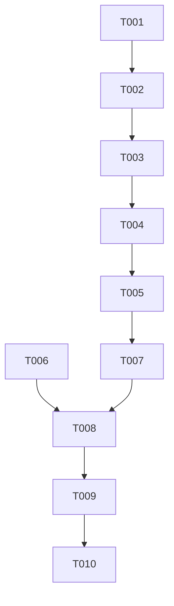

# Tasks: 凭证安全存储（系统关键资产存储 + 自动迁移）

**Input**: Design documents from `harmony/entry/src/main/ets/storage/secure-credential-store/`
**Prerequisites**: plan.md（已批准）, spec.md（3 个用户故事 P1–P3）

**Tests**: 本特性未要求自动化测试（沿用项目既有流程：`arkts_check` + 构建 + 设备验证），故不生成测试任务。

**Organization**: 任务按用户故事分组。本特性为存储层实现替换，US 粒度较细（保存 / 迁移 / 清除与语义）。

## Format: `[ID] [P?] [Story] Description`

- **[P]**: 可并行（不同文件、无未完成依赖）
- **[Story]**: 所属用户故事（US1/US2/US3）；Setup / Foundational / Polish / Verification 阶段不加故事标签
- 所有路径相对工作区根（`harmony/...`）

## Path Conventions

- 存储层：`harmony/entry/src/main/ets/storage/`
- 调用方（**本特性不改动**）：`harmony/entry/src/main/ets/services/auth/`、`harmony/entry/src/main/ets/services/campus/`
- 本特性产物：`harmony/entry/src/main/ets/storage/secure-credential-store/`

---

## Phase 1: Setup

**Purpose**: 确认改造基线与系统能力可用性

- [X] T001 核对基线与依赖：`harmony/entry/src/main/ets/storage/SecureStorage.ets`（现有"偏好设置 + URL 编码"实现，旧键 `@secure:credentials`）；调用点清单（`services/auth/TsinghuaAuthService.ets` 的 hydrate/save/clear、`services/auth/SessionManager.ets`、`services/campus/CampusNetworkService.ets`）；确认 `@ohos.security.asset` 在本 API 版本可用并按 ArkTS 指南核对新增/查询/更新/删除接口与所需属性标签（别名、密文、访问条件、返回类型）

---

## Phase 2: Foundational (Blocking Prerequisites)

**Purpose**: 关键资产读写辅助与内部常量

**⚠️ CRITICAL**: 本阶段完成前，任何用户故事均不可实现

- [X] T002 在 `harmony/entry/src/main/ets/storage/SecureStorage.ets` 新增内部实现基础：①关键资产别名/访问条件/返回类型等**常量**；②关键资产**读写辅助**（新增、查询取明文、更新、删除；含"已存在"错误码判定）；③**序列化/反序列化辅助**（沿用既有格式：`encodeURIComponent(学号):encodeURIComponent(密码):指纹`）；④旧明文读写清除辅助（`PreferencesStorage` 的读写删，仅迁移与清除使用）；⑤统一日志标签与字段（**仅步骤/错误码/旧值存在布尔与长度，禁止输出明文**）

**Checkpoint**: 实现基础就绪，三个对外方法可改造

---

## Phase 3: User Story 1 - 新登录凭证以安全存储保存 (Priority: P1) 🎯 MVP

**Goal**: 登录成功后凭证写入关键资产；偏好设置中不再出现含密码的明文记录；重复保存不产生多份

**Independent Test**: 保存后检查偏好设置无明文；再次登录不产生重复凭证；`arkts_check` 与构建通过

- [X] T003 [US1] 改造 `harmony/entry/src/main/ets/storage/SecureStorage.ets` 的 `saveCredentials`：改为**幂等写入关键资产**（新增 → 命中"已存在"则更新）；**不再写入旧明文字段**；写入失败仅记日志、不向调用方抛出；成功后尝试清除旧明文残留（依赖 T002）

**Checkpoint**: US1 完成（保存路径已无明文落盘）

---

## Phase 4: User Story 2 - 自动迁移既有明文凭证 (Priority: P2)

**Goal**: 新存储未命中时，自动把旧明文迁入关键资产并清除旧明文；迁移失败不丢数据

**Independent Test**: 在存在旧明文的设备上触发一次读取：日志显示迁移成功且旧明文已清除；自动登录成功

- [X] T004 [US2] 改造 `harmony/entry/src/main/ets/storage/SecureStorage.ets` 的 `getCredentials`：①查询关键资产（命中则返回，并尝试清除旧明文残留）；②未命中 → 读旧明文字段：存在则**先写入关键资产、成功后再清除旧明文**，返回该凭证；**写入失败不得清除旧明文**（保留并返回凭证，记录可读日志）；③两者皆无 → 返回 `undefined`；④全过程异常不得抛出到调用方（依赖 T003）

**Checkpoint**: US1 + US2 均可独立验证

---

## Phase 5: User Story 3 - 读取与清除语义保持不变 (Priority: P3)

**Goal**: 无凭证读取返回空值；注销后新旧存储均无残留

**Independent Test**: 无凭证时读取得到空值；执行清除后读取得到空值且旧明文不存在

- [X] T005 [US3] 改造 `harmony/entry/src/main/ets/storage/SecureStorage.ets` 的 `clearCredentials`：同时清除关键资产与本模块旧明文字段（各自容错、幂等）；复核三个对外方法的**签名与语义未变**（无数据/异常 → 空值；不抛异常），确认调用方无需改动（依赖 T004）

**Checkpoint**: 全部用户故事可独立验证

---

## Phase 6: Polish & Cross-Cutting Concerns

**Purpose**: 文档与静态检查收口

- [X] T006 [P] 更新 `harmony/DEVELOPMENT.md`：在待办中标记"#3 密码明文存储"已修复（改为系统关键资产存储 + 自动迁移），并注明 `SecureStorageTurboModule`（HUKS 桥接桩）现状与不在本特性范围
- [X] T007 对 `harmony/entry/src/main/ets/storage/SecureStorage.ets` 运行 `arkts_check` 并修复全部 ArkTS 严格模式违规；同时确认调用方（`services/auth/TsinghuaAuthService.ets`、`services/auth/SessionManager.ets`、`services/campus/CampusNetworkService.ets`）**未被改动**（唯一允许噪声：`Logger.ets` 的 `BuildProfile` 已知误报）

---

## Phase 7: Verification

<!-- verification_scope: build+ui -->

**Purpose**: 构建、部署并验证可见行为与日志证据

- [X] T008 构建工程并修复编译错误（`devecocli build --modules entry`，迭代 修复 → 构建 直至成功）——首次构建即 BUILD SUCCESSFUL（无修复）
- [X] T009 部署到模拟器（`devecocli run --skip-build --device 127.0.0.1:5555`，必要时先唤醒屏幕）——App installed successfully + Smoke: PASS（无 FAIL_BLANK）
- [X] T010 运行 UI 验证（`verify_ui`）并核对日志：**冷启动应直接进入首页（自动登录成功，无需重新登录）**；日志应显示凭证查询命中或迁移成功、且**不含任何密码明文**；无凭证场景应停留登录页且不崩溃——US1/US2/US3 全部 PASS；日志 `CRED_MIGRATE migrated=true cleared=true`、`CRED_CLEAR ok asset_cleared=true legacy_cleared=true`；SecureStore 日志无任何明文

---

## Dependencies & Execution Order

### Phase Dependencies

- **Setup (Phase 1)**: 无依赖，可立即开始
- **Foundational (Phase 2)**: 依赖 Setup
- **User Stories (Phase 3–5)**: 均依赖 Foundational，且 US1 → US2 → US3 依次依赖（同文件、串行）
- **Polish (Phase 6)**: 依赖三个 US 完成
- **Verification (Phase 7)**: 依赖全部代码改动完成

### User Story Dependencies

- **US1 (P1)**: 依赖 T002
- **US2 (P2)**: 依赖 US1（T003，迁移需先具备写入能力）
- **US3 (P3)**: 依赖 US2（T004，清除需覆盖迁移引入的旧键语义）

### Within Each User Story

- 辅助 → 保存 → 读取/迁移 → 清除
- 同一文件（`SecureStorage.ets`）内的任务必须串行

### Parallel Opportunities

- T006（文档）可与 T007（静态检查）并行（不同文件/关注点）
- 其余任务同文件串行

### Dependency Graph

---

## Parallel Example

| Phase | Tasks | Required Files | Execution Notes |
|-------|-------|----------------|-----------------|
| Setup | T001 | `storage/SecureStorage.ets`, 三个调用方（只读核对）, ASSET ArkTS 指南 | 单任务 |
| Foundational | T002 | `storage/SecureStorage.ets` | 单任务（内部辅助与常量） |
| US1 | T003 | `storage/SecureStorage.ets` | 同文件串行 |
| US2 | T004 | `storage/SecureStorage.ets` | 同文件串行 |
| US3 | T005 | `storage/SecureStorage.ets` | 同文件串行 |
| Polish | T006 [P] ∥ T007 | `DEVELOPMENT.md`, `storage/SecureStorage.ets`, 三个调用方 | 文档与静态检查可并行 |
| Verification | T008 → T009 → T010 | 全工程 | 严格串行（构建 → 部署 → UI/日志验证） |

---

## Implementation Strategy

### MVP First

1. 完成 Phase 1 Setup + Phase 2 Foundational
2. 完成 Phase 3（US1：保存路径已无明文）
3. **STOP & VALIDATE**：保存后偏好设置无明文、自动登录仍可用
4. 增量交付 US2（迁移）→ US3（清除与语义）

### Incremental Delivery

- Foundational 完成即具备 ASSET 读写能力；US1 先切断明文写入，US2 再迁移存量，US3 收口清除与语义
- 每个故事后独立验证；失败不得丢数据、不得回退明文

---

## Notes

- [P] 任务 = 不同文件且无未完成依赖
- **同一文件**（`SecureStorage.ets`）的任务必须串行
- 对外接口**签名与语义不变**，调用方零改动（本特性不改动 `services/` 下任何文件）
- 本轮验证范围为 **build+ui**：构建 + 部署 + 冷启动自动登录（可见行为）+ 日志证据（含"无明文"核对）
- 迁移路径的自然验证条件：模拟器上由旧实现写入的旧明文凭证仍在（升级安装后首次启动即触发迁移）

### Summary

- **总任务数**: 10（T001–T010）
- **分阶段统计**: Setup 1（T001）· Foundational 1（T002）· US1 1（T003）· US2 1（T004）· US3 1（T005）· Polish 2（T006–T007）· Verification 3（T008–T010）
- **每故事任务数**: US1 = 1 · US2 = 1 · US3 = 1
- **并行机会**: T006 与 T007（文档 vs 静态检查）
- **独立测试标准**: US1 保存后偏好设置无明文且可自动登录；US2 旧明文被迁入新存储并清除（日志证据）；US3 无凭证读取返回空值、清除后无残留
- **建议 MVP 范围**: Phase 1 + Phase 2 + Phase 3（US1）——即可交付"凭证不再明文落盘"的最小可用价值
