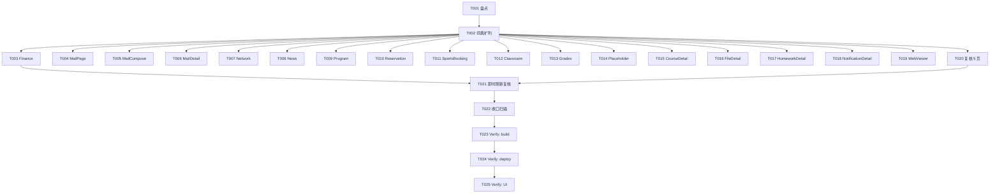

# Tasks: i18n 批次二（校园子页 / 学习详情页 / 顶层页文案迁移）

**Input**: Design documents from `harmony/entry/src/main/ets/utils/i18n-batch2/`
**Prerequisites**: plan.md（已批准）, spec.md（4 个用户故事：US1 校园子页 P1 / US2 顶层页 P1 / US3 学习详情 P1 / US4 复核与即时刷新 P2）

**Tests**: 本特性未要求自动化测试（沿用项目既有流程：`arkts_check` + 构建 + 验证），故不生成测试任务。

**Organization**: 任务按用户故事 + 页面分组；页面任务互不依赖（不同文件），可并行。

## Format: `[ID] [P?] [Story] Description`

- **[P]**: 可并行（不同文件、无未完成依赖）
- **[Story]**: 所属用户故事（US1–US4）；Setup / Foundational / Polish / Verification 阶段不加故事标签
- 所有路径相对工作区根（`harmony/...`）

## Path Conventions

- 词典：`harmony/entry/src/main/ets/utils/I18n.ets`
- 页面：`harmony/entry/src/main/ets/pages/`（含 `campus/`、`learning/`）
- 本特性产物：`harmony/entry/src/main/ets/utils/i18n-batch2/`

---

## Phase 1: Setup

**Purpose**: 盘点硬编码文案并拟定键名（供词典扩列）

- [x] T001 扫描盘点：逐页列出**可见静态文案**（标题/按钮/状态/错误/提示/标签），排除注释、服务数据与演示示例，并按前缀约定拟定键名（`campus.finance.*`/`mail.*`/`campus.network.*`/`campus.news.*`/`campus.reservation.*`/`campus.sports.*`/`classroom.*`/`campus.grades.*`/`common.placeholder.*`/`learning.*`/`webviewer.*`）；覆盖 17 目标页 + 5 复核页

---

## Phase 2: Foundational (Blocking Prerequisites)

**Purpose**: 词典扩列——所有页面任务的前置

**⚠️ CRITICAL**: 本阶段完成前，页面迁移不可开始（页面逐字替换依赖词条已存在）

- [x] T002 `harmony/entry/src/main/ets/utils/I18n.ets`：按 T001 清单扩列全部新词条（`I18nEntry { zh, en }` 成对、键唯一、按前缀分组；保持 `t()`/`tp()` API 不变）（依赖 T001）

**Checkpoint**: 词条就绪

---

## Phase 3: User Story 1 - 校园子页文案双语 (Priority: P1) 🎯 MVP

**Goal**: 校园 9 个子页的静态文案随语言切换

**Independent Test**: 切到英文后逐一进入 9 页，无残留中文静态文案（数据除外）

- [x] T003 [P] [US1] `harmony/entry/src/main/ets/pages/campus/FinancePage.ets`：接入 `@StorageLink('locale')` + `tr()/trp()`，替换全部可见静态文案；数据/逻辑不动（依赖 T002）
- [x] T004 [P] [US1] `harmony/entry/src/main/ets/pages/campus/MailPage.ets`：同上（依赖 T002）
- [x] T005 [P] [US1] `harmony/entry/src/main/ets/pages/campus/MailComposeView.ets`：同上（依赖 T002）
- [x] T006 [P] [US1] `harmony/entry/src/main/ets/pages/campus/MailDetailView.ets`：同上（依赖 T002）
- [x] T007 [P] [US1] `harmony/entry/src/main/ets/pages/campus/NetworkPage.ets`：同上（依赖 T002）
- [x] T008 [P] [US1] `harmony/entry/src/main/ets/pages/campus/NewsPage.ets`：同上（依赖 T002）
- [x] T009 [P] [US1] `harmony/entry/src/main/ets/pages/campus/ProgramPage.ets`：同上（依赖 T002）
- [x] T010 [P] [US1] `harmony/entry/src/main/ets/pages/campus/ReservationPage.ets`：同上（依赖 T002）
- [x] T011 [P] [US1] `harmony/entry/src/main/ets/pages/campus/SportsBookingPage.ets`：同上（依赖 T002）

**Checkpoint**: US1 可独立验证

---

## Phase 4: User Story 2 - 顶层页文案双语 (Priority: P1)

**Goal**: 空教室/成绩/占位页静态文案随语言切换

**Independent Test**: 英文模式下进入三页，无残留中文静态文案

- [x] T012 [P] [US2] `harmony/entry/src/main/ets/pages/ClassroomPage.ets`：接入 `tr()/trp()`，替换可见静态文案（含表头/状态/周次等动态文案用 `tp()`）；数据/逻辑不动（依赖 T002）
- [x] T013 [P] [US2] `harmony/entry/src/main/ets/pages/GradesPage.ets`：同上（依赖 T002）
- [x] T014 [P] [US2] `harmony/entry/src/main/ets/pages/PlaceholderPage.ets`：同上（依赖 T002）

**Checkpoint**: US1 + US2 均可独立验证

---

## Phase 5: User Story 3 - 学习详情页文案双语 (Priority: P1)

**Goal**: 学习 4 个详情页 + WebViewer 的静态文案随语言切换

**Independent Test**: 英文模式下进入四详情页与 WebViewer，无残留中文静态文案

- [x] T015 [P] [US3] `harmony/entry/src/main/ets/pages/learning/CourseDetailPage.ets`：接入 `tr()/trp()`，替换可见静态文案；数据/逻辑不动（依赖 T002）
- [x] T016 [P] [US3] `harmony/entry/src/main/ets/pages/learning/FileDetailPage.ets`：同上（依赖 T002）
- [x] T017 [P] [US3] `harmony/entry/src/main/ets/pages/learning/HomeworkDetailPage.ets`：同上（依赖 T002）
- [x] T018 [P] [US3] `harmony/entry/src/main/ets/pages/learning/NotificationDetailPage.ets`：同上（依赖 T002）
- [x] T019 [P] [US3] `harmony/entry/src/main/ets/pages/learning/WebViewerPage.ets`：同上（网页正文不译，仅工具栏/提示）（依赖 T002）

**Checkpoint**: US1–US3 均可独立验证

---

## Phase 6: User Story 4 - 已迁移页复核与即时刷新 (Priority: P2)

**Goal**: 已迁移页补齐遗漏；所有目标页切换语言即时刷新

**Independent Test**: 逐页扫描无遗漏；切换语言后返回目标页文案立即变更

- [x] T020 [P] [US4] 复核并补齐 5 个已迁移页的遗漏硬编码：`harmony/entry/src/main/ets/pages/campus/LibrarySeatPage.ets`、`LibraryRoomPage.ets`、`DormitoryPage.ets`、`LaundryPage.ets`、`PETestPage.ets`（复用既有前缀词条，不足则扩列）（依赖 T002）
- [x] T021 [US4] 复核全部目标页的 `@StorageLink('locale')` 订阅与 `tr()` 使用，确认切换语言后**即时重渲染**（依赖 T003–T020）

**Checkpoint**: 全部用户故事均可独立工作

---

## Phase 7: Polish & Cross-Cutting Concerns

**Purpose**: 收口校验

- [x] T022 硬编码中文**可见文案**扫描（排除注释、服务数据、演示示例）确认目标页残留 = 0；校验新增词条 zh/en 成对且无重复/冲突键；确认未改动逻辑/布局/数据流（依赖 T021）

---

## Phase 8: Verification

<!-- verification_scope: build+ui -->

**Purpose**: 构建、部署并逐用户故事做 UI 验证

- [X] T023 构建工程并修复编译错误（`devecocli build --modules entry`；同时对改动 `.ets` 文件运行 `arkts_check`；迭代 修复 → 构建 直至成功）
- [X] T024 部署到设备/模拟器（`devecocli run --skip-build --device 127.0.0.1:5555`）
- [X] T025 运行 UI 验证（`verify_ui`）：逐用户故事在中/英模式下走查（US1 校园 9 页、US2 顶层 3 页、US3 学习详情 5 页、US4 复核页与即时刷新）

---

## 📊 Dependency Graph

## ⚡ Parallel Execution Guide

| Phase | Tasks | Required Files | Execution Notes |
|-------|-------|----------------|-----------------|
| Setup | T001 | 只读扫描 | 单任务 |
| Foundational | T002 | `I18n.ets` | 单文件；阻塞全部页面任务 |
| US1 (P1) | T003–T011 | 9 个校园页（不同文件） | **全部 [P] 可并行** |
| US2 (P1) | T012–T014 | 3 个顶层页 | **全部 [P] 可并行** |
| US3 (P1) | T015–T019 | 5 个学习详情页 | **全部 [P] 可并行** |
| US4 (P2) | T020 [P]；T021 | 5 个复核页；全部目标页 | T020 可并行；T021 最后 |
| Polish | T022 | 复核对 | 依赖 T021 |
| Verification | T023 → T024 → T025 | 全工程 | 严格串行（build → deploy → UI） |

---

## Dependencies & Execution Order

### Phase Dependencies

- **Setup（Phase 1）**：无依赖
- **Foundational（Phase 2）**：依赖 Setup，阻塞全部页面任务（词条需先存在）
- **User Stories（Phase 3–6）**：均依赖 Foundational；页面任务互不依赖
- **Polish（Phase 7）**：依赖全部迁移完成
- **Verification（Phase 8）**：依赖 Polish

### User Story Dependencies

- **US1/US2/US3**：Foundational 后即可开始，彼此独立
- **US4**：依赖词条（T002）；复核在迁移后收口

### Within Each User Story

- 每页：接入 locale 订阅 → 替换静态文案 → 校验无残留
- 同文件任务须串行（本特性每页一个任务，互不冲突）

### Parallel Opportunities

- T003–T011（US1）、T012–T014（US2）、T015–T019（US3）、T020 均为**不同文件**，可并行（前提 T002 完成）

---

## Parallel Example

| Phase | Tasks | Required Files | Execution Notes |
|-------|-------|----------------|-----------------|
| 校园九页并行 | T003 ∥ … ∥ T011 | 9 个 `pages/campus/*.ets` | 不同文件 |
| 顶层+学习并行 | T012 ∥ T013 ∥ T014 ∥ T015 ∥ … ∥ T020 | 各自页面文件 | 不同文件 |
| 收口串行 | T021 → T022 → T023 → T024 → T025 | — | 依赖全部迁移 |

---

## Implementation Strategy

### MVP First

1. 完成 T001（盘点）+ T002（词典）
2. 完成 US1（T003–T011）
3. **STOP & VALIDATE**：英文模式下校园 9 页无残留中文

### Incremental Delivery

- 词典就绪后，各页可并行迁移；按 US1 → US2 → US3 → US4 验证
- Polish 收口硬编码扫描与词条校验
- Verification 为 **build+ui**；完成后**等待真机测试**，通过后再提交/推送

---

## Notes

- [P] 任务 = 不同文件且无未完成依赖
- 词典单文件（`I18n.ets`）必须串行修改（仅 T002 一处）
- **本轮验证范围为 build+ui**；实现与验证完成后**不提交**，等真机测试通过再入库
- 严格约束：只译 UI 静态文案（数据/演示示例不译）；不改逻辑/布局/数据流；词条 zh/en 成对且唯一

---

## Summary Report

- **总任务数**: 25（T001–T025）
- **分阶段统计**: Setup 1（T001）· Foundational 1（T002）· US1 9（T003–T011）· US2 3（T012–T014）· US3 5（T015–T019）· US4 2（T020–T021）· Polish 1（T022）· Verification 3（T023–T025）
- **每故事任务数**: US1 = 9 · US2 = 3 · US3 = 5 · US4 = 2
- **并行机会**: T003–T011、T012–T014、T015–T019、T020 均并行（不同文件，前提 T002）
- **独立测试标准**: US1/2/3 英文模式下目标页无残留中文静态文案；US4 复核页补齐 + 切换即时刷新
- **建议 MVP 范围**: T001 + T002 + US1（T003–T011）
- **Verification 范围**: `build+ui`（构建 + 部署 + UI 验证）
