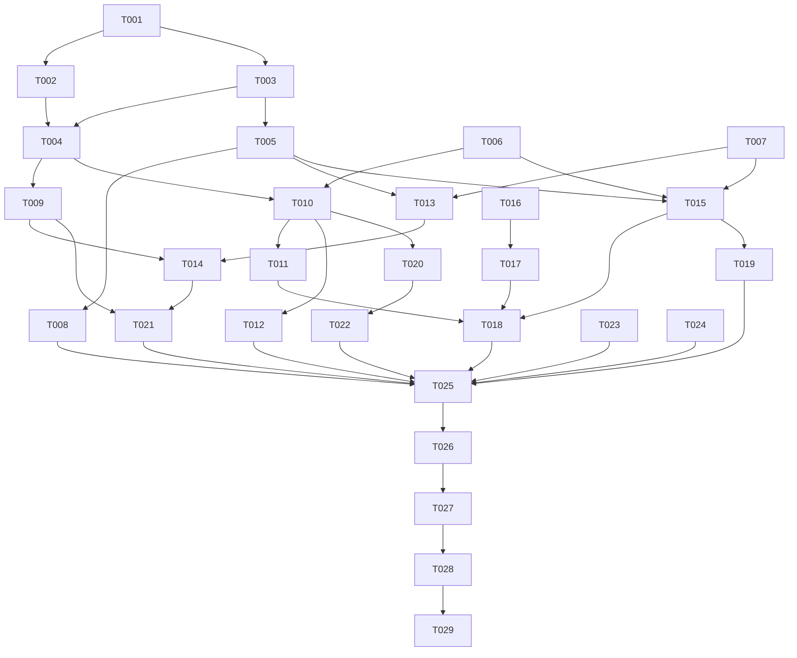

# Tasks: AI 治理（审计持久化 + 权限 UI）

**Input**: Design documents from `harmony/specs/ai-governance/`
**Prerequisites**: plan.md (required), spec.md (required for user stories)

**Tests**: 特性未要求单元测试；验证以 `arkts_check` + 构建 + 逐故事 UI 验证为准。

**Organization**: Tasks are grouped by user story to enable independent implementation and testing of each story.

## Format: `[ID] [P?] [Story] Description`

- **[P]**: Can run in parallel (different files, no dependencies)
- **[Story]**: Which user story this task belongs to (e.g., US1, US2, US3)
- Include exact file paths in descriptions

## Path Conventions

- 单模块 HarmonyOS 应用：`harmony/entry/src/main/ets/`
- 文档与规格：`harmony/specs/ai-governance/`、`docs/`

## Phase 1: Setup (Shared Infrastructure)

**Purpose**: 复核现有治理链基线，避免凭记忆改动

- [X] T001 加载 `hmos-arkui-develop-skill` 与 `ai-agent` 技能，复核 `harmony/entry/src/main/ets/services/ai/AgentService.ets`、`AgentTools.ets`、`AgentWriteTools.ets` 的工具清单、27 个权限键与 `dryRun→确认→run→verify` 入口，记录与 plan 的差异

---

## Phase 2: Foundational (Blocking Prerequisites)

**Purpose**: 数据模型、存储与服务端基础设施，所有用户故事都依赖

**⚠️ CRITICAL**: No user story work can begin until this phase is complete

- [X] T002 [P] 扩展 `AuditRecord`：新增 `permission`、`paramsJson`、`previewAffectedResource`、`verificationOk`、`verificationMessage` 字段并保留现有字段语义，位于 `harmony/entry/src/main/ets/domain/ActionTypes.ets`
- [X] T003 [P] 在 `StorageKeysMap` 与导出对象中登记 `AI_DISABLED_PERMISSIONS = '@campusos/ai_disabled_permissions'`，位于 `harmony/entry/src/main/ets/storage/StorageKeys.ets`
- [X] T004 新建 `ActionAuditStore`：preferences 读写（`StorageKeys.ACTION_AUDIT`）、200 条上限、新记录在前、串行写队列、`auditTick` 信号、读写失败吞掉；实现键名递归脱敏（敏感键正则）、摘要文本兜底打码、500/20/5/2000 截断，位于 `harmony/entry/src/main/ets/storage/ActionAuditStore.ets`（依赖 T002、T003）
- [X] T005 新建 `AIPermissionStore`：`ensureLoaded`/`isLoaded`/`getDisabled`/`isDisabled`/`setEnabled`；读取去重排序、写失败回滚内存，位于 `harmony/entry/src/main/ets/storage/AIPermissionStore.ets`（依赖 T003）
- [X] T006 [P] 在 `harmony/entry/src/main/ets/utils/I18n.ets` 增加本特性全部中英文案键（权限页摘要/风险标签/恢复全部/切换失败；审计标题/空态/清空确认/状态/风险/确认/参数/结果/错误/验证；`ai.permissionDisabled`）
- [X] T007 [P] 在 `harmony/entry/src/main/ets/services/ai/AgentTools.ets` 新增只读辅助 `permissionKeys()`（从注册表去重），不改变 `all()` 与 `byName()` 的权限语义
- [X] T008 在 `harmony/entry/src/main/ets/entryability/EntryAbility.ets` 启动链中预加载 `AIPermissionStore.ensureLoaded()`（不阻塞首屏、失败不抛出）（依赖 T005）

**Checkpoint**: 数据模型、两个存储门面与文案就绪，用户故事可以开始

---

## Phase 3: User Story 1 - 跨重启回看 AI 操作记录 (Priority: P1) 🎯 MVP

**Goal**: 工具调用审计落盘，设置页可查看最近记录并展开详情

**Independent Test**: 触发一次工具调用 → 杀进程重启 → 设置页仍能看到该记录且字段完整

### Implementation for User Story 1

- [X] T009 [US1] 改造 `AgentService.appendAuditRecord` 为异步双写：补齐 `permission/paramsJson/previewAffectedResource/verification*` 字段、内存上限改为 200、追加后投递 `ActionAuditStore.append` 并吞掉异常；`clearAuditRecords()` 同时清空内存与持久化，位于 `harmony/entry/src/main/ets/services/ai/AgentService.ets`（依赖 T004）
- [X] T010 [P] [US1] 新建 `AIAuditPanel`：加载持久化记录、展示最近 6 条、点击展开/收起、空态、订阅 `auditTick` 刷新，位于 `harmony/entry/src/main/ets/pages/settings/AIAuditPanel.ets`（依赖 T004、T006）
- [X] T011 [US1] 在 `harmony/entry/src/main/ets/pages/SettingsPage.ets` 的「功能」组用 `AIAuditPanel` 替换 `settings.actionHistory` 的 `UnsupportedRow`，保持「AI 记忆」「智能监控」禁用态不变（依赖 T010）
- [X] T012 [US1] 补齐审计条目的本地时间格式化（`yyyy-MM-dd HH:mm`）、风险/状态/确认状态标签与工具展示名回退，位于 `harmony/entry/src/main/ets/pages/settings/AIAuditPanel.ets`（依赖 T010）

**Checkpoint**: User Story 1 可独立验收（审计跨重启保留 + 设置页可查看）

---

## Phase 4: User Story 2 - 按能力类别关闭 AI 工具 (Priority: P1)

**Goal**: 权限页按权限键启停；关闭后工具不下发、点名调用被可读拒绝；确认链不变

**Independent Test**: 关闭某类能力 → AI 请求不带该工具且点名调用被拒绝；重开即恢复；写操作仍要求确认

### Implementation for User Story 2

- [X] T013 [US2] `AgentService.runAgent` 开始时 `await AIPermissionStore.ensureLoaded()`，用 `getDisabled()` 调用 `AgentTools.all(disabled)` 构建工具清单，位于 `harmony/entry/src/main/ets/services/ai/AgentService.ets`（依赖 T005、T007）
- [X] T014 [US2] `AgentService.executeToolCall` 在 `dryRun` 前增加权限门禁：命中禁用时返回含错误码/权限键/可读文案的结果，派发 `onToolStart` 与 `onToolEnd(error)` 并写审计，不调用 `dryRun`/`run`/`verify`，位于 `harmony/entry/src/main/ets/services/ai/AgentService.ets`（依赖 T009、T013）
- [X] T015 [P] [US2] 新建 `AIPermissionsPage`：按权限键分组、类别标题映射、最高风险与需确认标记、Switch、已启用计数，位于 `harmony/entry/src/main/ets/pages/settings/AIPermissionsPage.ets`（依赖 T005、T006、T007）
- [X] T016 [US2] 在 `harmony/entry/src/main/ets/state/BackDispatcher.ets` 的 `BackOwner` 增加 `SETTINGS = 'settings'`
- [X] T017 [US2] 在 `harmony/entry/src/main/ets/pages/Index.ets` 的 `activeBackOwner()` 为设置标签（index 5）返回 `BackOwner.SETTINGS`（依赖 T016）
- [X] T018 [US2] 在 `harmony/entry/src/main/ets/pages/SettingsPage.ets` 增加 `subScreen` 状态、AI 权限入口行、子页切换、进入时注册 `BackDispatcher` 并在退出/销毁时移除（依赖 T011、T015、T017）
- [X] T019 [US2] 在 `harmony/entry/src/main/ets/pages/settings/AIPermissionsPage.ets` 补齐「恢复全部权限」动作与切换失败提示（持久化失败时回滚开关并 toast）（依赖 T015）

**Checkpoint**: User Story 2 可独立验收（权限关闭后不可调用 + 可读拒绝 + 持久化）

---

## Phase 5: User Story 3 - 清空审计记录与脱敏回看 (Priority: P2)

**Goal**: 审计可二次确认清空；展开详情只展示脱敏内容；日志无敏感明文

**Independent Test**: 清空后列表与重启后均为空；含手机号/Token 的记录展开时被打码；日志无原文

### Implementation for User Story 3

- [X] T020 [US3] 在 `harmony/entry/src/main/ets/pages/settings/AIAuditPanel.ets` 增加清空按钮（显示条数）、二次确认弹窗、清空后刷新空态（依赖 T010）
- [X] T021 [US3] 审计与治理链日志治理：移除或约束可能输出参数/结果正文的日志，新增仅含工具名、状态与记录条数的日志，位于 `harmony/entry/src/main/ets/services/ai/AgentService.ets`（依赖 T009、T014）
- [X] T022 [US3] 在 `harmony/entry/src/main/ets/pages/settings/AIAuditPanel.ets` 展开区展示权限键、确认状态、影响资源、脱敏参数 JSON、结果/错误与验证结论，确保不渲染未脱敏原始值（依赖 T020）

**Checkpoint**: User Story 3 可独立验收（清空需确认 + 脱敏回看 + 日志洁净）

---

## Phase 6: Polish & Cross-Cutting Concerns

**Purpose**: 文档同步、静态检查与回归自检

- [X] T023 [P] 更新 `docs/RN-FEATURE-SYNC.md`：3.4 节「AI 权限」「AI 操作记录」改为 ✅ 并指向 `pages/settings/AIPermissionsPage.ets`、`storage/ActionAuditStore.ets`、`services/ai/AgentService.ets`；同步顶部「最后更新」与第 8 节变更记录
- [X] T024 [P] 更新 `harmony/specs/INDEX.md`：新增 `ai-governance` 行、任务计数与合计
- [X] T025 对全部改动 `.ets` 运行 `arkts_check`（`AgentService.ets`、`AgentTools.ets`、`ActionAuditStore.ets`、`AIPermissionStore.ets`、`AIAuditPanel.ets`、`AIPermissionsPage.ets`、`SettingsPage.ets`、`Index.ets`、`I18n.ets`、`ActionTypes.ets`、`StorageKeys.ets`、`BackDispatcher.ets`、`EntryAbility.ets`）并修复报告中的 error
- [X] T026 回归自检：逐项确认风险分级、`requiresConfirmation`、`dryRun→确认→run→verify` 顺序与 `AgentTools` 注册表内容未被改变，记录核对结论

---

## Phase 7: Verification (Build + Deploy + UI)

<!-- verification_scope: build+ui -->

**Purpose**: 构建、部署并逐用户故事做 UI 验证

- [X] T027 构建项目：在 `harmony/` 执行 `devecocli build`（timeout ≥ 600000 ms），修复编译错误直至成功
- [X] T028 部署应用：执行 `devecocli run --skip-build` 安装并启动到模拟器；白屏时先重跑一次再判断
- [X] T029 UI 验证：逐用户故事执行 `verify_ui` —— US1 设置页显示审计记录且重启后仍可见；US2 关闭能力后开关状态持久化、AI 请求不带该工具或返回可读拒绝；US3 清空需二次确认且清空后为空

---

## Dependencies & Execution Order

### Phase Dependencies

- **Setup (Phase 1)**: No dependencies - can start immediately
- **Foundational (Phase 2)**: Depends on Setup completion - BLOCKS all user stories
- **User Stories (Phase 3–5)**: All depend on Foundational phase completion
  - US1 与 US2 共享 `AgentService.ets`，`AgentService` 内任务必须串行（T009 → T013 → T014 → T021）
  - US3 的 UI 任务依赖 US1 的 `AIAuditPanel`（T010）
- **Polish (Phase 6)**: Depends on all user stories being complete
- **Verification (Phase 7)**: Depends on Polish completion

### User Story Dependencies

- **User Story 1 (P1)**: 可在 Foundational 后立即开始，不依赖其他故事
- **User Story 2 (P1)**: 可在 Foundational 后开始；`AgentService` 文件与 US1 串行，但权限页/返回导航可与 US1 并行
- **User Story 3 (P2)**: 依赖 US1 的审计面板；清空与脱敏展示不依赖 US2

### Within Each User Story

- 数据模型与存储先于服务与 UI
- 服务层改动先于 UI 接线
- 同一文件的任务串行执行
- 每个故事完成后先做独立自检，再进入下一优先级

### Parallel Opportunities

- T002 / T003 / T006 / T007 分属不同文件，可并行
- T004 与 T005 分属不同文件，可并行（各自依赖 T002/T003）
- T009（AgentService）与 T010（AIAuditPanel）可并行
- T013/T014（AgentService）与 T015（AIPermissionsPage）、T016（BackDispatcher）可并行
- T023 与 T024 可并行
- 同一文件（`AgentService.ets`、`AIAuditPanel.ets`、`AIPermissionsPage.ets`、`SettingsPage.ets`）内的任务必须串行

---

## 📊 Dependency Graph



---

## ⚡ Parallel Execution Guide

| Phase | Tasks | Required Files | Execution Notes |
|---|---|---|---|
| Setup | T001 | `services/ai/AgentService.ets`、`AgentTools.ets`、`AgentWriteTools.ets` | 只读复核，不改代码 |
| Foundational | T002、T003、T006、T007 | `domain/ActionTypes.ets`、`storage/StorageKeys.ets`、`utils/I18n.ets`、`services/ai/AgentTools.ets` | 四文件互不重叠，可并行 |
| Foundational | T004、T005 | `storage/ActionAuditStore.ets`、`storage/AIPermissionStore.ets` | 两个新文件互相独立，可并行 |
| Foundational | T008 | `entryability/EntryAbility.ets` | 需 T005 完成 |
| US1 | T009、T010 | `services/ai/AgentService.ets`、`pages/settings/AIAuditPanel.ets` | 不同文件，可并行；T011/T012 依赖 T010 |
| US2 | T013、T014 与 T015、T016 | `services/ai/AgentService.ets`、`pages/settings/AIPermissionsPage.ets`、`state/BackDispatcher.ets` | 服务层与 UI 可并行；同一文件内串行 |
| US3 | T020 → T022 | `pages/settings/AIAuditPanel.ets` | 同一文件，必须串行 |
| Polish | T023、T024 | `docs/RN-FEATURE-SYNC.md`、`harmony/specs/INDEX.md` | 可并行 |
| Verification | T027 → T028 → T029 | — | 构建、部署、UI 验证严格串行 |

---

## Parallel Example: User Story 1

```text
Task: "T009 [US1] AgentService 审计双写 in harmony/entry/src/main/ets/services/ai/AgentService.ets"
Task: "T010 [P] [US1] AIAuditPanel 组件 in harmony/entry/src/main/ets/pages/settings/AIAuditPanel.ets"
```

---

## Implementation Strategy

### MVP First (User Story 1 Only)

1. Complete Phase 1: Setup
2. Complete Phase 2: Foundational (CRITICAL - blocks all stories)
3. Complete Phase 3: User Story 1
4. **STOP and VALIDATE**: 触发调用 → 重启 → 设置页仍可见
5. 继续 US2 / US3

### Incremental Delivery

1. Setup + Foundational → 存储与文案就绪
2. US1 → 审计可查看（MVP）
3. US2 → 权限可关闭
4. US3 → 可清空且脱敏
5. Polish → 文档、静态检查、回归自检
6. Verification → 构建 + 部署 + UI 验证

### Parallel Team Strategy

1. 先完成 Setup + Foundational
2. 之后按文件边界并行：A 负责 `AgentService.ets` 串行链（T009 → T013 → T014 → T021）；B 负责审计面板 `AIAuditPanel.ets`（T010 → T011/T012 → T020 → T022）；C 负责权限页与返回导航（T015/T019、T016/T017）
3. `SettingsPage.ets` 的两次改动（T011、T018）必须串行，由同一人完成

---

## Notes

- [P] tasks = different files, no dependencies
- [Story] label maps task to specific user story for traceability
- 同一文件（`AgentService.ets`、`AIAuditPanel.ets`、`AIPermissionsPage.ets`、`SettingsPage.ets`）禁止并行改动
- 构建 timeout 必须 ≥ 600000 ms；同一时刻只跑一条构建流水线
- 验证阶段之外不执行构建；实现阶段以 `arkts_check` 收口
- 本任务不要求提交或推送；汇报前必须更新 `docs/RN-FEATURE-SYNC.md`
- 审计持久化、权限拒绝与日志脱敏均不得输出参数/结果原文
