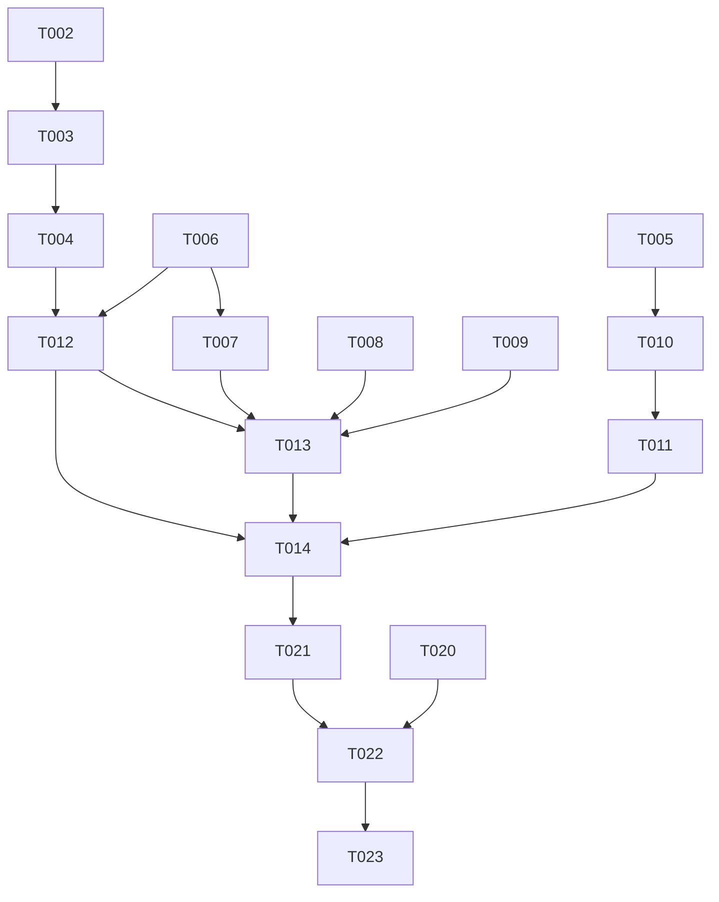

# Tasks: 校园网接入（网络信息查询、设备注销与验证码登录）

**Input**: Design documents from `harmony/entry/src/main/ets/pages/campus/campus-network/`
**Prerequisites**: plan.md（已批准，含修订）, spec.md（5 个用户故事 US1/US5/US2/US3/US4）

**Tests**: 本特性未要求自动化测试（沿用项目既有流程：`arkts_check` + 构建 + 人工 UI 验证），故不生成测试任务。

**Organization**: 任务按用户故事分组。**标 `[X]` 者为上一轮已交付并验证的部分**；本轮增量（图片验证码登录：共享能力 + 服务 + 页面）为 `[ ]`；任务 ID 按执行顺序重排。

## Format: `[ID] [P?] [Story] Description`

- **[P]**: 可并行（不同文件、无未完成依赖）
- **[Story]**: 所属用户故事（US1/US5/US2/US3/US4）；Setup / Foundational / Polish / Verification 阶段不加故事标签
- 所有路径相对工作区根（`harmony/...`）

## Path Conventions

- 共享能力：`harmony/entry/src/main/ets/services/`、`harmony/entry/src/main/ets/utils/`
- 服务层：`harmony/entry/src/main/ets/services/campus/`
- 页面层：`harmony/entry/src/main/ets/pages/campus/`
- 本特性产物：`harmony/entry/src/main/ets/pages/campus/campus-network/`

---

## Phase 1: Setup

**Purpose**: 确认改造基线（既有项目增量特性）

- [X] T001 核对既有接线与依赖基线：`harmony/entry/src/main/ets/pages/campus/NetworkPage.ets`（占位页）、`harmony/entry/src/main/ets/pages/CampusPage.ets`（分发已接线）、`harmony/entry/src/main/ets/services/HttpClient.ets`（`get`/`postForm`）、`harmony/entry/src/main/ets/services/auth/SessionManager.ets`（`getAuthService`/`getHttpClient`）

---

## Phase 2: Foundational (Blocking Prerequisites)

**Purpose**: 模型/解析/快照（上轮已交付）+ 验证码登录所需共享能力（本轮新增）

**⚠️ CRITICAL**: 本阶段完成前，任何用户故事均不可开始

- [X] T002 新建 `harmony/entry/src/main/ets/services/campus/CampusNetworkService.ets`：模型类 `NetworkBalance`/`NetworkAccountInfo`/`NetworkDevice`/`NetworkSnapshot`/`NetworkLogoutResult`、`NetworkCaptchaRequiredError`（code `NETWORK_CAPTCHA_REQUIRED`）与判别辅助、端点常量
- [X] T003 在 `harmony/entry/src/main/ets/services/campus/CampusNetworkService.ets` 实现正则解析辅助与会话探测（命中 WebVPN 登录页标记 → 会话失效；命中验证码标记 → 抛 `NetworkCaptchaRequiredError`）
- [X] T004 在 `harmony/entry/src/main/ets/services/campus/CampusNetworkService.ets` 实现 `getNetworkSnapshot()`（探测 → 首页余额/设备/状态 → 账户表 → 允许设备数 → 组装；包 `withSessionRecovery(..., 'campus-network')`）
- [X] T005 在 `harmony/entry/src/main/ets/services/auth/SessionManager.ets` 新增 `static getNetworkService(): CampusNetworkService` 单例
- [X] T006 在 `harmony/entry/src/main/ets/services/HttpClient.ets` 新增 `getBytes(url: string): Promise<Uint8Array>`：复用既有会话与 Cookie 注入（含手动重定向），返回响应体**原始字节**（验证码图片用，避免文本解码损坏）
- [X] T007 在 `harmony/entry/src/main/ets/services/HttpClient.ets` 新增 `postFormWithHeaders(url: string, formData: Record<string, string>, extraHeaders: Record<string, string>): Promise<HttpResponse>`：表单编码与既有 `postForm` 一致，附加自定义请求头（`X-CSRF-Token`/`X-Requested-With` 等）；**不改动既有 `postForm` 签名**（依赖 T006，同文件串行）
- [X] T008 [P] 在 `harmony/entry/src/main/ets/utils/CryptoUtils.ets` 新增 `rsaEncryptPkcs1(plainText: string, publicKeyPem: string): string`：PEM → DER → 公钥对象 → PKCS#1 v1.5 加密 → Base64 输出（密钥长度按实际推导/回退处理）
- [X] T009 [P] 在 `harmony/entry/src/main/ets/services/campus/CampusDataService.ets` 新增 `roamByYyfwidHtml(yyfwid: string): Promise<string>`：复用既有漫游逻辑，返回漫游落点页 HTML；失败返回空串（不抛）；**既有 `roamByYyfwid` 保持不变**

**Checkpoint**: 共享能力就绪，验证码登录流程可实现

---

## Phase 3: User Story 1 - 查看校园网账户余额与用量 (Priority: P1) 🎯 MVP

**Goal**: 打开"校园 → 校园网络"即见余额卡（产品名、已用流量、已用时长、账户余额、结算日期）

**Independent Test**: 打开页面即可看到余额卡数值，无需任何交互

- [X] T010 [US1] 改造 `harmony/entry/src/main/ets/pages/campus/NetworkPage.ets`：真实/演示双模式、`aboutToAppear` 加载、余额/用量 Hero 卡、右上角"刷新"
- [X] T011 [US1] 在 `harmony/entry/src/main/ets/pages/campus/NetworkPage.ets` 补齐加载/错误/重试态（可读中文错误 + 重试）

**Checkpoint**: US1 可独立演示

---

## Phase 4: User Story 5 - 图片验证码登录后载入数据 (Priority: P2)

**Goal**: 服务端要求验证码时，页内展示图片验证码；用户填写提交后自动载入真实数据

**Independent Test**: 在需要验证码的环境打开页面即见验证码图片；填入正确验证码提交后，页面自动出现余额/账户/设备数据

- [X] T012 [US5] 在 `harmony/entry/src/main/ets/services/campus/CampusNetworkService.ets` 实现 `fetchCaptchaImage(): Promise<string>`：`getBytes` 取验证码图片原始字节 → Base64 data URI（随机查询参数规避缓存）；取图失败抛可读错误（依赖 T004、T006）
- [X] T013 [US5] 在 `harmony/entry/src/main/ets/services/campus/CampusNetworkService.ets` 实现 `loginNetworkWithCaptcha(code: string): Promise<void>`：解析登录页 CSRF 与公开密钥（正则）→ `CampusDataService.roamByYyfwidHtml` 解析账号名（邮箱前缀）→ `rsaEncryptPkcs1` 加密密码 → `postFormWithHeaders` 校验用户（`X-CSRF-Token`/`X-Requested-With`）→ 提交登录表单 → 复探测确认；错误（含验证码错误/参数缺失/账号名失败）抛出可读错误（依赖 T007、T008、T009、T012）
- [X] T014 [US5] 在 `harmony/entry/src/main/ets/pages/campus/NetworkPage.ets` 新增页内验证码登录区块：说明文案 + 验证码图片 + 输入框 + "提交" + "换一张"；进入验证码态自动取图；提交中禁用按钮；成功后自动重载并退出验证码态；失败时提示 + **自动换图** + 清空输入（依赖 T011、T012、T013）

**Checkpoint**: US5 可独立验证（验证码登录后数据可见）

---

## Phase 5: User Story 2 - 查看校园网账户信息 (Priority: P3)

**Goal**: 展示账户资料 9 项（用户名、联系邮箱、联系电话、固定电话、真实姓名、用户组、状态、所在位置、允许在线设备数）

**Independent Test**: 加载完成即读到各字段；缺失字段显示"—"

- [X] T015 [US2] 在 `harmony/entry/src/main/ets/pages/campus/NetworkPage.ets` 增加账户信息区块（InfoRow 组，9 字段，"—" 兜底）

**Checkpoint**: US1 + US2 + US5 均可独立工作

---

## Phase 6: User Story 3 - 查看在线设备列表 (Priority: P4)

**Goal**: 逐条展示在线设备（IPv4、IPv6、登录时间、权限、MAC）；无设备时展示空态

**Independent Test**: 加载完成即看到设备明细；无设备时看到空态提示

- [X] T016 [US3] 在 `harmony/entry/src/main/ets/pages/campus/NetworkPage.ets` 增加在线设备列表与空态，使用稳定 ForEach key

**Checkpoint**: US1/US2/US3/US5 均可独立工作

---

## Phase 7: User Story 4 - 注销在线设备 (Priority: P5)

**Goal**: 对单台在线设备执行注销，需二次确认；成功提示并刷新，失败展示服务端原因

**Independent Test**: 对任一在线设备点击注销，观察确认弹窗 → 结果提示 → 列表刷新

- [X] T017 [US4] 在 `harmony/entry/src/main/ets/services/campus/CampusNetworkService.ets` 实现 `logoutNetworkDevice(key: number, mac: string): Promise<NetworkLogoutResult>`（探测 + 取 CSRF + `postForm` + 成功标记判定）
- [X] T018 [US4] 在 `harmony/entry/src/main/ets/pages/campus/NetworkPage.ets` 增加"注销"按钮与交互（`AlertDialog.show` 二次确认 + 行内 busy + toast + 重载）

**Checkpoint**: 全部用户故事均可独立工作

---

## Phase 8: Polish & Cross-Cutting Concerns

**Purpose**: 跨故事的质量收口

- [X] T019 [P] 走查 `harmony/entry/src/main/ets/pages/campus/NetworkPage.ets`：卡片右缘不溢出、演示模式零网络请求、中文 UI 文案风格一致
- [X] T020 [P] 更新 `harmony/DEVELOPMENT.md`：补充"校园网图片验证码登录"进展（修改记录），并更新待办
- [X] T021 对 `harmony/entry/src/main/ets/services/campus/CampusNetworkService.ets`、`harmony/entry/src/main/ets/pages/campus/NetworkPage.ets`、`harmony/entry/src/main/ets/services/HttpClient.ets`、`harmony/entry/src/main/ets/utils/CryptoUtils.ets`、`harmony/entry/src/main/ets/services/campus/CampusDataService.ets`、`harmony/entry/src/main/ets/services/auth/SessionManager.ets` 运行 `arkts_check` 并修复全部 ArkTS 严格模式违规（唯一允许噪声：`Logger.ets` 的 `BuildProfile` 已知误报）

---

## Phase 9: Verification

<!-- verification_scope: build-only -->

**Purpose**: 构建并部署（本轮不做自动化 UI 验证——验证码需人工识图，将由用户实测）

- [X] T022 构建工程并修复编译错误（`devecocli build --modules entry`，迭代 修复 → 构建 直至成功）
- [X] T023 部署到模拟器（`devecocli run --skip-build --device 127.0.0.1:5555`，必要时先唤醒屏幕）

---

## Dependencies & Execution Order

### Phase Dependencies

- **Setup (Phase 1)**: 无依赖
- **Foundational (Phase 2)**: T002–T005（已完成）→ T006 → T007；T008/T009 可与 T006/T007 并行
- **User Stories (Phase 3–7)**: US1 已完成；**US5（本轮增量）依赖 Foundational 的 T006–T009 与 US1 的 T011**；US2/US3/US4 已完成
- **Polish (Phase 8)**: 依赖本轮增量代码完成
- **Verification (Phase 9)**: 依赖全部代码改动完成

### User Story Dependencies

- **US1 (P1)**: 已完成，无依赖
- **US5 (P2)**: 依赖 T006–T009（共享能力）与 T011（页面加载/错误态）；本轮核心增量
- **US2 (P3)**: 已完成
- **US3 (P4)**: 已完成
- **US4 (P5)**: 已完成

### Within Each User Story

- 共享能力 → 服务方法 → 页面区块 → 交互
- 同文件任务串行（`HttpClient.ets` 的 T006/T007；`CampusNetworkService.ets` 的 T012/T013；`NetworkPage.ets` 的 T014）

### Parallel Opportunities

- T008 与 T009 可与 T006/T007 并行（不同文件）
- T020 与 T021 中"文档更新"部分可并行

### Dependency Graph

---

## Parallel Example

| Phase | Tasks | Required Files | Execution Notes |
|-------|-------|----------------|-----------------|
| Foundational（本轮） | T006 → T007；T008 [P]；T009 [P] | `HttpClient.ets`, `CryptoUtils.ets`, `CampusDataService.ets` | T006/T007 同文件串行；T008/T009 不同文件可并行 |
| US5（本轮） | T012 → T013 → T014 | `CampusNetworkService.ets`, `NetworkPage.ets` | 服务层同文件串行；T014 依赖服务两方法与页面既有骨架 |
| Polish | T020 [P] → T021 | `DEVELOPMENT.md`, 全量 | T020 文档可与 T021 代码检查并行，T021 需在代码改动后 |
| Verification | T022 → T023 | 全工程 | 严格串行（构建 → 部署） |

---

## Implementation Strategy

### 本轮增量（验证码登录）

1. 完成 Foundational 增量（T006–T009：共享能力）
2. 完成 US5（T012–T014：服务两方法 + 页面验证码区块）
3. 完成 Polish（T020–T021）
4. 构建 + 部署（T022–T023），交由用户用真实账号实测验证码登录

### 已交付部分（上一轮）

- Setup / Foundational（T001–T005）/ US1（T010–T011）/ US2（T015）/ US3（T016）/ US4（T017–T018）/ 部分 Polish（T019）——均已实现、构建通过并（演示模式下）验证

---

## Notes

- [P] 任务 = 不同文件且无未完成依赖
- 全部任务已交付并验证；历史“本轮增量”已闭环
- 同文件任务必须串行，避免冲突
- 本轮验证范围为 **build-only**：自动化 UI 验证不做（验证码需人工识图），由用户实测确认

### Summary

- **总任务数**: 23（T001–T023），全部完成；历史“本轮待办 8/9 项”已闭环
- **每故事任务数（全量）**: US1 = 2 · US5 = 3 · US2 = 1 · US3 = 1 · US4 = 2
- **并行机会**: T008/T009 可与 T006/T007 并行；T020 与 T021 并行
- **独立测试标准**: US1 见余额卡；US5 需验证码环境：进入即见验证码图 → 填入正确验证码提交 → 自动载入余额/账户/设备；US2 账户 9 字段；US3 设备列表/空态；US4 注销确认 → 提示 → 刷新
- **建议范围**: 本轮仅交付增量（验证码登录），并在 build+部署后由用户实测
