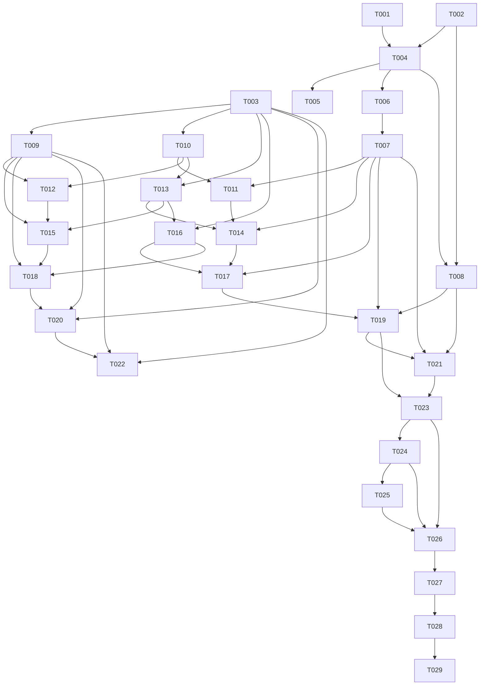

# Tasks: 选课系统服务（CourseRegService）

**Input**: Design documents from `harmony/specs/course-registration-service/`
**Prerequisites**: `plan.md`（必需）、`spec.md`（用户故事与验收口径）

**Tests**: 本 feature 不引入测试框架；按用户确认，包含纯解析函数的 fixture 自测（`CourseRegSelfTest`），不包含网络集成测试。选课/退课真实增删因当前非开放时段推迟。

**Organization**: 任务按用户故事分组，每个故事可独立实现与验证；同一文件内的任务按顺序执行，不标 `[P]`。

## Format: `[ID] [P?] [Story] Description`

- **[P]**: 可并行（不同文件、无未完成依赖）
- **[Story]**: 所属用户故事（US1–US5）；Setup/Foundational/Polish/Verification 不带故事标签
- 每个任务包含精确文件路径

## Path Conventions

- 源码根：`harmony/entry/src/main/ets/`
- 所有路径相对仓库根 `D:\Develop\campus_os\campus-os\`
- 只修改 `harmony/`；`../src` 与 `../android` 只读对照

---

## Phase 1: Setup (Shared Infrastructure)

**Purpose**: 共享类型、文案键与解析原语；为所有用户故事提供编译基础。

- [X] T001 [P] 在 `harmony/entry/src/main/ets/utils/I18n.ets` 的 `SETTINGS_DICTIONARY` 中新增 `courseReg.error.*` 全部文案键（12 个，中英双语），不改变 `I18n.t()` / `tp()` 行为
- [X] T002 [P] 将 `harmony/entry/src/main/ets/domain/CourseRegTypes.ets` 的占位类替换为 RN 对齐模型：`CrSemester`、`SelectedCourse`、`CrRemainingInfo`、`CrRemainingSearchResult`、`CourseSearchParams`、`SelectCourseParams`、`DropCourseParams`、`CourseRegPriority`、`CourseRegErrorCode`、`CourseRegError`、`CourseRegI18n`
- [X] T003 [P] 新建 `harmony/entry/src/main/ets/utils/CourseRegHtml.ets`，实现共享文本与表单原语：`stripHtml`、`decodeHtmlEntities`、`extractFormToken`（属性顺序无关）、`extractShowMsg`、`isLoginPage`

---

## Phase 2: Foundational (Blocking Prerequisites)

**Purpose**: 服务骨架、会话激活、错误归一、解析自测入口；所有用户故事的前置条件。

**⚠️ CRITICAL**: 本阶段完成前，不开始任何用户故事实现。

- [X] T004 新建 `harmony/entry/src/main/ets/services/campus/CourseRegService.ets`：类骨架、构造函数（`HttpClient` + `TsinghuaAuthService`）、`resetSessionState()`、错误归一辅助、详情脱敏/截断、日志辅助；不实现任何用户故事方法
- [X] T005 在 `harmony/entry/src/main/ets/services/auth/SessionManager.ets` 中新增 `CourseRegService` 导入、静态字段、`getCourseRegService()` 与复位登记（判空 + try/catch），不改动既有服务行为
- [X] T006 在 `harmony/entry/src/main/ets/services/campus/CourseRegService.ets` 中实现会话激活：空 yyfwid 默认漫游（webvpn csrf → `onlineAppRedirect` → `roamingurl` → 落点页）→ 失败或落回登录页时回退 `roamIdSubsystem(INFO_PORTAL_YYFWID)`；进程内缓存 `crSessionEnsured`
- [X] T007 在 `harmony/entry/src/main/ets/services/campus/CourseRegService.ets` 中实现只读会话包装与响应归一：`withSessionRecovery` 包装、HTTP 200/201 判定、登录页/超时页检测、`CourseRegError` 映射
- [X] T008 在 `harmony/entry/src/main/ets/services/campus/CourseRegService.ets` 中实现参数校验与写操作结果分类辅助：学期/课程号/课序号非空、优先级 `bx/xx/rx/ty`、志愿 1/2/3、页码 ≥1；成功/拒绝/未确认文案分类
- [X] T009 新建 `harmony/entry/src/main/ets/utils/CourseRegSelfTest.ets` 并在 `harmony/entry/src/main/ets/utils/Phase4SelfTest.ets` 的 `runPhase4SelfTest()` 中调用；自测只使用内嵌 fixture，不发起网络请求

**Checkpoint**: 服务骨架可编译、会话激活与错误契约就绪、自测入口可运行；用户故事实现可以开始。

---

## Phase 3: User Story 1 - 查询可选学期 (Priority: P1) 🎯 MVP

**Goal**: 返回选课系统提供的学期 ID 与名称，作为其余接口的输入。

**Independent Test**: 真实登录后调用 `getAvailableSemesters()`，返回至少一个学期；未登录/会话失效返回 `NOT_LOGGED_IN` / `SESSION_EXPIRED`，不返回空成功。

- [X] T010 [US1] 在 `harmony/entry/src/main/ets/utils/CourseRegHtml.ets` 中实现 `parseSemesters(mainHtml, treeHtml)`：主页面提取基础学期，树页面解析 `<option value>`，丢弃空值
- [X] T011 [US1] 在 `harmony/entry/src/main/ets/services/campus/CourseRegService.ets` 中实现 `getAvailableSemesters()`：复用只读会话包装，主页面 + 学期树两次 GET，空结果映射 `NO_SEMESTER`
- [X] T012 [US1] 在 `harmony/entry/src/main/ets/utils/CourseRegSelfTest.ets` 中新增学期解析 fixture（正常选项、空选项、缺失基础学期）并断言

**Checkpoint**: US1 可独立验证；MVP 范围（Setup + Foundational + US1）完成。

---

## Phase 4: User Story 2 - 查看已选课程 (Priority: P1)

**Goal**: 按学期返回已选课程完整字段；空学期返回空列表。

**Independent Test**: 真实登录后对有效学期调用 `getSelectedCourses()`，字段完整；对无课程学期返回 `[]`；会话失效返回结构化错误。

- [X] T013 [US2] 在 `harmony/entry/src/main/ets/utils/CourseRegHtml.ets` 中实现 `parseSelected(html)`：解析 `.trr2` / `.tdd2` 行，<9 列跳过，志愿文本映射 1/2/3，二级选课按“是”映射
- [X] T014 [US2] 在 `harmony/entry/src/main/ets/services/campus/CourseRegService.ets` 中实现 `getSelectedCourses(semesterId)`：参数校验、只读会话包装、空列表与失败区分
- [X] T015 [US2] 在 `harmony/entry/src/main/ets/utils/CourseRegSelfTest.ets` 中新增已选课程 fixture（正常行、空列表、缺列坏行、志愿文本映射）并断言

**Checkpoint**: US2 可独立验证；与 US1 共享会话/错误基础设施，但可单独演示。

---

## Phase 5: User Story 3 - 课余量搜索 (Priority: P1)

**Goal**: 按学期与可选条件返回分页的课余量列表。

**Independent Test**: 真实登录后按学期搜索，分页字段与课程余量字段完整；按课程号缩小结果；无结果返回空列表与分页信息。

- [X] T016 [US3] 在 `harmony/entry/src/main/ets/utils/CourseRegHtml.ets` 中实现 `parseRemaining(html)` 与分页脚注解析：`p.yeM`、`.trr2`、`<td>` ≥6、≥8 列时插入队列列、缺脚注回退 1/1/0
- [X] T017 [US3] 在 `harmony/entry/src/main/ets/services/campus/CourseRegService.ets` 中实现 `searchRemaining(params)`：参数校验、只读会话包装、表单字段与 RN 对齐、返回分页结果
- [X] T018 [US3] 在 `harmony/entry/src/main/ets/utils/CourseRegSelfTest.ets` 中新增搜索 fixture（含队列列、不含队列列、缺脚注、坏行跳过）并断言

**Checkpoint**: US1–US3 三类只读能力全部可独立验证；服务已具备 T14 只读数据基础。

---

## Phase 6: User Story 4 - 选课 (Priority: P2)

**Goal**: 在选课开放时段提交选课，只认服务端明确成功。

**Independent Test**: 参数非法时本地拒绝且零网络请求；fixture 覆盖 token 提取与成功/失败/缺失消息；真实增删因非开放时段推迟，开放后按受控课程验证。

- [X] T019 [US4] 在 `harmony/entry/src/main/ets/services/campus/CourseRegService.ets` 中实现 `selectCourse(params)`：优先级/志愿/字段校验 → 预检 GET 取 token（可走会话恢复）→ POST 仅一次 → 解析 `showMsg` → 成功返回消息 / 明确失败 `REJECTED` / 模糊 `UNCONFIRMED`
- [X] T020 [US4] 在 `harmony/entry/src/main/ets/utils/CourseRegSelfTest.ets` 中新增选课 fixture：`input` 两种属性顺序、成功消息、拒绝消息、缺失 `showMsg`、非法优先级本地拒绝

**Checkpoint**: US4 实现完成；真实写入验证标记为“待开放时段”，不伪造成功。

---

## Phase 7: User Story 5 - 退课 (Priority: P2)

**Goal**: 在允许退课时段删除已选课程，只认服务端明确成功。

**Independent Test**: 参数非法时本地拒绝；fixture 覆盖退课响应消息；真实增删因非开放时段推迟，开放后按受控课程验证并回查已选列表。

- [X] T021 [US5] 在 `harmony/entry/src/main/ets/services/campus/CourseRegService.ets` 中实现 `dropCourse(params)`：字段校验 → 预检 GET 取 token → POST 仅一次 → 解析 `showMsg` → 成功返回消息 / 明确失败 `REJECTED` / 模糊 `UNCONFIRMED`
- [X] T022 [US5] 在 `harmony/entry/src/main/ets/utils/CourseRegSelfTest.ets` 中新增退课 fixture：已选页 token、退课成功消息、拒绝消息、缺失 `showMsg`

**Checkpoint**: US1–US5 服务能力全部实现；写操作真实验证明确挂起。

---

## Phase 8: Polish & Cross-Cutting Concerns

**Purpose**: 日志脱敏审计、文档同步、实现会话自检。

- [X] T023 [P] 审计 `harmony/entry/src/main/ets/services/campus/CourseRegService.ets` 与 `harmony/entry/src/main/ets/utils/CourseRegHtml.ets` 的全部日志/错误详情：确认不出现表单 token、Cookie、学号、密码、完整 URL；业务消息截断并剥离 HTML/控制字符
- [X] T024 [P] 更新 `docs/RN-FEATURE-SYNC.md` 选课/退课对应行：标注“服务层完成（T03），AI 工具待 T14，真实增删待开放时段”，并写入受控验证步骤（选课 → 回查已选 → 退课 → 再回查）
- [X] T025 [P] 更新 `harmony/specs/INDEX.md`：新增 `course-registration-service` 行，记录任务计数、状态与已知边界
- [X] T026 对本次新增/修改的 `.ets` 文件运行 `arkts_check` 并修复全部 ArkTS 违规（重点：`CourseRegTypes.ets`、`CourseRegHtml.ets`、`CourseRegService.ets`、`SessionManager.ets`、`I18n.ets`、`CourseRegSelfTest.ets`、`Phase4SelfTest.ets`）
- [X] T027 运行 `devecocli build` 作为实现自检（timeout ≥ 600000 ms；同一时刻只跑一条构建流水线），修复编译错误；不执行正式 Verification

---

## Phase 9: Verification (Build + Deploy)

<!-- verification_scope: build-only -->

**Purpose**: 构建与部署验证；本 feature 无页面 UI，不执行 UI 验证。

- [X] T028 构建项目并修复编译错误：在 `harmony/` 内执行 `devecocli build`，迭代修复直至成功（timeout ≥ 600000 ms）
- [X] T029 部署应用到设备/模拟器：在 `harmony/` 内执行 `devecocli run --skip-build`，确认可安装启动

---

## Dependencies & Execution Order

### Phase Dependencies

- **Setup (Phase 1)**: 无依赖，可立即开始
- **Foundational (Phase 2)**: 依赖 Setup 完成；阻塞全部用户故事
- **User Stories (Phase 3–7)**: 全部依赖 Foundational 完成；按 P1 → P2 顺序串行执行（同一服务文件，避免写冲突）
- **Polish (Phase 8)**: 依赖 US4/US5 实现完成
- **Verification (Phase 9)**: 依赖 Polish 与实现自检完成

### User Story Dependencies

- **US1 (P1)**: Foundational 完成后即可开始；无其他故事依赖
- **US2 (P1)**: Foundational 完成后即可开始；与 US1 共享会话/错误基础设施，但可独立验证
- **US3 (P1)**: Foundational 完成后即可开始；不依赖 US1/US2 的业务方法
- **US4 (P2)**: 依赖 Foundational 的写操作分类与只读会话包装；不依赖 US1–US3 的返回值
- **US5 (P2)**: 依赖 Foundational 的写操作分类与只读会话包装；与 US4 同文件，需在 US4 之后执行

### Within Each User Story

- 解析函数先于服务方法
- 服务方法先于 fixture 自测
- 会话/错误辅助必须在故事方法之前完成
- 每个 story 完成后再进入下一个优先级

## 📊 Dependency Graph



## ⚡ Parallel Execution Guide

| Phase | Tasks | Required Files | Execution Notes |
|---|---|---|---|
| Setup | T001, T002, T003 | `I18n.ets`, `CourseRegTypes.ets`, `CourseRegHtml.ets` | 三个不同文件，可并行 |
| Foundational | T004 → T005 → T006 → T007 → T008；T009 可与 T004–T008 并行 | `CourseRegService.ets`, `SessionManager.ets`, `CourseRegSelfTest.ets`, `Phase4SelfTest.ets` | 服务文件内任务串行；T009 仅依赖 T003 |
| US1 | T010 → T011 → T012 | `CourseRegHtml.ets`, `CourseRegService.ets`, `CourseRegSelfTest.ets` | 同文件任务串行；T012 可在 T010 后与 T011 并行 |
| US2 | T013 → T014 → T015 | 同上 | 同文件任务串行；T015 可在 T013 后与 T014 并行 |
| US3 | T016 → T017 → T018 | 同上 | 同文件任务串行；T018 可在 T016 后与 T017 并行 |
| US4 | T019 → T020 | `CourseRegService.ets`, `CourseRegSelfTest.ets` | T020 只依赖 T003/T009，可与 T019 并行 |
| US5 | T021 → T022 | 同上 | T022 只依赖 T003/T009，可与 T021 并行；T021 必须在 T019 后（同文件） |
| Polish | T023, T024, T025（并行）→ T026 → T027 | 源码 + 两份文档 | 三个不同文件可并行；检查任务串行 |
| Verification | T028 → T029 | — | 构建成功后再部署 |

---

## Parallel Example: User Story 1

```bash
# US1 的解析函数与服务方法分属不同文件，可按依赖并行准备：
Task: "T010 在 CourseRegHtml.ets 实现 parseSemesters"
Task: "T011 在 CourseRegService.ets 实现 getAvailableSemesters（依赖 T007/T010）"
Task: "T012 在 CourseRegSelfTest.ets 新增学期 fixture（依赖 T009/T010）"
```

---

## Implementation Strategy

### MVP First (User Story 1 Only)

1. 完成 Phase 1：Setup
2. 完成 Phase 2：Foundational（阻塞全部故事）
3. 完成 Phase 3：US1 查询学期
4. **STOP and VALIDATE**：真实登录调用学期接口，确认返回与错误路径
5. 可独立演示学期列表能力

### Incremental Delivery

1. Setup + Foundational → 服务骨架、会话、错误契约就绪
2. US1 → 学期列表可验证
3. US2 → 已选课程可验证
4. US3 → 课余量搜索可验证（T14 只读数据基础完成）
5. US4/US5 → 写操作实现完成，真实增删待开放时段
6. Polish → 日志审计、文档同步、静态检查
7. Verification → 构建 + 部署

### Parallel Team Strategy

本 feature 主要落在 `CourseRegService.ets` 单文件，多人并行收益有限。可按以下边界拆分：

- 开发者 A：`CourseRegHtml.ets` 解析函数 + `CourseRegSelfTest.ets` fixture
- 开发者 B：`CourseRegService.ets` 会话/错误/只读方法
- 开发者 C：`I18n.ets` 文案键 + `SessionManager.ets` 单例登记
- 写操作（US4/US5）由同一人串行完成，避免 POST 逻辑冲突

---

## Notes

- **写操作验证挂起**：当前非选课开放时段，T019/T021 的真实增删不执行。开放后按以下受控步骤验证：① 选一门可安全退选的课程；② `selectCourse` → 回查 `getSelectedCourses`；③ `dropCourse` → 再回查确认删除；④ 记录服务端消息与错误码。
- **高危文件回归**：修改 `SessionManager.ets` 后按 `tsinghua-auth` 技能清单检查冷启动自动登录、重登录后 learn 数据、退出复位；该文件只允许加法式改动。
- **日志红线**：`CourseReg` tag 下不得出现表单 token、Cookie、学号、密码、完整 WebVPN URL；`detail` 必须脱敏、截断。
- **GBK 关注点**：响应解码依赖 `HttpClient` 的 `cr_xk` token 标记；中文课程名搜索若线上异常，先记录为已知限制，不在本任务中擅自改请求编码。
- **不修改 RN 侧**：`../src`、`../android` 只读；选课服务端点与 token 从 RN 源码原样移植。
- **文档同步**：完成实现后必须更新 `docs/RN-FEATURE-SYNC.md` 与 `harmony/specs/INDEX.md`，不得只改 `tasks.md` 复选框。
- **评审修复（2026-10-19，2 阻断 + 14 应修）**：B1 自测 `stripHtml` fixture 改为 `&nbsp;&amp;&nbsp;`（期望 `数据结构 & 算法` 成立，未动生产代码）；B2 新增页面结构识别（`isSelectedPage`/`isRemainingPage` + `parseSelectedPage`/`parseRemainingPage`，未命中标记的 200 HTML 抛 `PARSE`，FR-019）；应修 1–14：6 列行越界保护、坏行 `skipped` 计数与日志、`redactSensitive` 脱敏（URL/token/hex/学号）+ 网络异常固定文案、`ensureCrSession` single-flight（`crEnsureInFlight`）、`NOT_LOGGED_IN` 改不可重试 + 门户兜底网络失败映射 `NETWORK`、解析与 `NO_SEMESTER` 判定移出 `withSessionRecovery`、`parseSemesters` 跳过空名称、`CR_SM2_MARK` 改 `sm2publicKey`（兼容单引号）、Phase4 汇总日志输出 CourseReg passed/failed、dayOfWeek/period 整数校验、FR-014→FR-020 注释、补 fieldKey/saveMethod/parseCrUrlToWebVPN/6 列/单引号 sm2/错误页 vs 合法空页 fixtures、`trR2SegmentEnd` 泛化为自身闭合标签截断；page 默认值保留 `1`（RN 未传时发 `-1`，待真机只读验证对比）。修复后 `arkts_check` 0 error、`devecocli build` 成功。
- **评审修复（2026-10-19，第二轮 7 应修）**：① 门户兜底网络判定改 `e instanceof HttpError`（HttpClient 网络异常统一包装形态，删除 `BusinessError` 数字 code 探测）；默认漫游为可重试失败而门户流程也失败时保留原可重试分类（`defaultRoamError.retryable` 时不降级 `NOT_LOGGED_IN`）。② `ensureCrSession` single-flight 加固：新增 `crEnsureEpoch`（`resetSessionState()` 自增作废在途任务回写）；等待者统一承接在途失败（不再各自重跑）；`finally` 仅在 `crEnsureInFlight === task` 时清空；`force` 先等在途再强制重激活。③ `WEBVPN_CSRF` 异常日志改固定文案（`e.message` 可能透传响应体/URL，FR-013）。④ 容器分支 `<td` gate 改 `/<td\b/i`（大写 `<TD>` 不再被当纯 th 行跳过）。⑤ 闭合标签匹配改 `findSelfCloseEnd`（大小写不敏感 + 同名标签嵌套深度归零，嵌套 `<table>` 不在内层闭合处提前截断）。⑥ 识别启发式收紧：`isSelectedPage` 要求 trr2/yxSearchTab/tokenPriFlag 强标记（`name="token"` 仅辅助）；`isRemainingPage` 要求 yeM/trr2 强标记（pathContent/"课余量" 仅辅助）。⑦ `redactSensitive` 迁至 `utils/CourseRegHtml.ets` 导出（可独立测试；10 位数字规则为安全优先的过度脱敏，已在注释记录）。fixtures 62→70（补大写 TD/大写闭合/嵌套同名 table/token-only/pathContent-only 错误页/redactSensitive 全套）。修复后 `arkts_check` 0 error、`devecocli build` 成功。
- **提交纪律**：不要自行提交/推送；如需提交，按项目 Conventional Commits 与 scope 白名单执行。
