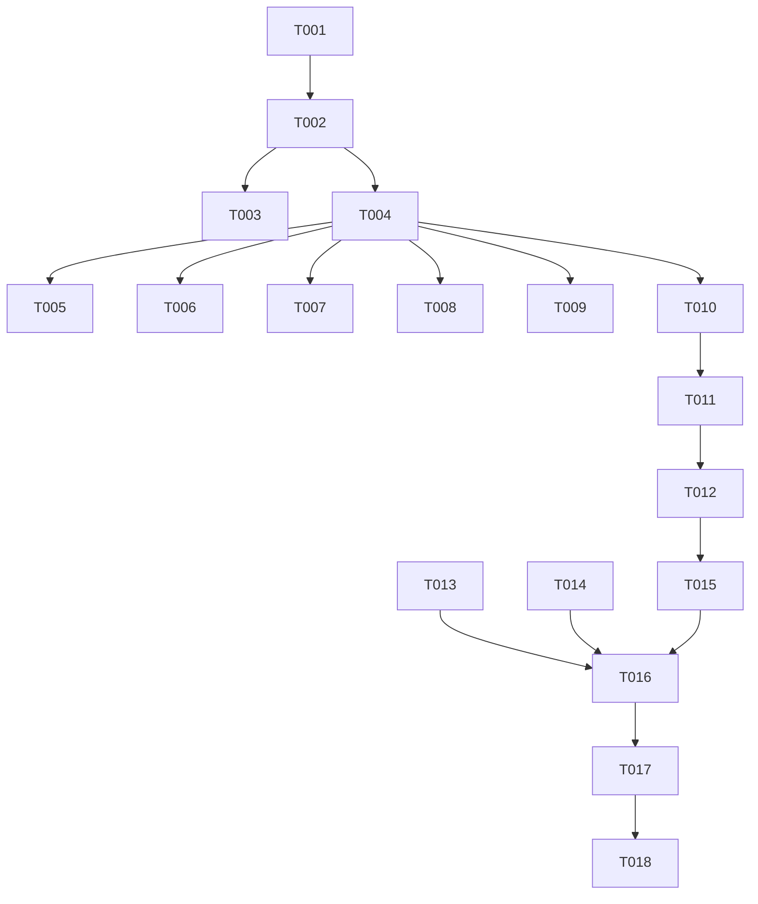

# Tasks: i18n 后续迁移（核心骨架 + 高频页）

**Input**: Design documents from `harmony/entry/src/main/ets/utils/i18n-migration/`
**Prerequisites**: plan.md（已批准）, spec.md（4 个用户故事 P1–P4）

**Tests**: 本特性未要求自动化测试（沿用项目既有流程：`arkts_check` + 构建 + 模拟器 UI 验证），故不生成测试任务。

**Organization**: 按用户故事分组；**须先于 `schedule-visual` 实施**（其 `schedule.*` 词典键为 F1 所依赖）。

> **状态回填（2026-10-19）**：T001–T015 已按源码与验证结果回填为 `[X]`。
> T011 的实际实现为“通用态 `status.*` + 页面特有态页面级键”；
> T012 的“未迁移页面不引入 `t()/tr()`”已被后续 `i18n-batch2` 取代；
> T015 已对 `I18n.ets` 及 7 个页面运行 `arkts_check`，结果 0 error。

## Format: `[ID] [P?] [Story] Description`

- **[P]**: 可并行（不同文件、无未完成依赖）
- **[Story]**: 所属用户故事（US1–US4）；Setup / Foundational / Polish / Verification 阶段不加故事标签
- 所有路径相对工作区根（`harmony/...`）

## Path Conventions

- 框架：`harmony/entry/src/main/ets/utils/`
- 页面：`harmony/entry/src/main/ets/pages/`
- 本特性产物：`harmony/entry/src/main/ets/utils/i18n-migration/`

---

## Phase 1: Setup

**Purpose**: 确认框架现状与待迁移文案分布

- [X] T001 核对基线与文案清单：`harmony/entry/src/main/ets/utils/I18n.ets`（词典前缀/回退链/`t(key, locale?)` 重载）、`AppStorage 'locale'` 订阅方式、`pages/SettingsPage.ets` 已验证的 `tr()` 范式；逐个列出待迁移文件的**用户可见静态文案**：`pages/Index.ets`（底部导航）、`pages/HomePage.ets`（+ `pages/HomeData.ets`）、`pages/LearningPage.ets`（+ `pages/LearningData.ets`）、`pages/SchedulePage.ets`、`pages/CampusPage.ets`、`pages/ai/AIChatPage.ets`、`pages/LoginPage.ets`；确认 `components/Ui` 组件文案均由调用方传入

---

## Phase 2: Foundational (Blocking Prerequisites)

**Purpose**: 词典扩展与参数化翻译——所有用户故事的前置

**⚠️ CRITICAL**: 本阶段完成前，任何页面迁移均不可开始

- [X] T002 改造 `harmony/entry/src/main/ets/utils/I18n.ets`：①按**页面前缀**扩词典（`nav.*` / `home.*` / `learning.*` / `schedule.*` / `campus.*` / `ai.*` / `login.*` / `status.*` / `common.*`），条目 **zh/en 成对**；②新增 `static tp(key: string, args: Record<string, string>): string`（`{name}` **安全替换**；缺参保留占位符原文；复用既有回退链）；③保持既有 `t/setLocale/getLocale` 语义不变

**Checkpoint**: 词典与参数化就绪，页面可迁移

---

## Phase 3: User Story 1 - 底部导航与页面标题双语 (Priority: P1) 🎯 MVP

**Goal**: 底部导航与各页标题/副标题随语言即时切换

**Independent Test**: 切 English 后底部导航与各页标题为英文；切回中文即时恢复

- [X] T003 [US1] 改造 `harmony/entry/src/main/ets/pages/Index.ets`：底部导航标签改用 `tr('nav.*')` + `@StorageLink('locale')`（依赖 T002）
- [X] T004 [US1] 改造各页头部文案为 `tr()` 并加 `@StorageLink('locale')`：`pages/HomePage.ets`、`pages/LearningPage.ets`、`pages/SchedulePage.ets`、`pages/CampusPage.ets`、`pages/ai/AIChatPage.ets`（依赖 T002）

**Checkpoint**: US1 可独立验证（骨架文案双语）

---

## Phase 4: User Story 2 - 高频页文案双语 (Priority: P2)

**Goal**: 六个高频页的静态文案（区块名、按钮、行标签、占位）迁移并随语言切换

**Independent Test**: 逐页切 English，页面内**无残留中文**（业务数据除外）

- [X] T005 [US2] 迁移 `harmony/entry/src/main/ets/pages/HomePage.ets`（含 `pages/HomeData.ets` 中的 **UI 文案**；函数签名不变）（依赖 T004）
- [X] T006 [US2] 迁移 `harmony/entry/src/main/ets/pages/LearningPage.ets`（含 `pages/LearningData.ets` 中的 **UI 文案**）（依赖 T004）
- [X] T007 [US2] 迁移 `harmony/entry/src/main/ets/pages/CampusPage.ets`（入口标题/副标题/状态文案）（依赖 T004）
- [X] T008 [US2] 迁移 `harmony/entry/src/main/ets/pages/ai/AIChatPage.ets`（依赖 T004）
- [X] T009 [US2] 迁移 `harmony/entry/src/main/ets/pages/LoginPage.ets`（并顺带清理页面内**弃用提示 API**）（依赖 T004）
- [X] T010 [US2] 迁移 `harmony/entry/src/main/ets/pages/SchedulePage.ets` 静态文案（与 `schedule-visual` 协同：键名与本特性词典一致；若 F1 先改结构，此处仅换文案）（依赖 T004）

**Checkpoint**: US1 + US2 均可独立验证

---

## Phase 5: User Story 3 - 状态与错误文案双语 (Priority: P3)

**Goal**: 加载中/空态/失败/重试/演示提示随语言切换

**Independent Test**: English 下触发加载/空态/错误或演示模式，提示均为英文

- [X] T011 [US3] 将首批页面的状态类文案统一走 i18n 键（通用态 `status.*`，页面特有态用 `home.*`/`learning.*`/`schedule.*`/`ai.*`/`login.*`）（覆盖 `HomePage`/`LearningPage`/`SchedulePage`/`CampusPage`/`AIChatPage`/`LoginPage` 的加载、空态、失败、重试与演示提示）（依赖 T010）

**Checkpoint**: US1–US3 均可独立验证

---

## Phase 6: User Story 4 - 未迁移范围回退（不泄露键名） (Priority: P4)

**Goal**: 未迁移页面在 English 下仍为中文且无键名/空白外泄

**Independent Test**: English 下进入未迁移子页，文案为中文、无键名或空白

- [X] T012 [US4] 代码走查并确认：首批范围外页面在迁移前**未引入** `t()/tr()` 调用；后续 `i18n-batch2` 已接管校园/学习子页（原回退条件被取代）；已迁移页面的词典缺项按回退链处理（依赖 T011）

**Checkpoint**: 全部用户故事均可独立验证

---

## Phase 7: Polish & Cross-Cutting Concerns

**Purpose**: 质量与文档收口

- [X] T013 [P] 走查首批范围：**无硬编码中文残留**（静态文案）、词典 zh/en **成对**、页面内无弃用提示 API、中英文案风格与术语一致
- [X] T014 [P] 更新 `harmony/DEVELOPMENT.md`：记录 i18n 迁移批次（首批范围与键前缀）、参数化用法；下批清单已由 `i18n-batch2` 完成
- [X] T015 对 `harmony/entry/src/main/ets/utils/I18n.ets` 与 7 个迁移页面（及视需要 `HomeData.ets`/`LearningData.ets`）运行 `arkts_check` 并修复全部 ArkTS 严格模式违规（唯一允许噪声：`Logger.ets` 的 `BuildProfile` 已知误报）

---

## Phase 8: Verification

<!-- verification_scope: build+ui -->

**Purpose**: 构建、部署并逐用户故事做 UI 验证

- [X] T016 构建工程并修复编译错误（`devecocli build --modules entry`，迭代 修复 → 构建 直至成功）
- [X] T017 部署到模拟器（`devecocli run --skip-build --device 127.0.0.1:5555`，必要时先唤醒屏幕）
- [X] T018 运行 UI 验证（`verify_ui`）：US1 导航/标题双语；US2 六个高频页无残留中文；US3 状态与错误文案双语；US4 未迁移子页中文且无键名外泄；并验证**切换即时生效**与**重启后保持**

---

## Dependencies & Execution Order

### Phase Dependencies

- **Setup (Phase 1)**: 无依赖
- **Foundational (Phase 2)**: 依赖 Setup
- **US1–US4 (Phase 3–6)**: 依赖 Foundational；按 P1 → P4 顺序
- **Polish (Phase 7)**: 依赖用户故事完成
- **Verification (Phase 8)**: 依赖全部代码改动完成

### User Story Dependencies

- **US1 (P1)**: 依赖 T002
- **US2 (P2)**: 依赖 US1 的页面订阅范式（T003/T004）
- **US3 (P3)**: 依赖 US2（页面已迁移，便于统一状态文案）
- **US4 (P4)**: 依赖 US3（走查需在迁移完成后）

### Within Each User Story

- 词典 → 页面迁移 → 状态文案 → 走查
- 同一文件的任务必须串行

### Parallel Opportunities

- T013 与 T014 可并行（走查 vs 文档）

### Dependency Graph

---

## Parallel Example

| Phase | Tasks | Required Files | Execution Notes |
|-------|-------|----------------|-----------------|
| Setup | T001 | `I18n.ets`, 8 个待迁移文件（只读核对） | 单任务 |
| Foundational | T002 | `utils/I18n.ets` | 单任务（词典 + `tp()`） |
| US1 | T003；T004 | `pages/Index.ets`；`HomePage/LearningPage/SchedulePage/CampusPage/AIChatPage` | T003 与 T004 不同文件，可并行 |
| US2 | T005–T010 | 六个页面（+2 个数据文件） | 各自不同文件，可并行（本表按序列出） |
| US3 | T011 | 上述页面 | 需在 T010 后（文案已迁移） |
| US4 | T012 | 未迁移页面（只读走查） | 单任务 |
| Polish | T013 [P] ∥ T014 [P] → T015 | 页面与 `I18n.ets`, `DEVELOPMENT.md` | 走查与文档可并行 |
| Verification | T016 → T017 → T018 | 全工程 | 严格串行 |

---

## Implementation Strategy

### MVP First

1. 完成 Phase 1 + Phase 2（词典 + `tp()`）
2. 完成 Phase 3（US1：底部导航 + 页面标题双语）
3. **STOP & VALIDATE**：切换语言后骨架文案即时双语
4. 增量交付 US2 → US4

### Incremental Delivery

- Foundational 完成即具备词典与参数化能力
- 页面按批迁移，每批后独立验证；未迁移页保持中文（无键名外泄）

---

## Notes

- [P] 任务 = 不同文件且无未完成依赖
- 本特性**须先于 `schedule-visual` 实施**（其 `schedule.*` 键依赖本特性）
- 仅迁移**静态 UI 文案**；业务数据（课程名/邮件主题等）不翻译
- 首批范围外页面**不引入** `t()` 调用，以保证回退无键名外泄
- 本轮验证范围为 **build+ui**

### Summary

- **总任务数**: 18（T001–T018）
- **分阶段统计**: Setup 1 · Foundational 1 · US1 2 · US2 6 · US3 1 · US4 1 · Polish 3 · Verification 3
- **每故事任务数**: US1 = 2 · US2 = 6 · US3 = 1 · US4 = 1
- **并行机会**: T003/T004；T005–T010（不同文件）；T013/T014
- **独立测试标准**: US1 导航/标题双语；US2 六页无残留中文；US3 状态/错误文案双语；US4 未迁移页中文且无键名外泄
- **建议 MVP 范围**: Phase 1 + Phase 2 + Phase 3（US1）
