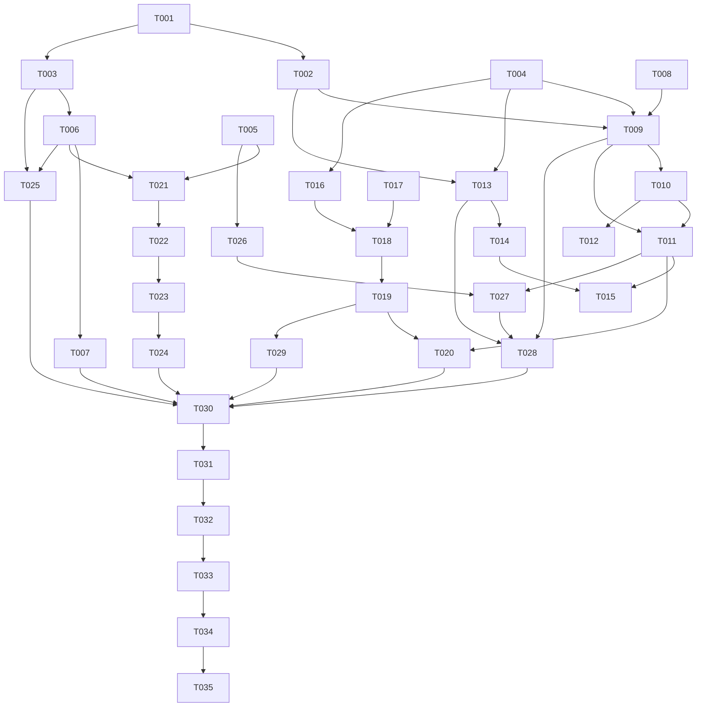

# Tasks: 学习详情深链

**Input**: Design documents from `harmony/specs/learning-detail/`
**Prerequisites**: plan.md (required), spec.md (required for user stories)

**Tests**: 本特性未要求单元/契约测试；验证以 `arkts_check` + 构建 + 模拟器 UI 验证为准。

**Organization**: 任务按用户故事分组，每个故事可独立实现与验证。

## Format: `[ID] [P?] [Story] Description`

- **[P]**: 可并行（不同文件、无未完成依赖）
- **[Story]**: 所属用户故事（US1–US5）；Setup / Foundational / Polish / Verification 不带故事标签
- 所有路径以 `D:\Develop\campus_os\campus-os\harmony\` 为根

## Path Conventions

- 源码：`entry/src/main/ets/`
- 规格：`harmony/specs/learning-detail/`

---

## Phase 1: Setup (Shared Infrastructure)

**Purpose**: 确认工程基线、补齐共享文案与时间工具

- [X] T001 加载 `hmos-arkui-develop-skill`；核对 `entry/src/main/module.json5` 已声明 INTERNET 与 GET_NETWORK_INFO，确认 `build-profile.json5` 的 compatibleSdkVersion 为 24，记录本特性无需新增权限
- [X] T002 [P] 按 `plan.md` 的「文案（i18n）」清单，在 `entry/src/main/ets/utils/I18n.ets` 增补课程分组/空态/错误、通知元信息、文件预览与下载、DDL 删除确认、演示态的中英文 key
- [X] T003 [P] 新建 `entry/src/main/ets/utils/DeadlineFormat.ets`，提供 DDL 截止文本拼装、毫秒解析与升序比较；将 `entry/src/main/ets/pages/HomePage.ets` 的页内重复实现改为调用该工具

**Checkpoint**: 文案与时间工具就绪，后续故事不再各自拼装 DDL 文本

---

## Phase 2: Foundational (Blocking Prerequisites)

**Purpose**: 数据模型外键与共享 DDL 存储，任何故事开始前必须完成

**⚠️ CRITICAL**: 本阶段完成前不得开始用户故事实现

- [X] T004 在 `entry/src/main/ets/services/campus/CampusDataService.ets` 为 `CampusNotification` 增加 `courseId`/`courseName`、为 `CampusFile` 增加 `courseId`，并在 `fetchNotifications` 与 `fetchFiles` 的课程循环中写入
- [X] T005 [P] 在 `entry/src/main/ets/pages/LearningData.ets` 为 `HomeworkItem` 增加 `id`、`manual`、`note` 字段（远程项默认非手动、空备注）
- [X] T006 新建 `entry/src/main/ets/state/ManualDeadlineStore.ets`：懒加载 `StorageKeys.MANUAL_DEADLINES`、列表/追加/删除/按 id 或标题查找、按 `date + time` 升序、变更订阅；沿用 `ManualDeadline` 现有字段与 JSON 格式，不做迁移
- [X] T007 重构 `entry/src/main/ets/services/ai/AgentWriteTools.ets`：删除私有 DDL 缓存与读写实现，改为委托 `ManualDeadlineStore`，保留 `listManualDeadlines()` 公共契约与写工具确认流程不变
- [X] T008 对 T003–T007 涉及的 `.ets` 文件运行 `arkts_check`，修复严格模式错误后再进入故事阶段（锚点：`entry/src/main/ets/state/ManualDeadlineStore.ets`）

**Checkpoint**: 模型外键与共享 DDL 存储可用，US1–US5 可开始

---

## Phase 3: User Story 1 - 课程详情聚合三类数据 (Priority: P1)

**Goal**: 课程详情展示该课程的作业/通知/资料，支持逐条下钻并在缺失时补拉一次

**Independent Test**: 进入任一课程详情，三个分组齐全且计数正确；点击任一作业/通知/资料进入对应详情，返回仍停留在课程详情

- [X] T009 [US1] 重构 `entry/src/main/ets/pages/learning/CourseDetailPage.ets`：扩展入参（课程、学期、三类数组、演示模式、三个下钻回调），在基础信息卡下渲染作业/通知/资料三个分组与各自空态
- [X] T010 [US1] 在 `entry/src/main/ets/pages/learning/CourseDetailPage.ets` 增加补拉：三类同时为空且非演示模式时并发拉取该课程作业/通知/资料，展示加载态、失败提示与重试；已尝试过不重复自动拉取
- [X] T011 [US1] 在 `entry/src/main/ets/pages/LearningPage.ets` 计算当前课程的三类过滤结果并传入 `CourseDetailPage`；新增 `detailParent` 状态，使课程内下钻的作业/通知/资料返回时回到课程详情
- [X] T012 [US1] 在 `entry/src/main/ets/pages/learning/CourseDetailPage.ets` 补齐「课程不存在或已不可用」空态与返回入口，确保索引/外键失配时不崩溃

**Checkpoint**: US1 可独立演示：课程详情三类齐全、可下钻、可返回课程

---

## Phase 4: User Story 2 - 通知正文可见 (Priority: P1)

**Goal**: 通知详情稳定展示正文；正文缺失时按课程补拉并按 id 匹配

**Independent Test**: 打开有正文的通知立即可见；打开正文为空的通知触发一次补拉，成功显示或给出可读空态/失败重试

- [X] T013 [US2] 在 `entry/src/main/ets/pages/learning/NotificationDetailPage.ets` 展示标题、所属课程、发布人、发布时间与正文，正文为空时显示明确空态
- [X] T014 [US2] 在 `entry/src/main/ets/pages/learning/NotificationDetailPage.ets` 增加正文补拉：非演示且正文为空时按 `courseId` 重拉通知列表并按 `id` 匹配；加载中/失败/重试三态齐全，不回写已读
- [X] T015 [US2] 在 `entry/src/main/ets/pages/LearningPage.ets` 打开通知详情时传入演示模式与课程上下文，确保补拉与演示跳过都能生效

**Checkpoint**: US2 可独立演示：真实通知正文可见，空正文有补拉与空态

---

## Phase 5: User Story 3 - 资料下载与预览 (Priority: P1)

**Goal**: 资料可在应用内预览、下载到私有目录并再次打开

**Independent Test**: 点击预览能看到服务端预览页；点击下载出现进度/成功提示，重进详情显示已下载并可打开；断网下载给出可读失败与重试

- [X] T016 [P] [US3] 在 `entry/src/main/ets/services/campus/CampusDataService.ets` 增加 `syncLearnCookiesForWebView()`（learn 域 Cookie 写入 ArkWeb）与 `downloadFileBytes(url)`（复用 `HttpClient.getBytes`，空 URL/网络异常抛可读错误）
- [X] T017 [P] [US3] 新建 `entry/src/main/ets/services/learning/LearningFileStore.ets`：确定性下载路径（`filesDir/learn_downloads/`、文件标识 + 清洗标题、非法字符与长度处理）、已下载探测、临时文件写入后替换、HTML 登录页嗅探、按扩展名给出 MIME
- [X] T018 [US3] 重构 `entry/src/main/ets/pages/learning/WebViewerPage.ets`：加载前同步 learn 域 Cookie 并设置桌面 UA，增加加载进度、失败提示与重试；保留标题与返回契约
- [X] T019 [US3] 重构 `entry/src/main/ets/pages/learning/FileDetailPage.ets`：预览按钮打开内嵌浏览器；下载实现 `idle/downloading/done/failed` 四态与重试；进入页面探测已下载；已下载可打开（系统预览优先、`startAbility` 回退）
- [X] T020 [US3] 在 `entry/src/main/ets/pages/LearningPage.ets` 将文件详情的预览回调接到 `WebViewerPage`，传递 `previewUrl` 与标题，并保证返回后仍停留在文件详情

**Checkpoint**: US3 可独立演示：预览、下载、已下载、重新打开四条路径可用

---

## Phase 6: User Story 4 - 手动 DDL 持久化并共享 (Priority: P1)

**Goal**: 手动 DDL 跨重启保留，学习页可增删，首页共享同一份数据

**Independent Test**: 新增 DDL 后重启应用，学习页与首页仍显示；删除后两处消失；AI 写入的 DDL 在两处出现

- [X] T021 [US4] 在 `entry/src/main/ets/pages/LearningPage.ets` 加载 `ManualDeadlineStore` 并订阅变更；将手动项与远程未提交作业合并为升序列表，计数随之更新
- [X] T022 [US4] 在 `entry/src/main/ets/pages/LearningPage.ets` 将 DDL 表单保存改为 `ManualDeadlineStore.append`：校验标题非空、日期与时间格式，成功后关闭表单、清空输入并切到作业标签
- [X] T023 [US4] 在 `entry/src/main/ets/pages/LearningPage.ets` 为手动 DDL 增加删除入口与确认弹窗，确认后调用 `ManualDeadlineStore.remove` 并刷新列表
- [X] T024 [US4] 在 `entry/src/main/ets/pages/LearningPage.ets` 完善手动 DDL 卡片：来源徽标、可选课程名/备注、过期视觉区分、删除按钮；远程作业卡片不出现删除入口
- [X] T025 [US4] 在 `entry/src/main/ets/pages/HomePage.ets` 将手动 DDL 合并进「最近 DDL」建议（真实与演示模式均生效），并订阅 store 变更即时重算；保持原有快捷入口行为不变

**Checkpoint**: US4 可独立演示：增删、重启保留、首页与学习页一致、AI 数据可见

---

## Phase 7: User Story 5 - 演示模式详情可用且零请求 (Priority: P2)

**Goal**: 演示模式下课程/通知/资料三级下钻齐全且不发请求

**Independent Test**: 演示模式从学习页进入课程、通知、资料详情，全部有内容；预览/下载提示演示态；日志无学习相关请求

- [X] T026 [US5] 在 `entry/src/main/ets/pages/LearningData.ets` 补齐演示原始数据（课程/作业/通知/资料），提供可按课程过滤的原始对象，满足详情页字段完整且不含可请求的预览/下载地址
- [X] T027 [US5] 在 `entry/src/main/ets/pages/LearningPage.ets` 演示模式下同时填充 UI 列表与原始对象数组（含文件），保证按索引下钻可用，并把演示模式标志传给四个详情页
- [X] T028 [US5] 在 `entry/src/main/ets/pages/learning/CourseDetailPage.ets` 与 `entry/src/main/ets/pages/learning/NotificationDetailPage.ets` 增加演示态分支：不补拉、不请求，直接使用传入数据并展示演示空态
- [X] T029 [US5] 在 `entry/src/main/ets/pages/learning/FileDetailPage.ets` 增加演示态：预览/下载按钮不发请求，提示「演示模式不可用」；不进入 `WebViewerPage`

**Checkpoint**: US5 可独立演示：演示模式三级下钻完整、零网络请求

---

## Phase 8: Polish & Cross-Cutting Concerns

**Purpose**: 跨故事的质量收口

- [X] T030 [P] 审查本特性改动的全部页面，确认新增可见文案均走 `t()`/`tp()`、无硬编码中文，缺失参数不抛错（锚点：`entry/src/main/ets/utils/I18n.ets`）
- [X] T031 [P] 安全与降级自检：日志不含 Cookie/学号明文；下载失败不覆盖已有文件；演示模式分支无网络调用；空 fileId/无扩展名有回退（锚点：`entry/src/main/ets/services/learning/LearningFileStore.ets`）
- [X] T032 对全部改动文件运行 `arkts_check` 并修复遗留严格模式问题（锚点：`entry/src/main/ets/pages/LearningPage.ets`）

**Checkpoint**: 静态检查与文案/安全自检通过，可进入构建验证

---

## Phase 9: Verification

<!-- verification_scope: build+ui -->

**Purpose**: 构建、部署并按用户故事做 UI 验证

- [X] T033 构建工程并修复编译错误（在 `harmony/` 内执行 `devecocli build`，timeout ≥ 600000 ms；迭代 fix → build 至成功）
- [X] T034 部署到模拟器/真机（执行 `devecocli run --skip-build`，确认应用启动无白屏；白屏先重跑一次再判定）
- [X] T035 对已部署应用执行 UI 验证（`verify_ui`，覆盖 US1–US5；截图目录必须在工作区内 `harmony/.tmp-ui-verify/learning-detail/`）

---

## Dependencies & Execution Order

### Phase Dependencies

- **Setup (Phase 1)**: 无依赖，可立即开始
- **Foundational (Phase 2)**: 依赖 Setup 完成，阻塞全部用户故事
- **User Stories (Phase 3–7)**: 依赖 Foundational 完成；建议按 P1（US1 → US2 → US3 → US4）后 P2（US5）顺序推进
- **Polish (Phase 8)**: 依赖全部目标故事完成
- **Verification (Phase 9)**: 依赖 Polish 完成

### User Story Dependencies

- **US1（P1）**: 依赖 T004、T005；无其它故事依赖
- **US2（P1）**: 依赖 T004；与 US1 共享 `LearningPage` 详情传参（T015 在 T011 之后更稳妥）
- **US3（P1）**: 依赖 T011 的导航改造；T018 依赖 T016、T017
- **US4（P1）**: 依赖 T003、T005、T006；与 US1/US2 无代码冲突（同文件不同区域，需顺序执行）
- **US5（P2）**: 依赖 T009、T013、T019 的分支结构；建议最后实现

### Within Each User Story

- 模型/服务先于页面
- 页面骨架先于补拉与错误分支
- 同文件任务必须顺序执行（T009→T010→T012、T013→T014、T018→T019、T021→T022→T023→T024）

### Parallel Opportunities

- Setup 的 T002 与 T003 可并行
- Foundational 的 T005 与 T004/T006 可并行（不同文件）
- US3 的 T016 与 T017 可并行
- Polish 的 T030 与 T031 可并行
- 不同用户故事的页面文件大多不同，但共享 `LearningPage.ets`，建议串行合并

---

## 📊 Dependency Graph



---

## ⚡ Parallel Execution Guide

| Phase | Tasks | Required Files | Execution Notes |
|---|---|---|---|
| Setup | T002、T003 | `utils/I18n.ets`、`utils/DeadlineFormat.ets`、`pages/HomePage.ets` | 两个任务文件集不重叠，可同时进行；T003 会改 HomePage，注意与 T025 顺序 |
| Foundational | T004、T005、T006 | `services/campus/CampusDataService.ets`、`pages/LearningData.ets`、`state/ManualDeadlineStore.ets` | 三者互不依赖；T007 必须在 T006 之后 |
| US1 | T009 → T010 → T012、T011 | `pages/learning/CourseDetailPage.ets`、`pages/LearningPage.ets` | 同文件串行；T011 可在 T009 入参定稿后并行推进 |
| US2 | T013 → T014、T015 | `pages/learning/NotificationDetailPage.ets`、`pages/LearningPage.ets` | T015 与 US1 的 T011 同文件，需串行 |
| US3 | T016、T017 并行；T018 → T019 → T020 | `CampusDataService.ets`、`services/learning/LearningFileStore.ets`、`WebViewerPage.ets`、`FileDetailPage.ets`、`LearningPage.ets` | 服务层两任务并行；页面链路串行 |
| US4 | T021 → T022 → T023 → T024、T025 | `pages/LearningPage.ets`、`pages/HomePage.ets` | 学习页四任务串行；T025 独立可并行 |
| US5 | T026 → T027 → T028 → T029 | `pages/LearningData.ets`、`pages/LearningPage.ets`、三个详情页 | 依赖前序故事的分支结构 |
| Polish | T030、T031 并行；T032 最后 | 全部改动文件 | 静态检查必须在收口后执行 |

---

## Parallel Example: User Story 3

```text
# 可并行的服务层任务（不同文件、无相互依赖）：
Task T016: 在 CampusDataService 增加 learn Cookie 同步与下载字节方法
Task T017: 新建 LearningFileStore（路径/落盘/已下载/打开）

# 随后串行完成页面链路：
Task T018: WebViewerPage 会话同步与加载态
Task T019: FileDetailPage 预览/下载/打开
Task T020: LearningPage 预览回调接线
```

---

## Implementation Strategy

### MVP First (Foundational + US1)

1. 完成 Phase 1 Setup 与 Phase 2 Foundational
2. 完成 US1（T009–T012）
3. **STOP and VALIDATE**：在模拟器用演示数据确认课程详情三类下钻
4. 作为第一个可演示增量交付

### Incremental Delivery

1. Foundational + US1 → 课程聚合可演示
2. US2 → 通知正文可读
3. US3 → 资料预览/下载可用
4. US4 → 手动 DDL 持久化与首页共享
5. US5 → 演示模式完整链路
6. Polish + Verification → 构建与 UI 验证

### Parallel Team Strategy

- 单人：按 T001 → T008 → US1 → US2 → US3 → US4 → US5 → Polish → Verification 顺序执行
- 双人： foundational 完成后，一人负责 US1+US2（同 `LearningPage`），另一人负责 US3 服务层（T016/T017）；页面接线仍串行

---

## Notes

- [P] 任务仅表示可并行，不改变执行顺序约束
- 同文件任务不得并行，尤其 `LearningPage.ets` 与 `CourseDetailPage.ets`
- 每完成一个故事，先在演示模式手动走通该故事的独立测试，再进入下一故事
- 验证阶段只做一次构建流水线，避免并发构建
- 严禁为通过 `verify_ui` 而修改业务逻辑；若为工具能力限制，记录为已知边界
