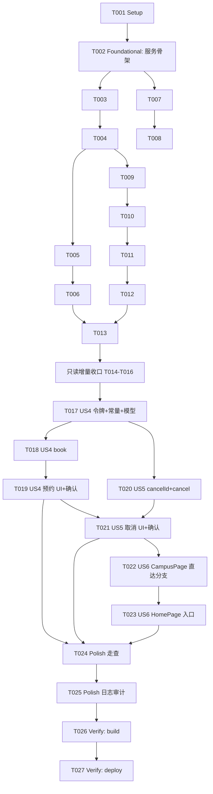

# Tasks: 图书馆座位查询与预约（含取消与首页直达）

**Input**: Design documents from `harmony/entry/src/main/ets/pages/campus/library-seat/`
**Prerequisites**: plan.md（已批准）, spec.md（6 个用户故事；本轮为预约/取消/首页直达增量）

**Tests**: 本特性未要求自动化测试（沿用项目既有流程：`arkts_check` + 构建 + 验证），故不生成测试任务。

**Organization**: 任务按用户故事分组，保证每个故事可独立实现、独立验证。**本文件为 2026-10-16 合并更新**：保留只读增量已完成任务（T001–T013；T014–T016 为并入 T013 的收口编号），追加预约（US4）/取消（US5）/首页直达（US6）。

## Format: `[ID] [P?] [Story] Description`

- **[P]**: 可并行（不同文件、无未完成依赖）
- **[Story]**: 所属用户故事（US1–US6）；Setup / Foundational / Polish / Verification 阶段不加故事标签
- 所有路径相对工作区根（`harmony/...`）

## Path Conventions

- 服务层：`harmony/entry/src/main/ets/services/`
- 页面层：`harmony/entry/src/main/ets/pages/`、`harmony/entry/src/main/ets/pages/campus/`
- 本特性产物：`harmony/entry/src/main/ets/pages/campus/library-seat/`

---

## Phase 1: Setup

**Purpose**: 确认改造基线（既有项目增量特性，无脚手架工作）

- [X] T001 核对既有接线与依赖基线：`ReservationPage.ets`（三卡片占位）、`CampusPage.ets`（`ReservationPage` 分发）、`SessionManager.ets`（单例范式）、`TsinghuaAuthService.ets`（`roamIdSubsystem`/`withSessionRecovery`/`getRoamCredentials`）、`HttpClient.ets`（`get`/`postForm`）；确认无新增依赖

---

## Phase 2: Foundational (Blocking Prerequisites)

**Purpose**: 模型、会话、解析与只读服务（只读增量，已完成）

**⚠️ CRITICAL**: 本阶段完成前，任何用户故事均不可开始

- [X] T002 新建 `harmony/entry/src/main/ets/services/campus/LibrarySeatService.ets`：模型类（`LibraryInfo`/`LibraryFloorInfo`/`LibrarySectionInfo`/`LibrarySeatInfo`/`LibraryBookingRecord`）；端点常量；模块级辅助（`dateForChoice`/`pad`/`qs`/`asRecord`/`asObjectArray`/状态中文映射）
- [X] T003 同文件：子系统会话激活（id 漫游 + 已激活标记，首个 home 请求失败忽略）与统一两层会话恢复 `withLibRetry`（自定义 reroam：重置标记 + 强制重漫游；label `lib`），以及 JSON 统一解析（依赖 T002）
- [X] T004 同文件：`getLibraryList()` 与 `getLibraryFloorList(libraryId, dateChoice)`（楼层聚合开放区域可用/总数；并发 + 单层容错；未开放不发请求）（依赖 T003）
- [X] T005 同文件：`getLibrarySectionList(floorId, dateChoice)`、内部"取目标日时段"（`areadays` 命中目标日期；今天起始时间钳制）与 `getLibrarySeatList(sectionId, dateChoice)`（依赖 T004）
- [X] T006 同文件：`getLibraryBookingRecords()`（我的预约记录）（依赖 T005）
- [X] T007 在 `harmony/entry/src/main/ets/services/auth/SessionManager.ets` 新增 `static getLibrarySeatService(): LibrarySeatService` 单例（依赖 T002）

**Checkpoint**: 只读服务就绪（已完成）

---

## Phase 3: User Story 1 - 浏览图书馆与楼层使用率 (Priority: P1) 🎯 MVP（已完成）

- [X] T008 [US1] 改造 `harmony/entry/src/main/ets/pages/campus/ReservationPage.ets`：三卡片；"图书馆座位"→ 内联渲染 `LibrarySeatPage`（依赖 T007）
- [X] T009 [US1] 新建 `harmony/entry/src/main/ets/pages/campus/LibrarySeatPage.ets`：骨架（层级状态、`DetailHeader` + 刷新、今天/明天）+ LIBRARY/FLOOR 层（依赖 T004）
- [X] T010 [US1] 同文件：各层加载/错误/空态 + 演示模式（内置示例、零请求）（依赖 T009）

---

## Phase 4: User Story 2 - 查看区域与座位状态 (Priority: P2)（已完成）

- [X] T011 [US2] `LibrarySeatPage.ets`：FLOOR → SECTION 层（可用/总数/已预约）（依赖 T010）
- [X] T012 [US2] `LibrarySeatPage.ets`：SECTION → SEAT 层（名称 + 状态标签）+ 逐级返回（依赖 T011）

---

## Phase 5: User Story 3 - 查看我的预约 (Priority: P3)（已完成）

- [X] T013 [US3] `LibrarySeatPage.ets`：BOOKINGS 层（记录 + 空态）与入口（依赖 T012、T006）

---

## Phase 6: User Story 4 - 预约座位 (Priority: P1)

**Goal**: 对"可用"座位二次确认后预约，成功刷新"我的预约"

**Independent Test**: 对可用座位点"预约"，确认后见成功提示，且"我的预约"出现该记录

- [X] T017 [US4] `harmony/entry/src/main/ets/services/campus/LibrarySeatService.ets`：新增写接口端点常量（预约 `…/api.php/spaces/{seatId}/book`、取消 `…/api.php/profile/books/{bookingId}`）、`LibraryBookResult` 模型、访问令牌抓取与缓存 `getLibraryAccessToken(force?)`（自 `LIB_HOME_URL` HTML 取 `access_token`，内存缓存约 5 分钟；`force` 跳过；日志禁止输出令牌）（依赖 T016、plan.md D8）
- [X] T018 [US4] 同文件：实现 `bookLibrarySeat(sectionId, seatId, seatType, dateChoice)`——复用内部"取目标日时段"拿 `segmentId`；`POST` 表单体 `{access_token, userid(=studentId), segment, type, operateChannel:'2'}`；`status===0` 视为成功；失败文本命中令牌关键字则刷新令牌后重试一次；整体包 `withLibRetry`（依赖 T017）
- [X] T019 [US4] `harmony/entry/src/main/ets/pages/campus/LibrarySeatPage.ets`：SEAT 层对"可用"座位提供"预约"动作 → 二次确认弹窗（馆/楼层/区域/座位/日期/时段）→ 提交（提交中禁用防重复）→ 成功刷新 BOOKINGS 与该区域座位状态并提示；非可用座位不提供动作；演示模式不发起请求（依赖 T018、plan.md D11/D12）

**Checkpoint**: US4 可独立验证（预约成功并出现在"我的预约"）

---

## Phase 7: User Story 5 - 取消预约 (Priority: P2)

**Goal**: 对"我的预约"中可取消记录二次确认后取消，成功刷新列表

**Independent Test**: 在"我的预约"点某记录"取消"，确认后见成功提示，且列表更新

- [X] T020 [US5] `harmony/entry/src/main/ets/services/campus/LibrarySeatService.ets`：扩展 `LibraryBookingRecord` 增 `cancelId` 并从记录行 `menuDel('…')` 解析（无则视为不可取消）；实现 `cancelLibraryBooking(bookingId)`——`POST` 表单体 `{_method:'delete', id, userid, access_token, operateChannel:'2'}`；令牌失效刷新重试一次；整体包 `withLibRetry`（依赖 T017、plan.md D9）
- [X] T021 [US5] `harmony/entry/src/main/ets/pages/campus/LibrarySeatPage.ets`：BOOKINGS 层对**可取消**记录提供"取消"动作 → 二次确认（座位/时间/状态）→ 提交（提交中禁用防重复）→ 成功刷新列表并提示；不可取消记录不提供动作；演示模式不发起请求（依赖 T019、T020）

**Checkpoint**: US4 + US5 均可独立验证

---

## Phase 8: User Story 6 - 首页直达座位页 (Priority: P3)

**Goal**: 首页"图书馆座位"入口一次点击直达座位页

**Independent Test**: 冷启动后停留首页，点击"图书馆座位"，一次点击进入座位页（不再提示"即将接入"）

- [X] T022 [US6] `harmony/entry/src/main/ets/pages/CampusPage.ets`：新增 `subScreen === 'library-seat'` 分支 → 直接渲染 `LibrarySeatPage({ onBack: () => this.subScreen = '' })`；不改既有其它分支（依赖 T021、plan.md D3/D10）
- [X] T023 [US6] `harmony/entry/src/main/ets/pages/HomePage.ets`：底部"图书馆座位"入口改为 `emitNavigate`（`tab=3`、`campusSub='library-seat'`），移除"即将接入" toast；不得影响其它跨页导航（依赖 T022、plan.md D10）

**Checkpoint**: US6 可独立验证（冷启动一次直达）

---

## Phase 9: Polish & Cross-Cutting Concerns

**Purpose**: 跨故事质量收口

- [X] T024 [P] 走查 `LibrarySeatPage.ets`/`CampusPage.ets`/`HomePage.ets`：移除只读引导文案（"预约请前往官方小程序完成"）改为可预约语义；卡片右缘不溢出（`constraintSize` 约定）；演示模式零网络请求；新增可见文案走 i18n（zh/en 成对，若需要）
- [X] T025 审计写操作（预约/取消）日志与错误信息：不得包含 `access_token` 等凭据明文（FR-019）；移除临时诊断输出

---

## Phase 10: Verification

<!-- verification_scope: build-only -->

**Purpose**: 构建并部署以验证可编译与可部署（本轮为 build-only；不包含 UI 验证任务）

- [X] T026 构建工程并修复编译错误（`devecocli build --modules entry`；同时对改动 `.ets` 文件运行 `arkts_check`；迭代 修复 → 构建 直至成功）
- [X] T027 部署到设备/模拟器（`devecocli run --skip-build --device 127.0.0.1:5555`）

---

## 📊 Dependency Graph

## ⚡ Parallel Execution Guide

| Phase | Tasks | Required Files | Execution Notes |
|-------|-------|----------------|-----------------|
| Setup/Foundational/US1–US3 | T001–T013（T014–T016 并入 T013） | 服务/页面/入口 | **已完成**（只读增量收口） |
| US4 (P1) | T017 → T018；T019 | `LibrarySeatService.ets`, `LibrarySeatPage.ets` | T017/T018 同文件串行；T019 在另一文件，依赖 T018 |
| US5 (P2) | T020 → T021 | `LibrarySeatService.ets`, `LibrarySeatPage.ets` | T020 与 T019 不同文件可并行；T021 依赖 T019 与 T020（同页串行） |
| US6 (P3) | T022 → T023 | `CampusPage.ets`, `HomePage.ets` | 依赖 T021；两文件串行 |
| Polish | T024 [P] → T025 | 页面/入口, 服务 | T024 需代码收敛后；T025 单独审计 |
| Verification | T026 → T027 | 全工程 | 严格串行（build → deploy） |

---

## Dependencies & Execution Order

### Phase Dependencies

- **Setup（Phase 1）/ Foundational（Phase 2）/ US1–US3（Phase 3–5）**：**已完成**（只读增量）
- **US4（Phase 6）**：依赖只读增量收口（T016）
- **US5（Phase 7）**：依赖 US4 的服务常量/令牌（T017）与页面（T019）
- **US6（Phase 8）**：依赖 US5（页面稳定）后接线直达
- **Polish（Phase 9）**：依赖 US4/US5/US6 完成
- **Verification（Phase 10）**：依赖 Polish 完成

### User Story Dependencies

- **US4 (P1)**：只读增量完成后即可开始；核心新价值
- **US5 (P2)**：依赖 US4 的令牌/常量（T017）与页面提交态（T019）
- **US6 (P3)**：依赖 US5（页面稳定）+ `CampusPage` 直达分支

### Within Each User Story

- US4：端点/令牌/模型（T017）→ 服务写方法（T018）→ 页面交互（T019）
- US5：服务（cancelId + cancel，T020）→ 页面（取消交互，T021）
- US6：`CampusPage` 分支（T022）→ `HomePage` 入口（T023）
- 同文件任务必须串行（`LibrarySeatService.ets`、`LibrarySeatPage.ets`）

### Parallel Opportunities

- T020（服务写方法）与 T019（页面交互）分属不同文件，可并行
- T024 在代码收敛后单独执行；其余同文件任务串行

---

## Parallel Example

| Phase | Tasks | Required Files | Execution Notes |
|-------|-------|----------------|-----------------|
| US4 ⊕ US5 交叉 | T019 ∥ T020 | `LibrarySeatPage.ets`, `LibrarySeatService.ets` | 不同文件可并行；T021 需二者完成 |
| 同文件串行 | T017 → T018；T020；T019 → T021 | `LibrarySeatService.ets`, `LibrarySeatPage.ets` | 同文件不得并行 |

---

## Implementation Strategy

### MVP First

1. 只读增量（已完成，T001–T013；T014–T016 并入 T013）
2. 本轮 MVP = **US4 预约**（T017–T019）→ 独立验证（预约成功并出现在"我的预约"）

### Incremental Delivery

- US4 预约 → US5 取消 → US6 首页直达，每个故事后独立验证
- Polish 收口只读文案与日志约束
- Verification 为 **build-only**：构建 + 部署

---

## Notes

- [P] 任务 = 不同文件且无未完成依赖
- 同文件任务（`LibrarySeatService.ets` / `LibrarySeatPage.ets`）必须串行，避免冲突
- **本轮验证范围为 build-only**：构建 + 部署（不含 UI 验证任务）
- 只读增量（T001–T013；T014–T016 为并入 T013 的收口编号）的构建与 UI 验证已在早前完成并入库（见 git 历史）；本文件保留其实现任务为已完成状态
- 严格约束：写操作日志无凭据明文；演示模式读写零网络请求；不新增依赖/资源

---

## Summary Report

- **总任务数**: 24（文件内实际任务行：T001–T013、T017–T027）
- **分阶段统计**: Setup 1（T001）· Foundational 6（T002–T007）· US1 3（T008–T010）· US2 2（T011–T012）· US3 1（T013）· **US4 3（T017–T019）· US5 2（T020–T021）· US6 2（T022–T023）· Polish(增量) 2（T024–T025）· Verification 2（T026–T027）**
- **编号说明**: T014–T016 为只读增量收口任务，合并更新时并入 T013，未单独成行；依赖图中的 T016 保留为历史引用。
- **本轮新增任务**: 11（T017–T027）
- **每故事任务数（本轮）**: US4 = 3 · US5 = 2 · US6 = 2
- **并行机会**: T019 ∥ T020（不同文件）；其余同文件串行
- **独立测试标准**: US4 预约成功并出现在"我的预约"；US5 取消成功且列表更新；US6 冷启动首页一次直达座位页
- **建议 MVP 范围（本轮）**: US4（T017–T019）
- **Verification 范围**: `build-only`（构建 + 部署）
