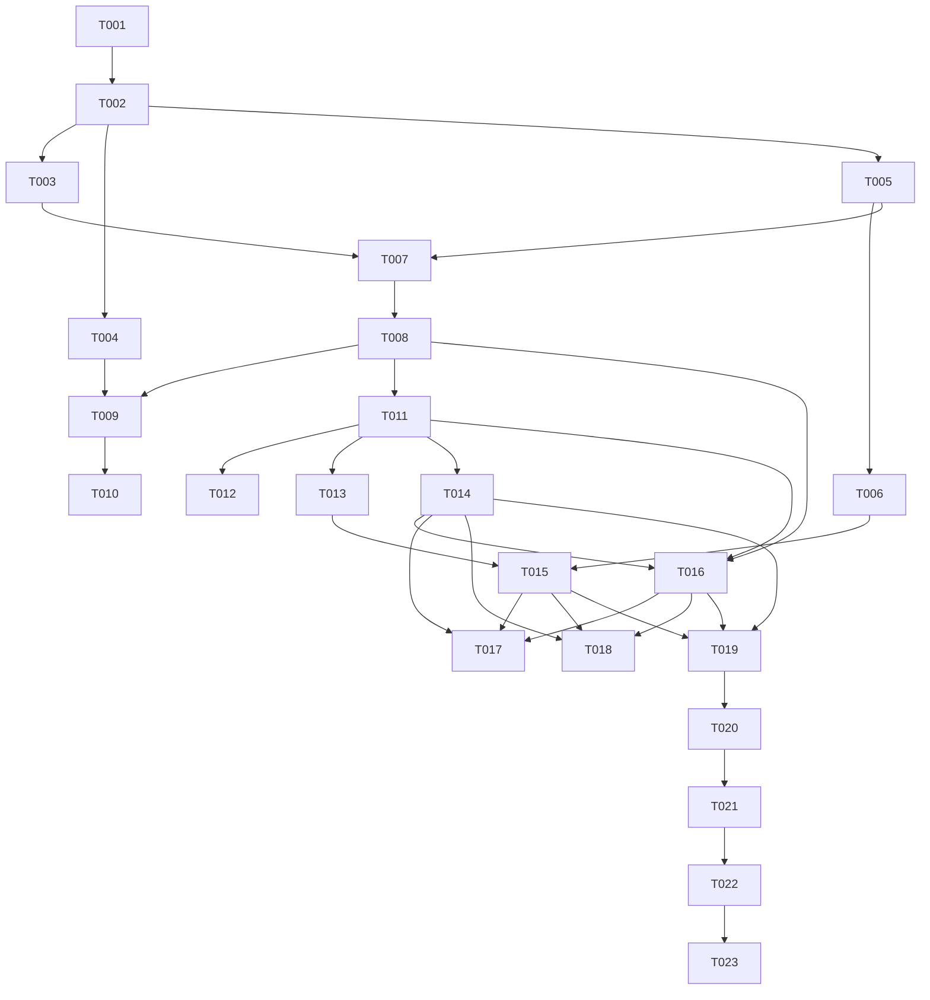

# Tasks: 支付宝支付基础设施（T02）

**Input**: Design documents from `harmony/specs/payment-alipay/`
**Prerequisites**: plan.md（已确认）、spec.md（4 个用户故事 P1–P3）
**Tests**: 本特性要求可验证的链接构建与回读事件，故包含启动自检任务；不引入测试框架。
**Organization**: 任务按用户故事分组，保证每个故事可独立实现与验证；US1/US2 为 P1，US3 为 P2，US4 为 P3。

## Format: `[ID] [P?] [Story] Description`

- **[P]**: 可并行（不同文件、无未完成依赖）
- **[Story]**: 所属用户故事（US1/US2/US3/US4）；Setup / Foundational / Polish / Verification 阶段不加故事标签
- 所有路径相对工作区根目录（`harmony/...`）

## Path Conventions

- 支付服务：`harmony/entry/src/main/ets/services/payment/`
- 入口 Ability：`harmony/entry/src/main/ets/entryability/EntryAbility.ets`
- 设置页：`harmony/entry/src/main/ets/pages/SettingsPage.ets`
- i18n：`harmony/entry/src/main/ets/utils/I18n.ets`
- 模块配置：`harmony/entry/src/main/module.json5`
- 特性文档：`harmony/specs/payment-alipay/`

---

## Phase 1: Setup

**Purpose**: 核对 RN 基线与 Harmony 现有接线，确认没有可复用的支付基础设施。

- [X] T001 只读核对基线：阅读 `src/services/campus/electricity.ts`、`src/services/campus/campusCard.ts`、`src/services/campus/sports.ts` 中 `buildAlipayUrl`/payCode 相关段；阅读 `harmony/entry/src/main/ets/entryability/EntryAbility.ets`、`harmony/entry/src/main/module.json5`、`harmony/entry/src/main/ets/pages/SettingsPage.ets`、`harmony/entry/src/main/ets/utils/I18n.ets`；确认 `harmony/` 内无既有支付服务、无 `querySchemes`、无 `openLink` 调用；记录 RN 链接格式与 Harmony 接线结论（`src/` 只读，禁止修改）

---

## Phase 2: Foundational (Blocking Prerequisites)

**Purpose**: 常量、数据模型、订阅句柄、模块 scheme 白名单与 i18n 键——所有用户故事的前置。

**⚠️ CRITICAL**: 本阶段完成前，任何用户故事均不可开始。

- [X] T002 新建 `harmony/entry/src/main/ets/services/payment/AlipayPaymentService.ets`：定义 `CampusPaymentSubsystem`、`CampusPaymentStatus`、`CampusPaymentI18n` 常量类；`CampusPaymentIntent`、`CampusPaymentLaunchResult`、`CampusPaymentReturnEvent`、`CampusPaymentProbeResult`、`CampusPaymentReturnSubscription` 模型类（全字段显式初始化，禁止无类型对象字面量）；定义 30 分钟 TTL 与事件 ID `11001`
- [X] T003 [P] 修改 `harmony/entry/src/main/module.json5`：在 `module` 下新增 `"querySchemes": ["alipayqr", "alipays"]`；不新增权限、不改既有 `requestPermissions`
- [X] T004 [P] 修改 `harmony/entry/src/main/ets/utils/I18n.ets`：按 `plan.md` 的 i18n 契约新增 `payment.error.*`、`payment.launch.opened`、`payment.return.*`、`payment.diag.*` 中英文成对词条；服务层不新增中文字面量

**Checkpoint**: 模型、配置与文案键就绪，US1 可开始。

---

## Phase 3: User Story 1 - 从 payCode 构建可验证的支付宝链接 (Priority: P1) 🎯 MVP

**Goal**: 实现与 RN 基线逐字符一致的 Deep Link 构建、支付码提取与严格校验，并用启动自检覆盖合法/非法输入。

**Independent Test**: 用已知支付码构建链接并比对预期字符串；用完整二维码 URL 提取末段；用空串、空白、控制字符、`&`、`?`、`#`、`/`、`%`、超长串验证拒绝；全程无网络、无设备。

### Implementation for User Story 1

- [X] T005 [US1] 在 `harmony/entry/src/main/ets/services/payment/AlipayPaymentService.ets` 实现纯逻辑：`buildDeepLink`（主链接 `alipayqr://platformapi/startapp?saId=10000007&qrcode=` + URL 编码后的 `https://qr.alipay.com/` + 支付码）、`tryBuildDeepLink`（不抛异常，返回 `CampusPaymentLaunchResult`）、`extractPayCode`（完整 URL 取末段并去除查询/片段）、支付码校验（trim、非空、≤256、拒绝空白/控制字符/URL 分隔符）；日志不含支付码
- [X] T006 [US1] 新建 `harmony/entry/src/main/ets/services/payment/PaymentSelfTest.ets`：实现 `runPaymentSelfTest(): Promise<number>` 的 US1 用例（合法码逐字符比对、完整二维码 URL、空串、空白、控制字符、`&`、`?`、`#`、`/`、`%`、超长）；PASS/FAIL 日志标签 `PaymentTest`，不输出支付码

**Checkpoint**: US1 可独立通过启动自检验证。

---

## Phase 4: User Story 2 - 从 CampusOS 外跳支付宝并在失败时可重试 (Priority: P1)

**Goal**: 探测支付宝可访问性，使用系统外部链接能力打开支付宝；未安装/失败返回可读状态并清除待回读；debug 设置页提供可点击的自检入口。

**Independent Test**: 在已安装支付宝的真机上从设置页自检入口打开测试链接；在未安装设备上得到“未检测到支付宝”；失败后重试；全程无“支付成功”文案。

### Implementation for User Story 2

- [X] T007 [US2] 在 `harmony/entry/src/main/ets/services/payment/AlipayPaymentService.ets` 实现可用性探测：`isAlipayAvailable`/`currentScheme` 依次探测 `alipayqr://platformapi/startapp`、`alipays://platformapi/startapp`；捕获 `bundleManager.canOpenLink` 异常（含 17700056），只记录 `BusinessError.code`，返回布尔值不抛异常
- [X] T008 [US2] 在 `harmony/entry/src/main/ets/services/payment/AlipayPaymentService.ets` 实现 `launch(context, payCode, subsystem, amount)`：`tryBuildDeepLink` → 选择可用 scheme → `context.openLink(link, { appLinkingOnly: false })`；`openLink` 前 `beginPending`；失败清除 pending；将 `BusinessError` 映射为 `not_installed`/`launch_failed`；返回 `CampusPaymentLaunchResult`，不得返回“支付成功”
- [X] T009 [US2] 修改 `harmony/entry/src/main/ets/pages/SettingsPage.ets`：新增 `if (BuildProfile.DEBUG)` 的“支付通道自检”分组；提供“探测支付宝”和“打开支付宝测试链接”两个动作；使用 `this.getUIContext().getHostContext() as common.UIAbilityContext` 调用 `launch`；toast 使用 `payment.diag.available`/`payment.diag.notInstalled`/`payment.diag.noPayment`/错误键；测试码固定且不发起支付
- [X] T010 [US2] 修改 `harmony/entry/src/main/ets/pages/SettingsPage.ets`：确认 release 构建不渲染诊断分组；确认诊断分组与既有账号/偏好/AI/功能组顺序不冲突、不改变既有设置行为；全文件检索不得出现“支付成功”“充值成功”文案

**Checkpoint**: US2 可在真机/模拟器上独立点击验证。

---

## Phase 5: User Story 3 - 返回 App 后收到一次性的支付回读信号 (Priority: P2)

**Goal**: `openLink` 前登记内存 pending；`EntryAbility.onForeground` 投递一次性回读事件；无 pending/过期/进程重启不误触发；设置页可观察回读。

**Independent Test**: 注入 pending 后调用前台通知，订阅方收到一次事件；无 pending、过期、最新覆盖旧状态分别验证；设置页返回后显示回读提示。

### Implementation for User Story 3

- [X] T011 [US3] 在 `harmony/entry/src/main/ets/services/payment/AlipayPaymentService.ets` 实现 `openLink` 前 pending 登记与事件总线：`beginPending`/`peekPending`/`clearPending`/`notifyForeground`/`subscribeReturn`/`unsubscribeReturn`；TTL 30 分钟；最新支付覆盖旧支付；`notifyForeground` 只在未过期时投递一次并清除；事件 payload 仅 `subsystem`/`amount`/`startedAt`/`elapsedMs`；日志只输出子系统与耗时
- [X] T012 [P] [US3] 修改 `harmony/entry/src/main/ets/entryability/EntryAbility.ets`：在 `onForeground()` 调用 `AlipayPaymentService.notifyForeground()`；不在 `onBackground`/`onNewWant` 重复投递；保持既有日志与生命周期行为不变
- [X] T013 [P] [US3] 在 `harmony/entry/src/main/ets/services/payment/PaymentSelfTest.ets` 的 `runPaymentSelfTest(): Promise<number>` 中增加 US3 用例：pending 一次性投递、无 pending 不投递、过期不投递、最新覆盖旧状态、事件 payload 字段完整；测试结束清理订阅与 pending
- [X] T014 [P] [US3] 修改 `harmony/entry/src/main/ets/pages/SettingsPage.ets`：在 `aboutToAppear` 订阅回读事件，收到后显示 `payment.diag.returned`/`payment.return.refreshing`；新增 `aboutToDisappear` 取消订阅；订阅只影响 debug 诊断分组，不改变业务页面

**Checkpoint**: US3 可通过自检与设置页独立验证。

---

## Phase 6: User Story 4 - 可诊断、可自检且日志不含凭据 (Priority: P3)

**Goal**: 启动时运行支付自检；确保日志、错误提示、自检输出不含支付码/二维码 URL/金额明文/凭据。

**Independent Test**: 启动日志出现 `PaymentTest` PASS/FAIL 摘要；完成一次外跳与返回后检索日志，支付码、二维码 URL、Cookie、学号、API Key 出现次数为 0；release 构建诊断入口不可见。

### Implementation for User Story 4

- [X] T015 [US4] 修改 `harmony/entry/src/main/ets/entryability/EntryAbility.ets`：在 `onWindowStageCreate` 的 `loadContent` 回调中、`runPhase4SelfTest()` 之后调用异步自检 `runPaymentSelfTest()`（返回 `Promise<number>`）；不阻塞首页加载；记录失败数摘要
- [X] T016 [P] [US4] 审计并修正 `harmony/entry/src/main/ets/services/payment/AlipayPaymentService.ets`、`harmony/entry/src/main/ets/services/payment/PaymentSelfTest.ets`、`harmony/entry/src/main/ets/pages/SettingsPage.ets` 的日志与错误文案：不得输出支付码、二维码 URL、金额明文、Cookie、学号、API Key；`BusinessError` 只记录 `code`；确保无“支付成功”结论

**Checkpoint**: US4 完成，所有用户故事可独立验证。

---

## Phase 7: Polish & Cross-Cutting Concerns

**Purpose**: 文档、索引、同步进度与实现期自检。

- [X] T017 [P] 修改 `harmony/DEVELOPMENT.md`：新增“支付基础设施（T02）”小节，记录链接格式、`querySchemes`、内存 pending/TTL、debug 自检入口、已知限制（进程被杀不补发、真实充值 UI 在 T11–T13）
- [X] T018 [P] 修改 `harmony/specs/INDEX.md` 新增 `payment-alipay` 行；修改 `docs/RN-FEATURE-SYNC.md` 的“支付宝外跳”行为 🟡（基础设施已就绪，充值 UI 待 T11–T13），更新顶部“最后更新”并在变更记录追加一行
- [X] T019 运行 `arkts_check` 检查所有改动 `.ets` 文件并修复 error；只允许 warning，不得新增 error
- [X] T020 运行 `devecocli build --modules entry`（timeout ≥ 600000ms）并修复编译错误；同一时刻只跑一条构建流水线

---

## Phase 8: Verification

<!-- verification_scope: build+ui -->

**Purpose**: 构建、部署并逐用户故事做 UI 验证。

- [X] T021 构建工程并修复编译错误（`devecocli build --modules entry`，迭代 修复 → 构建 直至成功）
- [X] T022 部署到真机/模拟器（`devecocli run --skip-build`；如白屏先重跑一次唤醒）
- [X] T023 运行 UI 验证（`verify_ui`）：US1 通过启动日志 `PaymentTest` 确认链接构建/提取用例 PASS；US2 在设置页 debug 自检入口探测支付宝并打开测试链接（未安装时验证可读提示）；US3 从支付宝返回后确认设置页显示回读提示；US4 检索日志确认无支付码/二维码 URL/凭据、无“支付成功”文案。外部 App 跳转若受 `verify_ui` 能力限制，按 AGENTS 能力边界改用日志 + 人工确认，不因工具限制改代码

> **验证记录**：真机启动自检 `PaymentTest 25/25 passed, 0 failed`（日志标签 `PaymentTest`，未污染生产 `Payment` 标签）；真机诊断入口 `PAYMENT launch requested subsystem=diagnostics status=launched` → `PAYMENT return delivered subsystem=diagnostics elapsedMs=5770`，证明生产 openLink→回读链路可用；模拟器覆盖构建/部署/未安装支付宝可读路径；未用真实 payCode 发起支付。

---

## Dependencies & Execution Order

### Phase Dependencies

- **Setup (Phase 1)**: 无依赖，可立即开始
- **Foundational (Phase 2)**: 依赖 Setup；完成前所有用户故事不可开始
- **User Stories (Phase 3–6)**: 均依赖 Foundational；US1 → US2 → US3 → US4 串行为主，US3 的 T012/T013/T014 可并行
- **Polish (Phase 7)**: 依赖所有用户故事完成
- **Verification (Phase 8)**: 依赖 Polish 完成

### User Story Dependencies

- **US1 (P1)**: 依赖 T002；T006 依赖 T005；是 US2/US3 的链接基础
- **US2 (P1)**: 依赖 T005（链接）与 T003（scheme 白名单）；T009/T010 依赖 T008 与 T004
- **US3 (P2)**: 依赖 T008（`openLink` 前写 pending）；T012/T013/T014 依赖 T011
- **US4 (P3)**: T015 依赖 T006/T013；T016 依赖 T008/T011；不阻塞业务故事

### Within Each User Story

- 模型/常量 → 纯逻辑 → 系统能力 → 事件总线 → 页面
- 同一文件任务必须串行：`AlipayPaymentService.ets`（T002/T005/T007/T008/T011/T016）、`SettingsPage.ets`（T009/T010/T014/T016）、`EntryAbility.ets`（T012/T015）、`PaymentSelfTest.ets`（T006/T013/T016）
- 先完成 US1 的链接构建，再实现 US2 的外跳；先完成 US2 的 pending 写入，再实现 US3 的回读

### Dependency Graph

### Parallel Opportunities

- T003（module.json5）与 T004（I18n.ets）可在 T002 后并行
- T012（EntryAbility）、T013（PaymentSelfTest）、T014（SettingsPage）可在 T011 后并行（不同文件）
- T017（DEVELOPMENT.md）与 T018（INDEX + RN-FEATURE-SYNC）可并行
- T019（arkts_check）→ T020（build）串行；Verification 的 T021 → T022 → T023 严格串行

---

## Parallel Example

| Phase | Tasks | Required Files | Execution Notes |
|-------|-------|----------------|-----------------|
| Setup | T001 | RN 三个 campus 服务、EntryAbility、module.json5、SettingsPage、I18n（只读） | 单任务，先核对再写 |
| Foundational | T002 → T003 / T004 | `AlipayPaymentService.ets`（新）、`module.json5`、`I18n.ets` | T003/T004 与 T002 不同文件，可并行 |
| US1 (P1) | T005 → T006 | `AlipayPaymentService.ets`、`PaymentSelfTest.ets` | 同文件/依赖，串行 |
| US2 (P1) | T007 → T008 → T009 → T010 | `AlipayPaymentService.ets`、`SettingsPage.ets` | 服务与页面各自串行 |
| US3 (P2) | T011 → T012 / T013 / T014 | `AlipayPaymentService.ets`、`EntryAbility.ets`、`PaymentSelfTest.ets`、`SettingsPage.ets` | T012/T013/T014 不同文件，可并行 |
| US4 (P3) | T015 / T016 | `EntryAbility.ets`、三个支付相关文件 | T016 可与 T015 并行 |
| Polish | T017 / T018 → T019 → T020 | `DEVELOPMENT.md`、`INDEX.md`、`RN-FEATURE-SYNC.md`、全工程 | 文档并行；检查/构建串行 |
| Verification | T021 → T022 → T023 | 全工程 | 构建 → 部署 → UI 验证，严格串行 |

---

## Implementation Strategy

### MVP First

1. 完成 Phase 1 Setup + Phase 2 Foundational
2. 完成 US1（链接构建/校验/自检）→ **STOP & VALIDATE**：启动日志 `PaymentTest` 全 PASS
3. 完成 US2（探测/外跳/debug 自检入口）→ 真机打开支付宝或得到可读未安装提示
4. 完成 US3（pending/回读事件）→ 返回后设置页显示回读提示
5. 完成 US4（启动自检/日志脱敏）→ 日志无凭据

### Incremental Delivery

- Foundational 完成即可独立验证链接构建，不依赖设备
- US2 完成后，T11/T12/T13 可开始接入 `launch`
- US3 完成后，T11/T12/T13 可订阅回读事件刷新余额/记录
- US4 提供验收证据，不改变业务行为

---

## Notes

- [P] 任务 = 不同文件且无未完成依赖；同一文件任务必须串行
- `src/`、`android/` 只读；本特性只改 `harmony/`
- 不新增第三方依赖、不新增权限、不持久化支付码/金额
- 服务层只返回状态码与 i18n 键，禁止硬编码中文
- 日志只记录子系统/状态/错误码/耗时；支付码、二维码 URL、金额明文、Cookie、学号、API Key 一律不得出现
- 真实设备外跳依赖设备已安装支付宝；未安装场景必须验证可读提示与重试，不得崩溃
- `verify_ui` 对外部 App 跳转可能不可靠；按 AGENTS 能力边界，必要时改用日志 + 人工确认，不为工具限制改代码
