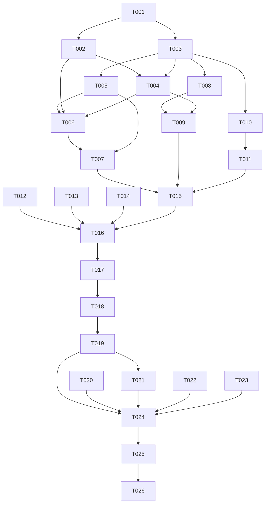

# Tasks: 课表交互增强（时间指示线 / 课程详情 / 扩展色板）

**Input**: Design documents from `harmony/specs/schedule-interaction/`
**Prerequisites**: plan.md（已批准）, spec.md（3 个用户故事 P1–P3）

**Tests**: 本特性未要求自动化测试（沿用项目既有流程：`arkts_check` + 构建 + 模拟器 UI 验证），故不生成测试任务。

**Organization**: 按用户故事分组；三个故事共用 `ScheduleGrid.ets` / `SchedulePage.ets`，同文件任务必须串行。

## Format: `[ID] [P?] [Story] Description`

- **[P]**: 可并行（不同文件、无未完成依赖）
- **[Story]**: 所属用户故事（US1–US3）；Setup / Foundational / Polish / Verification 阶段不加故事标签
- 所有路径相对工作区根（`harmony/...`）

## Path Conventions

- 组件：`harmony/entry/src/main/ets/components/`
- 页面：`harmony/entry/src/main/ets/pages/`
- 词典：`harmony/entry/src/main/ets/utils/`
- 本特性产物：`harmony/specs/schedule-interaction/`

---

## Phase 1: Setup

**Purpose**: 确认基线结构与既有契约，锁定新增文案键与色板缺口

- [X] T001 只读核对基线：`harmony/entry/src/main/ets/components/ScheduleGrid.ets`（`ScheduleBlock` 字段、8 色 `SCHEDULE_PALETTE`、`scheduleColorIndexForTitle`、`DayColumnBuilder` 顺序堆叠结构、组件 props）；`harmony/entry/src/main/ets/pages/SchedulePage.ets`（`mapEventsToBlocks`、`getMockBlocks`、周导航与 `bindSheet` 可挂载位置）；`harmony/entry/src/main/ets/utils/I18n.ets`（`schedule.*` 键与 `tp` 占位符写法）；`harmony/entry/src/main/ets/components/Theme.ets`（主色/分隔线令牌），并列出待新增的 8 个 `schedule.detail.*` 键与 8 组新颜色

---

## Phase 2: Foundational (Blocking Prerequisites)

**Purpose**: 数据模型字段、组件契约与词典键——三个故事共同依赖

**⚠️ CRITICAL**: 本阶段完成前，任何用户故事均不可开始

- [X] T002 [P] 在 `harmony/entry/src/main/ets/utils/I18n.ets` 新增课表详情词典键（zh/en 双语）：`schedule.detail.title`、`schedule.detail.date`、`schedule.detail.weekday`、`schedule.detail.periods`、`schedule.detail.time`、`schedule.detail.periodRange`（占位符 `{start}`/`{end}`）、`schedule.detail.noLocation`、`schedule.detail.close`
- [X] T003 在 `harmony/entry/src/main/ets/components/ScheduleGrid.ets` 扩展 `ScheduleBlock`（新增 `date`、`startTime`、`endTime`），并新增组件契约 `todayIndex`、`nowMinuteOfDay`、`onBlockSelect`（默认空实现）；本任务不改变既有渲染与配色行为
- [X] T004 在 `harmony/entry/src/main/ets/pages/SchedulePage.ets` 补齐课程块新字段：`mapEventsToBlocks` 写入事件原文 `date`/`startTime`/`endTime`，`getMockBlocks` 为演示数据填充同结构日期与时间段；按新契约传入占位的 `todayIndex=-1`、`nowMinuteOfDay=-1` 与空回调，保证工程可编译（依赖 T003）

**Checkpoint**: 模型与契约就绪，三个用户故事可开始

---

## Phase 3: User Story 1 - 点击课程查看详情 (Priority: P1) 🎯 MVP

**Goal**: 点击课程块弹出底部详情弹层，展示课程名、地点、日期、星期、节次区间、起止时间

**Independent Test**: 点击任意课程块出现弹层且六项信息与块数据一致；关闭后周次与滚动位置不变

- [X] T005 [US1] 在 `harmony/entry/src/main/ets/components/ScheduleGrid.ets` 为课程块挂载点击事件并回调 `onBlockSelect(block)`；空槽位不得触发；点击不得改变布局或滚动（依赖 T003）
- [X] T006 [US1] 在 `harmony/entry/src/main/ets/pages/SchedulePage.ets` 新增 `detailVisible` / `detailBlock` 状态与详情弹层 `@Builder`：渲染课程名、日期、星期（`schedule.day0-6`）、节次区间（1 基，`schedule.detail.periodRange`）、起止时间、地点；地点为空显示 `schedule.detail.noLocation`（依赖 T002、T004）
- [X] T007 [US1] 在 `harmony/entry/src/main/ets/pages/SchedulePage.ets` 于页面根节点挂载唯一 `bindSheet`（关闭按钮 + 拖拽条 + `onDisappear` 清空选中；拖拽条已由 T025 移除），把 `onBlockSelect` 接到打开逻辑，并确认关闭后周次、滚动位置、课程配色不变（依赖 T005、T006）

**Checkpoint**: US1 可独立验证（点击 → 查看 → 关闭）

---

## Phase 4: User Story 2 - 当前时间指示线 (Priority: P2)

**Goal**: 本周视图在今天列绘制每分钟刷新的横向时间线；其它周与课表时段外不显示

**Independent Test**: 本周视图今天列出现指示线；切换到上/下周后消失；等待 1 分钟位置更新

- [X] T008 [US2] 在 `harmony/entry/src/main/ets/components/ScheduleGrid.ets` 实现时间线：按 6 大节起止时间把 `nowMinuteOfDay` 换算为纵向偏移（节内线性插值、课间间隔吸附到节边界、早于 08:00 或晚于 21:45 隐藏）；仅 `todayIndex` 对应日列用 `Stack` 叠加 2vp 横线并关闭命中测试；显示时输出一条包含列索引/分钟数/偏移的日志（依赖 T003）
- [X] T009 [US2] 在 `harmony/entry/src/main/ets/pages/SchedulePage.ets` 新增 60 秒计时器（`aboutToAppear` 启动、`aboutToDisappear` 清理、页面可见时立即重算），维护 `nowMinuteOfDay` 与 `todayIndex`（仅 `weekOffset === 0` 有效），并传入 `ScheduleGrid`（依赖 T004、T008）

**Checkpoint**: US1 + US2 均可独立验证

---

## Phase 5: User Story 3 - 扩展色板，避免同色不同课 (Priority: P3)

**Goal**: 色板扩到 16 组，本周 ≤16 门不同课程零撞色，同名同色

**Independent Test**: 演示课表 8 门课程颜色两两不同；构造 16 门课程仍两两不同

- [X] T010 [US3] 在 `harmony/entry/src/main/ets/components/ScheduleGrid.ets` 把 `SCHEDULE_PALETTE` 扩为 16 组（背景/文字/边框三色结构，对比度不低于现有最低值），并新增 `assignScheduleColorIndexes`：本周不同课名去重后按字典序、以课名散列为基址、线性探测顺延；超过 16 个不同课名时回落基址并输出一次告警日志（依赖 T003）
- [X] T011 [US3] 在 `harmony/entry/src/main/ets/pages/SchedulePage.ets` 改为两段式配色：先完成课程块映射，再统一调用 `assignScheduleColorIndexes` 回填 `colorIndex`；真实数据与 `getMockBlocks` 演示数据共用同一分配逻辑（依赖 T010）

**Checkpoint**: 三个用户故事均可独立验证

---

## Phase 6: Polish & Cross-Cutting Concerns

**Purpose**: 文案、文档与静态检查收口

- [X] T012 [P] 走查新增 UI：全部用户可见文案走 `schedule.*` 词典键（无硬编码中文），中英文均可正常显示；弹层与时间线不引入横向溢出或遮挡课程名
- [X] T013 [P] 更新 `harmony/specs/INDEX.md`：新增 `schedule-interaction` 一行（目录、任务完成度、状态），保持既有表格格式
- [X] T014 [P] 更新 `harmony/DEVELOPMENT.md`：新增"课表交互增强"进展小节（时间线换算规则、详情弹层字段、16 色与冲突顺延策略、已知边界）
- [X] T015 对 `harmony/entry/src/main/ets/components/ScheduleGrid.ets`、`harmony/entry/src/main/ets/pages/SchedulePage.ets`、`harmony/entry/src/main/ets/utils/I18n.ets` 运行 `arkts_check` 并修复全部 ArkTS 严格模式违规（唯一允许噪声：`Logger.ets` 的 `BuildProfile` 已知误报）（依赖 T002–T011）

---

## Phase 7: Verification

<!-- verification_scope: build+ui -->

**Purpose**: 构建、部署并逐用户故事做 UI 验证（含既有行为回归）

- [X] T016 构建工程并修复编译错误（`devecocli build --modules entry`，迭代 修复 → 构建 直至成功）
- [X] T017 部署到设备/模拟器（`devecocli run --skip-build`，必要时先唤醒屏幕再判断白屏）
- [X] T018 运行 UI 验证（`verify_ui`）：US1 点击课程块弹出详情并展示六项信息；US2 本周今天列指示线存在、切到上一周后消失；US3 演示课表 8 门课程配色两两不同；并回归周导航、加载/空态/错误、演示模式（US3 的 `verify_ui` 受工具导航限制，已用实机截图 + 算法复核确认通过）

---

## Phase 8: Review Follow-up (2026-10-18)

**Purpose**: 收尾评审的 5 条非阻断建议（用户确认作为本特性收尾修订；不重跑 `spec-verify`）

- [X] T019 详情弹层内容区包 `Scroll`：固定 360vp 下超长课程名/地点可完整查看（`harmony/entry/src/main/ets/pages/SchedulePage.ets`）
- [X] T020 [P] 删除未使用的 `schedule.detail.close` 词典键（`harmony/entry/src/main/ets/utils/I18n.ets`）
- [X] T021 `NOW_LINE` 日志改为仅在跨大节/进入隐藏态时输出，消除每分钟重复（`harmony/entry/src/main/ets/pages/SchedulePage.ets`）
- [X] T022 [P] 时间线渲染改为单次 `nowLineOffset()` 计算：Builder 内部按 `offset < 0` 跳过渲染（`harmony/entry/src/main/ets/components/ScheduleGrid.ets`）
- [X] T023 [P] 同步文档：`spec.md` 假设、`plan.md` 决策 3、`DEVELOPMENT.md` 措辞（7 键 / 基址函数 / 日志频率 / Scroll）（`harmony/specs/schedule-interaction/`、`harmony/DEVELOPMENT.md`）
- [X] T024 运行 `arkts_check` + `devecocli build --modules entry` 本地校验（不重跑 `spec-verify`）（依赖 T019–T023）
- [X] T025 按用户确认禁用下滑关闭：`dragBar: false` + `onWillDismiss` 仅在 reason 非 `SLIDE_DOWN` 时 `dismiss()`，关闭按钮/遮罩/返回键保留（`harmony/entry/src/main/ets/pages/SchedulePage.ets`）
- [X] T026 重新构建并部署（`arkts_check` + `devecocli build --modules entry` + `devecocli run --skip-build`；实际部署设备 `183.173.11.214:44917`）（依赖 T025）

---

## Dependencies & Execution Order

### Phase Dependencies

- **Setup (Phase 1)**: 无依赖
- **Foundational (Phase 2)**: 依赖 Setup（T003 → T004）
- **US1（Phase 3）**: 依赖 Foundational（T005 → T006 → T007）
- **US2（Phase 4）**: 依赖 Foundational（T008 → T009）
- **US3（Phase 5）**: 依赖 Foundational（T010 → T011）
- **Polish（Phase 6）**: 依赖全部用户故事完成（T015 依赖 T002–T011）
- **Verification（Phase 7）**: 依赖全部代码改动完成

### User Story Dependencies

- **US1 (P1)**: 依赖 T002、T003、T004；不依赖 US2/US3
- **US2 (P2)**: 依赖 T003、T004；与 US1 共用组件文件，需在 T005 之后串行
- **US3 (P3)**: 依赖 T003；与 US1/US2 共用组件文件，需在 T008 之后串行

### Within Each User Story

- 组件契约 → 组件行为 → 页面接线
- 同一文件（`ScheduleGrid.ets` / `SchedulePage.ets`）的任务必须串行
- 每个故事完成后独立验证，再进入下一优先级

### Parallel Opportunities

- T002 与 T003 可并行（词典 vs 组件）
- T012 / T013 / T014 可并行（走查 vs 索引 vs 开发文档）
- T020 / T022 / T023 可并行（词典 vs 组时间线 vs 文档），T019 → T021 同文件串行
- 三个用户故事共用两个源文件，**不提供跨故事并行**

### Dependency Graph

---

## Parallel Example

| Phase | Tasks | Required Files | Execution Notes |
|-------|-------|----------------|-----------------|
| Setup | T001 | `ScheduleGrid.ets`, `SchedulePage.ets`, `I18n.ets`, `Theme.ets`（只读核对） | 单任务 |
| Foundational | T002 [P] ∥ T003 → T004 | `I18n.ets` ∥ `components/ScheduleGrid.ets` → `pages/SchedulePage.ets` | 词典与组件可并行；页面必须等组件契约 |
| US1 | T005 → T006 → T007 | `components/ScheduleGrid.ets`, `pages/SchedulePage.ets` | 组件点击 → 弹层 → 绑定，严格串行 |
| US2 | T008 → T009 | `components/ScheduleGrid.ets` → `pages/SchedulePage.ets` | 先换算与渲染，再接管计时器 |
| US3 | T010 → T011 | `components/ScheduleGrid.ets` → `pages/SchedulePage.ets` | 先扩色板与分配算法，再改页面映射 |
| Polish | T012 [P] ∥ T013 [P] ∥ T014 [P] → T015 | 组件/页面, `specs/INDEX.md`, `DEVELOPMENT.md` | 三项互不冲突；静态检查最后跑 |
| Verification | T016 → T017 → T018 | 全工程 | 严格串行 |
| Review Follow-up | T019 → T021；T020 [P] ∥ T022 [P] ∥ T023 [P] → T024 → T025 → T026 | `SchedulePage.ets`, `ScheduleGrid.ets`, `I18n.ets`, 文档 | 同文件串行；最后重新构建并部署 |

---

## Implementation Strategy

### MVP First

1. 完成 Phase 1 + Phase 2（模型与契约）
2. 完成 Phase 3（US1：点击查看详情）
3. **STOP & VALIDATE**：六项信息正确、关闭后状态不变
4. 增量交付 US2（时间线）→ US3（16 色与零撞色）

### Incremental Delivery

- 详情能力先可用；随后补时间线；最后收配色可读性
- 每个故事后独立验证；**回归**周导航、加载/空态/错误与演示模式
- 不新增网络请求，不修改 `CampusDataService`

---

## Notes

- [P] 任务 = 不同文件且无未完成依赖
- 同文件任务（`ScheduleGrid.ets` / `SchedulePage.ets`）必须串行
- 演示模式必须与真实数据共用同一套详情、时间线与配色逻辑
- 时间线仅在 08:00–21:45 内显示；课间间隔吸附到节边界
- 本轮验证范围为 **build+ui**
- Phase 8 为评审后的收尾修订（2026-10-18）：仅改 3 个源文件 + 文档，用 `arkts_check` + `devecocli build` 本地校验，**不重跑 `spec-verify`**
- 用户确认**禁用下滑关闭**（T025）：弹层仍支持关闭按钮 / 点击遮罩 / 返回键；`SLIDE_DOWN` 被拦截

### Summary

- **总任务数**: 26（T001–T026）
- **分阶段统计**: Setup 1 · Foundational 3 · US1 3 · US2 2 · US3 2 · Polish 4 · Verification 3 · Review Follow-up 8
- **每故事任务数**: US1 = 3 · US2 = 2 · US3 = 2
- **并行机会**: T002 ∥ T003; T012 ∥ T013 ∥ T014; T020 ∥ T022 ∥ T023
- **独立测试标准**: US1 六项详情与关闭后状态；US2 本周显示/切周隐藏/每分钟更新；US3 8 门与 16 门课程零撞色
- **建议 MVP 范围**: Phase 1 + Phase 2 + Phase 3（US1）
